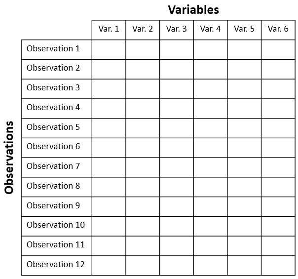

# Introduction to multivariate data and data analysis {#sec-mdata}

## Multivariate data

Things are not always one or two dimensional. Oftentimes in biology we need to consider many variables at once. This is the realm of **multivariate statistics**. The “multi” in “multivariate” refers to the fact that there are multiple variables or attributes of each sample that we want to understand simultaneously. The terminology can be confusing sometimes because other statistical methods have the word “multiple” in their names. For example, “multiple linear regression” is not considered a multivariate method because there is only one measurement from each sample (the response variable) that is being modeled. 

@fig-multi-data below shows some differences between a univariate analysis and a multivariate one. In the univariate analysis, one and only one variable is the response variable and is assumed to be predicted by (aka: depend on) the others. Frequently, the observations are divided *a priori* into groups by a factor encoded by one of the predictor variables. This means that the goal of a univariate analysis is to explain patterns in one variable relative to other variables. In a univariate analysis, the emphasis is on discovering relationships between variables, and the observations are a means to that end.

{#fig-multi-data fig.align="center" fig-cap="In a univariate analysis, there is one response variable which is modeled using predictor variables. In a multivariate analysis, there can be a response matrix of multiple variables, or no response variables at all. Instead, patterns among the variables can be explored without inferring causality." fig-width="100%"}

Whereas a univariate analysis has a single response variable, a multivariate analysis can have a response matrix of many variables. However, many multivariate analyses have no response variables, and instead all of the variables are analyzed together to characterize patterns among the observations. The observations may come from *a priori* groups defined in a separate matrix (see below), or the researcher may want to discover how the observations naturally separate into clusters based on the variables (i.e., *a posteriori* groups). Or, the researcher may want to know which variables, if any, drive most of the variation between observations.

### Enter the matrix

When planning and executing a multivariate analysis it is very important to keep in mind which components of the dataset are which. These components are usually stored in **matrices** with a well-defined structure. The key concept is that of the **sample unit** or **observation**. Observations are also sometimes called **records**. These are individual entities about which many measurements or attributes are recorded. Sample units correspond to *rows* of the data matrix. 

Each sample unit has several **variables** associated with it. Variables are also sometimes called **features** or **attributes**. Variables correspond to *columns* of the data matrix. 

@fig-multi-matrix below shows the layout of a typical multivariate dataset. The example has 12 observations and 6 variables . In some fields, samples are also called records and variables are called features.

{#fig-multi-matrix fig.align="center" fig-cap="Structure of a dataset. Data is collected about entities called observations. Each row of the dataset is an observation, and each column of the dataset contains one type of value (a variable) about each entity."}

A complete multivariate dataset often has several matrices, each with a different kind of information. @fig-multi-tables below shows the relationship between three interrelated matrices typical in community ecology. Similar matrices can be defined for other fields. Just replace “Environmental variables” with another label that helps describe variation among the sample units.

{#fig-multi-tables fig.align="center" fig-cap="Structure of a community ecology dataset with three tables. Table A contains the abundances of 6 species at 12 sites. Table E contains environmental variables that describe those 12 sites. Table S contains traits or characteristics of the 6 species from Table A."}
- The data matrix **A** contains data on the abundance of 6 species at each of 12 sites.
- The explanatory matrix **E** contains 4 environmental variables (e.g., temperature, latitude, etc.) for each of the sites. These data describe relationships between observations in **A**.
- The trait matrix **S** contains data about traits (e.g., maximum size, longevity, etc.) of the species in the main matrix. These data describe relationships between variables in **A**.

A biological system of interest might have relationships among all three of these matrices:

- **Patterns within A**: Explaining groupings or trends among the sites in terms of the species present or absent at each site (or, the abundances of species at each site).
- **Patterns within E**: Discovering groupings among the sites in terms of their environmental variables.
- **Relationships between A and E**: Relating patterns in environmental variables to patterns in species abundances across sites.
- **Relating patterns between A and E in terms of S**: Relating species traits to environmental conditions.
- **Patterns within S**: Identifying clusters of similar species.

@mccune2002analysis give a thorough treatment of the relationships between **S**, **E**, **A**, and other matrices derived from them. For this course, we will focus on analyzing **A** and sometimes **E**. There is a related set of terminology used to describe multivariate analyses in terms of what is being compared. Analyses that seek relationships among samples are said to be in **Q mode**; analyses that seek relationships among variables are in **R mode** [@legendre2012numerical]. These terms appear to be particular to ecology, but offer a helpful way to distinguish between different multivariate analysis pathways.

## Types of multivariate analyses

There are many types of multivariate analyses. What analysis you need to do depends on what kind of question you are trying to answer.

- **Clustering** is the practice of identifying groups of similar observations based on several variables at once. We will explore clustering in @sec-clust.
- **Ordination** is the practice of visualizing patterns among your observations based on several variables at once. We will explore ordination in @sec-ord.
    - **Constrained ordination** is a multivariate extension of regression. One set of variables is treated as dependent on another set of variables. Examples include [redundancy analysis (RDA)](#sec-ord-con-rda) and [canonical correspondence analysis (CCA)](#sec-ord-con-cca)
    - **Unconstrained ordination** identifies patterns among observations in terms of multiple variables at once. Some methods such as [principal components analysis](#sec-ord-un-pca) work by extracting composite variables from the variables; others such as [nonmetric multidimensional scaling (NMDS)](#sec-ord-un-nmds) do not. Unconstrained ordination is primarily a technique for data exploration.
- **Hypothesis testing** is possible in a multivariate context: just as we can test for differences between groups in terms of single response variables, we can test for differences between groups in terms of a response matrix. Or, we can test for correlations between two matrices of variables. In @sec-mtest we will explore methods like [PERMANOVA](#sec-mtest-group-perm) and [Mantel tests](#sec-mtest-dis-mantel).

