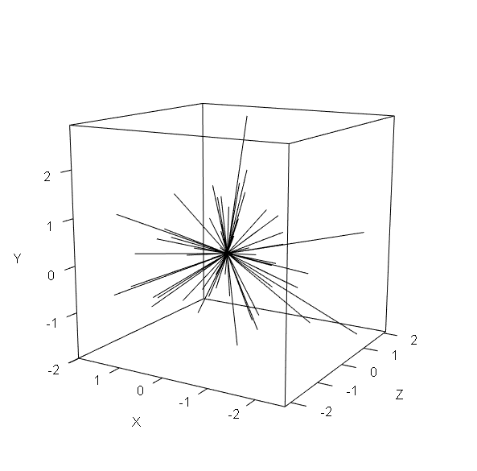

# Dissimilarity and distance measures {#sec-diss}

## Introduction and a silly example {#sec-diss-intro}

One of the central questions in any biological data analysis is, “How similar to each other are my samples?” This is a more complicated question than it appears. It’s worth considering for a moment what “similar” even means. Consider the set of organisms in @fig-multi-animals1 How would you group them by “similarity”?

{#fig-multi-animals1 fig.align="center" fig-alt="A collection of clip art organisms, including a microbe, a pine tree, a crab, a penguin, an elephant, and others."}

Here is one way to group them.

{#fig-multi-animals1 fig.align="center" fig-cap="Here is one way to group the organisms from the previous figure."}

You might have come up with a slightly different set of groupings. This one is just as valid:

{#fig-multi-animals3 fig.align="center" fig-cap="Here is another way to group the organisms from the previous figure."}

These examples illustrate how we might classify the organisms based on qualitative characteristics. But do our choices weight each characteristic equally? After all, fungi and plants are far more different from each other than ants and fish, but @fig-multi-animals3 lumps all non-animals together. Which characteristics of the organisms are really driving our classification decisions?

One way around this problem is to assign numeric scores to characters: 1 if an organism has the trait, and 0 if it doesn’t. @tbl-multi-traits below illustrates this for a few organisms and characteristics. Note that bacteria have `NA` for hetertrophy, becuase many bacteria are also autotrophs.

| Taxon    | Multicellular | Heterotroph | Flowers | Vertebrate | Gills | Amnion | Endotherm |
|:---------|:------------:|:-----------:|:-------:|:----------:|:-----:|:------:|:--------:|
| Bacteria | 0 | NA | 0 | 0 | 0 | 0 | 0 |
| Maple    | 1 | 0  | 1 | 0 | 0 | 0 | 0 |
| Pine     | 1 | 0  | 0 | 0 | 0 | 0 | 0 |
| Octopus  | 1 | 1  | 0 | 0 | 1 | 0 | 0 |
| Shark    | 1 | 1  | 0 | 1 | 1 | 0 | 0 |
| Mushroom | 1 | 1  | 0 | 0 | 0 | 0 | 0 |
| Frog     | 1 | 1  | 0 | 1 | 0 | 0 | 0 |
| Elephant | 1 | 1  | 0 | 1 | 0 | 1 | 1 |
| Penguin  | 1 | 1  | 0 | 1 | 0 | 1 | 1 |
| ...      |   |    |   |   |   |   |   |

: Example of a multivariate dataset containing binary biological traits (0 = absent, 1 = present, NA = not applicable or missing). {#tbl-multi-traits}

The next step is to somehow quantify the similarities between the organisms. It turns out that it's easier to define **dissimilarity** than it is define similarity. This is because the range of a similarity metric is ill-defined: there is no natural value to assign to identical samples. I.e., what value should identical samples have? Infinity? Some other arbitrary value? The first isn't very useful, and the second is highly subjective. Dissimilarity, on the other hand, has a natural value to assign to identical samples: 0. Dissimilarity is often expressed as a **distance** through a **hyperspace**. Hyperspace in this context means a coordinate system with one axis (dimension) for each variable in the data.

To quantify distances between taxa, we might try adding up the differences between each pair. We should also square each individual difference, so $1-0$ counts the same as $0-1$. Then, we add up the squared differences and take the square root to get back to the original scale. For example, the distance between maple and pine in the table above would be:

$$D\left(maple,pine\right)=\sqrt{(1-1)^{2}+(0-0)^{2}+(1-0)^{2}+(0-0)^{2}+(0-0)^{2}+(0-0)^{2}+(0-0)^{2}}=1$$

The difference between octopus and penguin would be:

$$ D(octopus,penguin)=\sqrt{(1-1)^{2}+(1-1)^{2}+(0-0)^{2}+(0-1)^{2}+(1-0)^{2}+(0-1)^{2}+(0-1)^{2}}=2$$

And the difference between mushrooms and elephants is:

$$ D(mushroom,elephant)=\sqrt{(1-1)^{2}+(1-1)^{2}+(0-0)^{2}+(0-1)^{2}+(1-0)^{2}+(0-1)^{2}+(0-1)^{2}}\approx1.73$$

So, for this set of characteristics, octopuses  and penguins are twice as different from each other as are maple trees and pine trees, while mushrooms and elephants are not quite as different from each other as octopuses and penguins are. Interestingly, mushrooms and elephants are more different from each other than are maples and pines, even though maples and pines are in the same kingdom while mushrooms and plants are not. Does that make sense biologically? Of course not.
 
These comparisons were chosen to make a couple of points about quantifying differences. First, the choice of characteristics (or measurements, or metrics, etc.) has a large influence over the calculation. Look over the list again and ask yourself if those characteristics are applicable to all of the organisms. Four of the eight traits are specific to just the animals! Second, the choice of how to combine the differences makes a big difference. There are other ways we could have quantified the differences between the organisms that might have measured dissimilarity differently. 

## Distance and dissimilarity {#sec-diss-dis}

As we saw in the silly organism grouping example, deciding how to measure "similarity" between sample units can be tricky. And, using the wrong metric can get to a wrong or misleading answer.

When we ask "how similar to each other are my samples?", what we really have to ask is "how *dis*similar to each other are my samples?". Think about it: if someone asks you how close the nearest restaurant is, you will answer in terms of *distance*, not *closeness* (or, you will answer in terms of travel time, which is just distance divided by speed). "Similarity" and "closeness" are tricky to define, because it's hard to define the scale. The maximum value seems easy: identical entities have the maximal possible similarity score. But what is that similarity? 1? 100? $\pi^2/4$? The minimum value is even more problematic because there is no clear minimum. If Alice and Bob are 10 meters apart, and Alice and Charlie are 100 meters apart, how do we express the difference in closeness? Alice and Bob are clearly closer than Alice and Charlie, but by how much?

That's why we quantify **distance** and **dissimilarity** rather than closeness and similarity. There is a clear minimum--identical entities have 0 dissimilarity or distance--and we can define dissimilarity measures both with and without maximal values. In statistics we use the terms **distance** and **dissimilarity** almost interchangeably, but they refer to slightly different things.

- A **dissimilarity** is any numerical measure of how different two sample units are. Greater values mean that two entities are more different.
- A **distance** is a special case of dissimilarity that satisfies these four properties:
    1. Non-negativity: $d\left(x,y\right)\geq0$.
    1. Self identity: $d\left(x,y\right)=0\iff x=y$. If $x$ and $y$ are the same, then $d\left(x,y\right)$ should equal 0.
    1. Symmetry: $d\left(x,y\right)=d\left(y,x\right)$.
    1. Triangle inequality: $d\left(x,z\right)\leq d\left(x,y\right)+d\left(y,z\right)$

:::{.callout-note title="The Triangle Inequality"}
A simple but very powerful fact is that the sum of the lengths of any two sides of a triangle will be longer than the length of the third side.

```{r}
#| echo: false
#| fig-width: 8
#| fig-height: 6

par(mar=c(1,1,1,1), mfrow=c(1,1), bty="n")
plot(2:9, 2:9, type="n", xlab="", ylab="",
     xlim=c(2.5,8.5), ylim=c(1,8.5), axes=FALSE)
polygon(x=c(3,6,8,3), y=c(3,8,5,3), border="black", lwd=2)
text(4,6, expression(italic(d)*(italic(x)*", "*italic(y))), cex=2, font=3)
text(7.5, 7, expression(italic(d)*(italic(y)*", "*italic(z))), cex=2, font=3)
text(6,3.5, expression(italic(d)*(italic(x)*", "*italic(z))), cex=2, font=3)
text(5.5, 1.5, expression(italic(d)*(italic(x)*", "*italic(z))<=italic(d)*(italic(y)*", "*italic(z))+italic(d)*(italic(y)*", "*italic(z))),
     cex=3)
text(c(2.75, 6, 8.25), c(3, 8.5, 5),
     c("x", "y", "z"), font=3, cex=2)
```
:::

A dissimilarity that satisfies these four criteria is called a **metric**. Dissimilarities can also be **nonmetric** or **semimetric**. A **semimetric** dissimilarity does not obey the triangle inequality, but meets the other criteria. A **nonmetric** dissimilarity may take negative values, violating the positivity criterion.

:::{.warning title="Reviewer 2 alert"}
Some people treat the terms *metric* and *distance* as synonyms, and will get grouchy if you use "distance" to describe nonmetric or semimetric dissimilarities. Pick your battles. 
:::

## Observations in space {#sec-diss-space}

### Definitions {#sec-diss-space-def}

For the rest of this unit to make sense, you need to think of observations and variables in a new way: coordinates in space. Here we use the mathematical definition of space, which is a **set** with a **structure** that defines the relationships among elements in that set. Actually, that doesn't sound very helpful, but it will in a moment.

Consider the real numbers, sometimes abbreviated $\mathbb{R}$. These are all numbers that can be defined as a position on a continuous line. There are infinitely many of them, but we can define a lot of ways to relate them to each other. A few include:

- Addition: the sum of two real numbers $a$ and $b$ defines a new real number $a+b$.
- Multiplication: the product of two real numbers $a$ and $b$ defines a new real number $a\times b$.
- Ordering: for any two numbers $a$ and $b$, exactly one of these statements is true: $a=b$, $a<b$, or $a>b$.

Even better, there are rules that tell us how to apply the relationships.

- Addition and multiplication are **commutative**: $a+b=b+a$ and $a\times b=b\times a$ for all $a$ and $b$.
- Addition and multiplication are also **associative**: $\left(a+b\right)+c=a+\left(b+c\right)$ and $\left(a\times b\right)\times c=a\times \left(b\times c\right)$ for all $a$ and $b$.
- Multiplication is **distributive** over addition: $a\left(b+c\right)=ab+ac$ and $\left(a+b\right)c=ac+bc$.

There are more rules and properties, but these are enough to make the point. This will probably make more sense if we explore a concrete(ish) example: the Cartesian plane.

### Coordinate systems {#sec-diss-space-coord}

One of the first spaces we learn about in school is the **Cartesian plane**, what you have probably heard called the "**X-Y plane**". The elements of that space are the positions on the plane, defined by **coordinates** on the **axes**. If you've ever taken an algebra course, you probably spent a lot of time learning about relationships between points on the plane.

@fig-cartesian below shows the Cartesian plane. The **origin** is at coordinates $\left(0, 0\right)$. Every location on the plane $\left(a,b\right)$ is defined by its position along the X-axis $a$ and its position along the Y-axis $b$. So, $\left(2,3\right)$ is 2 units to the right, and 3 units up. Point $\left(-4,-3\right)$ is 4 units to the left and 3 units down. 

```{r}
#| fig-width: 8
#| fig-height: 8
#| echo: false
#| label: fig-cartesian
#| fig-cap: "text"
#| fig-alt: "text"

par(mar=c(0,0,0,0), mfrow=c(1,1), lend=1)
n <- 5
plot(1:10, type="n", xlim=c(-n, n), ylim=c(-n, n), axes=FALSE)
ns <- seq(-n, n, by=1)
segments(ns, -n*2, ns, n*2, col="grey70")
segments(-n*2, ns, n*2, ns, col="grey70")
segments(-n*2, 0, n*2, 0, lwd=4)
segments(0, n*2, 0, -n*2, lwd=4)
text(-n, 0.5, "X-axis", adj=0, cex=2)
text(-0.5, n-1, "Y-axis", cex=2, srt=90)
points(0, 0, pch=19, col="red", cex=3)
text(0.2, -0.3, expression(Origin~(0*", "*0)), adj=0, col="red", cex=2)
points(2,3, pch=19, col="blue", cex=3)
text(2+0.2,3-0.2, expression((2*", "*3)), adj=0, col="blue", cex=2)
points(-4, -3, pch=19, col="forestgreen", cex=3)
text(-4+0.2,-3-0.2, expression((-4*", "*-3)), adj=0, col="forestgreen", cex=2)
points(1.5, -2.5, pch=19, col="orange2", cex=3)
text(1.5+0.2,-2.5-0.2, expression((1.5*", "*-2.5)), adj=0, col="orange2", cex=2)
points(-2, 4, pch=19, col="darkorchid", cex=3)
text(-2-0.2,4-0.2, expression((-2*", "*4)), adj=1, col="darkorchid", cex=2)
```

Most of us got kind of familiar with this way of describing positions on a graph ("in a space") in high school (or sometime). This is how maps work. Let's start there.

:::{.callout-note title="Yes, I know"}
This section is not a formal introduction to group theory, set theory, metric spaces, or any of the other very interesting areas of math that intersect here. The goal is to strengthen our understanding of coordinate systems so we can apply them to multivariate analysis. If you want a formal introduction to group theory, set theory, metric spaces, or any of that, you are in the wrong place.
:::


A real number is also a position on the real number line, defined by its position relative to 0. The magnitude (size) of the number is the distance from 0. The sign ($+$ or $-$) is the direction. So, 0 is like the **origin** of the number line. 

In exactly the same way, a position on the Cartesian plane *is* a number. It's just a number with two parts: displacement in the X-axis direction, and displacement in the Y-axis direction. It takes 2 numbers to define the position. The fact that it takes two values to define a point is what makes the Cartesian plane two-dimensional. So, in a sense, points on the plane are just two-dimensional numbers. By the same rule, it takes 1 number to define a point on the real number line, so the real number line is one-dimensional and its elements are one-dimensional numbers.

We can keep going. If we add a third axis Z perpendicular to the X- and Y-axes, we get a three-dimensional space. Now it takes 3 values to define a point in that space--which is also an element of the set defined by axes X, Y, and Z. The point $\left(3, 5, -2\right)$

```{r}
#| fig-width: 8
#| fig-height: 8
#| echo: false
#| label: fig-cartesian2
#| fig-cap: "Three-dimensional Cartesian coordinate system showing the location of a point at (4, −3, −2). The X, Y, and Z axes intersect at the origin (0, 0, 0). Dashed lines illustrate the projection of the point along each coordinate axis."
#| fig-alt: "Three-dimensional coordinate system enclosed in a wireframe cube, with the X-axis in red, Y-axis in blue, and Z-axis in green, intersecting at the origin. A black point labeled (4, −3, −2) lies below the XY plane. Dashed red, blue, and green lines illustrate its position relative to the coordinate axes."

# Reduce margins
op <- par(mar = c(0, 0, 0, 0))

lim <- c(-6, 6)

# Create empty 3D coordinate system
pmat <- persp(lim, lim, matrix(0, 2, 2),
              xlim = lim, ylim = lim, zlim = lim,
              theta = 35, phi = 25,
              col = NA, border = NA,
              xlab = "", ylab = "", zlab = "",
              ticktype = "simple",
              box = TRUE,
              scale = FALSE,
              expand = 1)

# Helper for drawing 3D lines
line3d <- function(x, y, z, ...) {
  p <- trans3d(x, y, z, pmat)
  lines(p$x, p$y, ...)
}

# Three coordinate axes intersecting at origin
line3d(lim, c(0, 0), c(0, 0), lwd = 2, col = "red")
line3d(c(0, 0), lim, c(0, 0), lwd = 2, col = "blue")
line3d(c(0, 0), c(0, 0), lim, lwd = 2, col = "darkgreen")

# Label positive ends of axes
axis_label <- function(x, y, z, label, col) {
  p <- trans3d(x, y, z, pmat)
  text(p$x, p$y, label, col = col, font = 2, cex = 1.2)
}

axis_label(6, 0, 0, "X", "red")
axis_label(0, 6, 0, "Y", "blue")
axis_label(0, 0, 6, "Z", "darkgreen")

# Dashed projection lines
line3d(c(0, 4), c(-3, -3), c(0, 0),
       lty = 2, col = "red")
line3d(c(4, 4), c(0, -3), c(0, 0),
       lty = 2, col = "blue")
line3d(c(4, 4), c(-3, -3), c(0, -2),
       lty = 2, col = "darkgreen")

# Plot the point
p <- trans3d(4, -3, -2, pmat)
points(p$x, p$y, pch = 19, col = "black", cex = 1.5)
text(p$x, p$y, "(4, -3, -2)", pos = 4, cex = 0.9)

# Mark origin
p0 <- trans3d(0, 0, 0, pmat)
points(p0$x, p0$y, pch = 19, cex = 0.7)
text(p0$x, p0$y, "0", pos = 2, cex = 0.8)

par(op)
```

### Points as vectors {#sec-diss-space-vect}

Positions in a 2-d plane or a 3-d cube or whatever are not just positions. We also saw how they represent numbers, even when that "number" has more than 1 dimension. In other words, we generalized our concept of "number" to "position in a coordinate system". Another term for that is **vector**. A vector has **magnitude** (its length) and **direction** (which way it points). So does the real number -3. It has magnitude 3, and points to the left of zero (i.e., in the opposite direction from the way that the positive numbers point). So does the Cartesian point $\left(4,3\right)$ shown below. The point itself is 4 units right and 3 units up. We can do a bit of trigonometry and find that its magnitude is $\sqrt{4^2+3^2}=5$ and its direction is $\arctan\left(3/4\right)\approx0.644$ radians. So, this element is $\left(4,3\right)$ in Cartesian coordinates and $\left(r,\theta\right)=\left(5,0.644\right)$ in **polar coordinates**. The point, or value, or element, is the same. The coordinate systems are just different ways of describing it. Sort of how like my office is both "370 Paulding Ave, Kennesaw, Georgia, 30144, USA, Room 331" and is also at "34.0607 °N, -84.5842 °E".

```{r}
#| fig-width: 8
#| fig-height: 8
#| echo: false
#| label: fig-vector1
#| fig-cap: "Two-dimensional coordinate system illustrating the Cartesian and polar representations of a point. The point (4, 3) can also be expressed in polar coordinates as (5, 0.644), where 5 is the distance from the origin and 0.644 radians is the angle (θ) measured counterclockwise from the positive X-axis."
#| fig-alt: "Two-dimensional Cartesian coordinate system with a blue point at (4, 3). A red vector extends from the origin to the point, with a green arc marking the angle θ between the vector and the positive X-axis. The Cartesian coordinates (4, 3) are labeled in blue, and the equivalent polar coordinates (5, 0.644) are labeled in green."

par(mar=c(0,0,0,0), mfrow=c(1,1), lend=1)
n <- 5
plot(1:10, type="n", xlim=c(-n, n), ylim=c(-n, n), axes=FALSE)
ns <- seq(-n, n, by=1)
segments(ns, -n*2, ns, n*2, col="grey70")
segments(-n*2, ns, n*2, ns, col="grey70")
segments(-n*2, 0, n*2, 0, lwd=4)
segments(0, n*2, 0, -n*2, lwd=4)
text(-n, 0.5, "X-axis", adj=0, cex=2)
text(-0.5, n-1, "Y-axis", cex=2, srt=90)

points(4, 3, pch=19, col="blue", cex=3)
text(4+0.2, 3-0.2, expression((4*", "*3)), adj=0, col="blue", cex=2)
s <- 0.97
arrows(0, 0, 4*s, 3*s, length=0.2, lwd=4, col="red")
theta <- seq(0, atan2(3, 4), length.out = 100)

lines(2 * cos(theta), 2 * sin(theta),
      col = "forestgreen", lwd = 3)
text(2.2 * cos(mean(theta)),
     2.2 * sin(mean(theta)),
     expression(theta), adj=0, col="forestgreen", cex=2)

text(3.8, 3.2, expression((5*", "*0.644)), adj=1, cex=2, col="forestgreen")
```

Don't worry, we're not going to be working with polar coordinates. I just wanted to introduce the idea of expressing a point as a vector. Now that we've seen how numbers on the real number line and points on the real number line are the same thing; how points on the plane are numbers with two parts; and points in 3-d or any-d space are just numbers with several parts; and how numbers can be expressed as vectors, we are ready for the big reveal: generalizing numbers to positions in coordinate systems gives us a way to measure distances between them!

- A distance between two points on the number line is just their difference.
- A distance between two points on the Cartesian plane is just the segment between them, whose length is defined by the Pythagorean theorem.
- And so on for more dimensions.

{#fig-clust-2mice fig.align="center" fig-alt="Scene from The Avengers just before Banner turns into the Hulk, saying That's my secret, I'm always a vector."}

But before we move on to learning about specific distance measures, it's worth asking: is a straight line really the only distance between two points? No.

Consider the points below. One way to describe the distance from one to another is to draw a straight line. An equally valid way would be to treat the plane as a grid of city blocks, with our movement restricted to the horizontal and vertical directions.

```{r}
#| fig-width: 8
#| fig-height: 8
#| echo: false
#| label: fig-distances
#| fig-cap: "Comparison of Euclidean (straight-line) and Manhattan (city-block) distances between two points in two-dimensional space. Euclidean distance measures the shortest distance between the points (5.31 units), while Manhattan distance sums the absolute differences along the two coordinate axes (7.5 units)."
#| fig-alt: "Two-dimensional coordinate grid showing a red point at the lower left and a blue point at the upper right. A black dashed diagonal line connects the points directly, representing Euclidean distance (5.31). Green dashed horizontal and vertical lines form a right-angle path between the points, representing Manhattan distance (7.5)."

par(mar=c(0,0,0,0), mfrow=c(1,1), lend=1)
n <- 3
plot(1:10, type="n", xlim=c(-n, n), ylim=c(-n, n), axes=FALSE)
ns <- seq(-n, n, by=1)
segments(ns, -n*2, ns, n*2, col="grey80")
segments(-n*2, ns, n*2, ns, col="grey80")
segments(-2, -2, 1.5, 2, lwd=4, lty=2)
segments(-2, -2, 1.5, -2, lwd=4, col="green4", lty=2)
segments(1.5, -2, 1.5, 2, lwd=4, col="green4", lty=2)
points(-2, -2, pch=19, cex=3, col="tomato2")
points(1.5,2, pch=19, cex=3, col="royalblue2")

text(-0.3, 0.7, "Straight line distance", adj=1, cex=2)
text(-0.3, 0.3, expression(italic(d)*(italic(a)*", "*italic(b))==5.31),
     adj=1, cex=2)
text(0.3, -2.3, "City block distance", adj=0, cex=2, col="green4")
text(0.3, -2.7, expression(italic(d)*(italic(a)*", "*italic(b))==7.5),
     adj=0, cex=2, col="green4")

```

There are other ways to define distance too, as we will see.

### The distance matrix {#sec-diss-space-distmatrix}

The distances between observations in a dataset are usually stored in a **distance matrix**. Here is a simple distance matrix for the first few rows of `iris`:

```{r}
library(vegan)

# small dataset
# 2 of each species in iris
# drop column 5 (species names)
x <- iris[c(1:2, 51:52, 101:102),1:4]

# calculate distance matrix
vegdist(x)
```

This output is the **distance matrix** for the dataset `x`. Each entry contains the distance measure between the observations whose row and column intersect on a cell. For example, the top left entry is about `0.0355`, which is the distance measure between observation `1` and observation `2`; the distance between observations `101` and `51` is about `0.0930`. Note that this distance matrix is printed without the **diagonal**, which would contain 0s for the distances between each observation and itself. It also doesn't include the **upper triangle**, which are the cells above the diagonal and are the redundant mirror image of the **lower triangle** that we see.

If you want the diagonal or upper triangle included for some reason, use arguments `diag=TRUE` and `upper=TRUE`. Let's round the result this time for clarity.

```{r}
round(
    vegdist(x, diag=TRUE, upper=TRUE)
    ,2)
```

### What can you do with a distance matrix? {#sec-diss-space-what}

We don't have to just imagine; we can visualize what a distance matrix is. @fig-distance-matrix-vis01 shows some points in a 3d space as vectors from the origin.  

{#fig-distance-matrix-vis01 fig-alt="Three-dimensional coordinate system with X, Y, and Z axes enclosed in a wireframe cube. Numerous thin black vectors radiate outward from the origin, representing observations with different combinations of values for the three variables."}

Now compare that to @fig-distance-matrix-vis02, which shows the distances between each point as thin grey lines.

{#fig-distance-matrix-vis02 fig-alt="Three-dimensional coordinate system with X, Y, and Z axes enclosed in a wireframe cube. Black vectors extend from the origin to numerous observations distributed throughout the space. Thin, semitransparent gray lines connect every pair of observations, forming a dense network that illustrates all pairwise distances."}

The lengths of every one of those thin lines would be an entry in the distance matrix. What can we do with these? One way to analyze distances is to compare **within-group distances** to **between-group** distances. @fig-distance-matrix-vis03 below shows the distances within each of two groups, red and blue.

{#fig-distance-matrix-vis03 fig-alt="Three-dimensional coordinate system with X, Y, and Z axes enclosed in a wireframe cube. Black vectors extend from the origin to observations belonging to two groups. Thin, semitransparent red lines connect observations in the upper group, while blue lines connect observations in the lower group, illustrating within-group distances."}

Just as an ANOVA partitions variance in a single variable into **within-group** and **between-group** components, so to can we partition *distance* into within- and between-group components. This is the basis for PERMANOVA and other tests we will see in @sec-mtest.

Another option would be to calculate a second set of distances between the points in terms of another set of variables. For example, we could calculate one distance matrix in terms of plant species composition, and another distance matrix in terms of soil chemistry. Then, we compare dissimilarity in terms of plant species to dissimilarity in terms of soil chemistry:

```{r}
#| fig-width: 8
#| fig-height: 6
#| echo: false
#| label: fig-distvsdist
#| fig-cap: "Relationship between dissimilarity in soil chemistry and dissimilarity in plant community composition. Each point represents a pairwise comparison between two sites. Plant communities generally become more dissimilar as differences in soil chemistry increase, although considerable variation exists around this relationship."
#| fig-alt: "Scatterplot showing dissimilarity in soil chemistry on the X-axis and dissimilarity in plant community composition on the Y-axis, both ranging approximately from 0 to 7. Thousands of semitransparent gray points show a generally positive relationship, with dense clusters at low dissimilarities and a broad, upward-trending distribution at higher values."

x1 <- iris[seq(2, 150, by=2),-5]
x2 <- iris[seq(1, 149, by=2), -5]

d1 <- vegdist(x1, method="euclidean")
d2 <- vegdist(x2, method="euclidean")

par(mar=c(5,5,1,1), mfrow=c(1,1), bty="n")
plot(d1, d2, pch=16, col="#00000030",
     ylab="Dissimilarity in terms of plant community",
     xlab="Dissimilarity in soil chemistry")
```

Each point in this figure is not an observation, it is a *pair* of observations. This imaginary dataset had 75 observations, so there are ${75\choose2}=\frac{75!}{2!\left(72-2\right)!}=2775$ pairwise distances. This figure shows us that the more dissimilar two observations are in terms of their soil chemistry, the more dissimilar their plant communities tend to be. This comparision is called a **Mantel test**, which we will explore more in @sec-mtest-dis-mantel.

## Dissimilarity measures {#sec-diss-meas}

### Metric distances {#sec-diss-meas-met}

#### Euclidean distance {#sec-diss-meas-met-euc}

The **Euclidean distance** is one of the most famous and most commonly used distance metrics. It is the generalization of the Pythagorean theorem to an arbitrary number of dimensions. Recall that the Pythagorean theorem $a^2+b^2=c^2$ gives the square of the length of the hypotenuse $c$ as the sum of the squares of the lengths of the other two sides $a$ and $b$. We can rewrite the theorem to calculate the distance $d$ between two points $a$ and $b$ on the Cartesian plane as:

$$d_{Euc}\left(a,b\right)=\sqrt{\left(a_1-b_1\right)^2+\left(a_2-b_2\right)^2}$$

where $a_1$ and $a_2$ are the coordinates of point $a$ and $b_1$ and $b_2$ are the coordinates of point $b$. 

We can generalize to an arbitrary number of dimensions $k$. For point $a$ with coordinates $a_1,a_2,\ldots,a_k$ and point $b$ with coordinates $b_1,b_2,\ldots,b_k$

$$d_{Euc}(a,b)=\sqrt{\sum_{j=1}^{k}(a_j-b_j)^{2}}$$

For example, for points with in a 4-d space:

$$d_{Euc}\left(a,b|k=4\right)=\sqrt{\sum_{j=1}^{4}(a_j-b_j)^{2}}=\sqrt{\left(a_1-b_1\right)^2+\left(a_2-b_2\right)^2+\left(a_3-b_3\right)^2+\left(a_4-b_4\right)^2}$$

There are several ways to get the Euclidean distance in R. In this and subsequent chapters we will use the functions in package `vegan` for consistency, but there are other options as well.

```{r}
# small dataset
# 2 of each species in iris
x <- iris[c(1:2, 51:52, 101:102),1:4]

# calculate distance matrix
dist.X <- vegdist(x, method="euclidean")

# inspect (2 decimal places for clarity)
round(dist.X, 2)
```

:::{.note title="Distances for geography"}
Tempting as it may be, do not use the Euclidean distance metric for geographic coordinates unless those coordinates have been transformed in a planar (projected) system such as UTM (although even UTM can be distorted over large spatial scales). If you calculate Euclidean distances on unprojected coordinates (such as latitude and longitude), your calculations will be off because they will treat measures of angle (degrees) as measures of distance (kilometers or something). There are very good R packages like `terra` that have functions for calculating geographic distances. Remember: the Earth is round!
:::

The Euclidean distance is appropriate for continuous data like lengths, masses, and other numeric values. Euclidean distance is often poorly suited to ecological community data because species abundances tend to be highly skewed, with a few abundant species and many rare species. Squaring differences gives disproportionate weight to abundant species, potentially obscuring differences in community composition. Unlike Bray–Curtis, Euclidean distance does not standardize differences by the combined abundances of the communities being compared, so differences in total abundance can overwhelm patterns of species composition.

#### Manhattan distances {#sec-diss-meas-met-man} 

The **Manhattan** or **city block** distance treats the plane like a grid of city blocks, with distances only measurable in directions parallel to the axes. See @fig-distances for an illustration. Basically, it is the sum of absolute differences in each variable between two observations. The Manhattan distance between two points $a$ and $b$ in $k$ dimensions is:

$$d_{Man}(a,b)=\sum_{i=1}^n{\lvert a_i-b_i\rvert}$$

The Manhattan distance is also called the $L^1$ norm or metric. 

Let's calculate the Manhattan distance for the [full table of organism traits](../datasets/silly-trait-matrix-example1.csv) from the silly example in @sec-diss-intro. Download this and put it in your working directory. 

```{r}
#| echo: false
silly <- read.csv("../datasets/silly-trait-matrix-example1.csv")
rownames(silly) <- silly$organism
silly$organism <- FALSE
```

```{r}
#| eval: false
silly <- read.csv("silly-trait-matrix-example1.csv")
rownames(silly) <- silly$organism
silly$organism <- FALSE
```

Calculate and insect the distance matrix.

```{r}
vegdist(silly, method="manhattan")
```

The Manhattan distance, like the Euclidean, is appropriate for continuous data.

#### Jaccard distance {#sec-diss-meas-met-jaccard}

The Jaccard distance is often used in ecology to describe differences in species composition between two samples. It is often used for presence/absence data, binary traits, species assemblages, genetic markers, and other datasets where shared presences are more informative than shared absences. To calculate the Jaccard distance between two observations $p$ and $q$, first define:

- $a$: number of species present (or variables $>0$) in both observations.
- $b$: number of species present (or variables $>0$) that are present only in the first observation.
- $c$: number of species present (or variables $>0$) that are present only in the second observation.

Then we calculate:

$$d_{Jac}\left(p,q\right)=1-\frac{a}{a+b+c}=\frac{b+c}{a+b+c}$$
The Jaccard distance ranges from 0 (identical sets of presences) to 1 (no shared presences). The Jaccard distance ignores joint absences.

We can get the Jaccard distance in R with `vegdist()`.

```{r}
# example dataset of species abundances 
# from package vegan
data(varespec)

# just need a few rows
x <- varespec[1:8,]

# convert to binary
# 1 = present; 0 = absent
x[x>0] <- 1

# calculate Jaccard distance
d <- vegdist(x, method="jaccard")

# round for clarity
round(d, 3)
```

These Jaccard distance answer the question, "What fraction of species present in at least one community are not shared by both?".

There is another version of the Jaccard version that extends the definition to quantitative data. E.g., distance in terms of species *abundances* instead of species *presence and absence*.  This is also called the **quantitative Jaccard** or **Ružička distance**. For two communities $p$ and $q$ with some number of species $k$, we can calculate 

$$d_{QJac}\left(p,q\right)=1-\frac{\sum_{i=1}^n{\min\left(p_i,q_i\right)}}{\sum_{i=1}^n{\max\left(p_i,q_i\right)}}$$

and get a distance metric that measures what proportion of total abundance is not shared by both communities. Interestingly, this distance is a transformed version of the [**Bray-Curtis distance**](#sec-diss-semi-bray) $d_{BC}$:

$$d_{QJac}=\frac{2d_{BC}}{1+d_{BC}}$$

Both the binary and quantitative Jaccard distances are [metric distances](#sec-diss-dis) under reasonable conditions, while the Bray-Curtis distance is **semimetric** because it does not satisfy the triangle inequality.

You can get the quantitative Jaccard distance in R by giving `vegdist()` a matrix of species abundances rather than species presences.

```{r}
# small dataset of abundances
x <- varespec[1:8,]

# calculate quantitative Jaccard distance
d1 <- vegdist(x, "jaccard")

# calculate Bray-Curtis and transform
d2 <- vegdist(x)
d2 <- (2*d2)/(1+d2)

# quantitative Jaccard
round(d1, 3)

# transformed Bray-Curtis
round(d2, 3)
```

#### Mahalanobis distance  {#sec-diss-meas-met-mal}

The **Mahalanobis distance** is a metric distance that measures the difference between two observations while accounting for the variance and covariance of the variables. Unlike Euclidean distance, which treats each variable as an independent dimension, Mahalanobis distance accounts for correlations among variables. Consequently, differences that follow common patterns of variation in the dataset contribute less to the distance than differences that deviate from those patterns.

The Mahalanobis distance is often used for morphometrics, physiology, multivariate phenotypes, and datasets with correlated continuous measurements. For example, consider measurements of body length, skull length, and body mass across mammals. These variables are correlated because of overall body size. Mahalanobis distance accounts for that covariance structure when measuring differences among individuals. It generalizes the Euclidean distance by accounting for both the variances of the individual variances and their covariance. An important limitation of the Euclidean distance is that when two (or more) variables are correlated, treating them as independent dimensions can overemphasize certain differences.

Because the Mahalanobis distance requires estimating a covariance matrix, it can be unstable when the number of variables approaches or exceeds the number of observations.

The Mahalanobis distance for two samples $p$ and $q$ with $k$ variables is:  
$$d_{Mal}=\sqrt{\sum_{i=1}^k\sum_{j=1}^k{\left(x_{pi}-x_{qi}\right)s^{ij}\left(x_{pj}-x_{qj}\right)}}$$

where:

- $x_{pi}$ is the value of variable $i$ for observation $p$
- $x_{qi}$ is the value of variable $i$ for observation $p$
- $s^{ij}$ is the element $\left(i,j\right)$ of the inverse covariance matrix $\mathbf{S}^{-1}$, estimated from the dataset
- $k$ is the number of variables

We can write that more compactly in matrix notation as:

$$
d_M(\mathbf{x},\mathbf{y}) =
\sqrt{(\mathbf{x}-\mathbf{y})^\mathsf{T}
\mathbf{S}^{-1}
(\mathbf{x}-\mathbf{y})}
$$

Don't worry about that. The point is, Mahalanobis distance captures differences between samples while accounting for the fact that the variables have different variances and may be correlated with each other.

We can get Mahalanobis distance in R with `vegdist()`:

```{r}
# 2 observations per species in iris
# drop species column (5)
x <- iris[c(1,2,51, 52, 101, 102), -5]

# calculate distance
d <- vegdist(x, "mahalanobis")

# round and print
round(d, 3)
```

Let's compare it to the Euclidean distance with the full `iris` dataset:

```{r}
#| fig-width: 8
#| fig-height: 6
#| echo: false
#| label: fig-mahalanobis
#| fig-cap: "Comparison of Euclidean and Mahalanobis distances between pairs of observations in a multivariate dataset. Each point represents a pairwise comparison, with Euclidean distance on the X-axis and Mahalanobis distance on the Y-axis. The red line indicates where the two distances would be equal (1:1). Differences between the two measures arise because Mahalanobis distance accounts for the variances and covariances among variables."
#| fig-alt: "Scatterplot of Euclidean distance versus Mahalanobis distance, with both axes ranging approximately from 0 to 7. Thousands of overlapping black open circles form a broad, positively associated cloud. A red diagonal line represents equal distances under the two metrics. Points occur both above and below the line, indicating that Mahalanobis distances can be greater or smaller than Euclidean distances for the same pair of observations."
#| 
x <- iris[,-5]

d.mah <- vegdist(x, "mahalanobis")
d.euc <- vegdist(x, "euclidean")

par(mar=c(5,5,1,1))
plot(d.euc, d.mah,
     xlab="Euclidean distance",
     ylab="Mahalanobis distance")
abline(a=0, b=1, col="red", lwd=2)
```

### Semimetric dissimilarities {#sec-diss-meas-semi}

Recall that a [semimetric dissimilarity](#sec-diss-space-def) is one that does not obey the triangle inequality. This means that for three samples $a$, $b$, and $c$, the dissimilarities between $a$ and $b$, and between $b$ and $c$, might not add up to be more than the dissimilarity between $a$ and $c$.

#### Sørensen dissimilarity  {#sec-diss-meas-semi-sor}

Like the Jaccard distance, the **Sørensen dissimilarity** is best understood in terms of entities shared by two samples. Conceptually, it answers the question, "What fraction of the elements found in both sets is common to both sets?" (roughly speaking). For two samples $x_1$ and $x_2$, which are vectors of presence and absence of elements, we can calculate 

$$d_{Sør}\left(x_1,x_2\right)=\frac{2\lvert x_1\cap x_2\rvert}{\lvert x_1\rvert+\lvert x_2\rvert}$$

The symbol $\cap$ means "intersection". For two sets $A$ and $B$, $A\cap B$ is the set of elements that belong to both $A$ and $B$. 

For example, suppose we had two rodent communities with 8 species between them. The vectors $\mathbf{A}$ and $\mathbf{B}$ contain the presence or absence of each species at sites $A$ and $B$. 

$$\mathbf{A}=\left(1,0,0, 1, 1, 0, 1, 0\right)$$

$$\mathbf{B}=\left(1,1,1, 0, 1, 1, 0, 1\right)$$

Each of the eight species occurs in at least 1 of the sites, and some occur at both. The Sørensen dissimilarity is:

$$d_{Sør}\left(x_1,x_2\right)=\frac{2\lvert 2\rvert}{4+6}=0.4$$ 

The Sørensen dissimilarity is the binary version of the Bray-Curtis dissimilarity (see below), so you can get it by providing a matrix of 1s and 0s to `vegdist()` with the option `method="bray"`. This is the default option in `vegdist()`.

```{r}
# first few rows of a
# species abundance dataset
x <- varespec[1:8,]

# convert abundances to presence (1)
# and absence (0)
x[x>0] <- 1

# calculate Sørensen dissimilarity
d <- vegdist(x)

# round and present
round(d, 3)
```

#### Bray-Curtis dissimilarity {#sec-diss-meas-semi-bray}

One of the most common dissimilarity measures used in ecology is the **Bray-Curtis dissimilarity**. It is a quantitative version of the [Sørensen dissimilarity](#sec-diss-meas-semi-sor). The Bray-Curtis dissimilarity ranges from 0 to 1, where 0 means two samples have the same composition, and 1 means that they don't  share any species. Its usefulness is attested to by the fact that it is the default in `vegdist()` and many other functions in package `vegan`. 

For two samples $a$ and $b$ with total number of species $k$, the Bray-Curtis dissimilarity is:

$$d_{BC}\left(a,b\right)=1-\frac{2\sum_{i=1}^k{\min\left(N_{ia},N_{ib}\right)}}{\sum_{i=1}^k{\left(N_{ia}+N_{ib}\right)}}$$

where $N_{ia}$ is the abundance of species $i$ at site $a$ and $N_{ib}$ is the abundance of species $i$ at site $b$. 

```{r}
# first few rows of a
# species abundance dataset
x <- varespec[1:8,]

# calculate Bray-Curtis dissimilarity
d <- vegdist(x)

# round and present
round(d, 3)
```

Bray–Curtis dissimilarity is widely used in ecology because ecological abundance datasets tend to be sparse (many species have zero abundance), highly skewed (a few abundant species and many rare species), and characterized by species turnover along environmental gradients. Bray–Curtis measures differences in abundance relative to the combined abundance of two observations, while ignoring joint absences. Consequently, it emphasizes differences in the species actually observed rather than treating the absence of a species from both communities as evidence of similarity.

Bray–Curtis is particularly useful for describing ecological gradients because species often exhibit unimodal responses to environmental conditions. Communities occupying similar environments tend to share species with similar abundances, whereas communities farther apart along a gradient tend to share fewer species. Bray–Curtis dissimilarity therefore often increases with environmental separation, reaching a maximum of 1 when two communities share no species. However, Bray–Curtis cannot distinguish degrees of dissimilarity beyond complete species turnover, and highly abundant species may still dominate the calculation.

## Dissimilarity with many zeros {#sec-diss-zeros}

One drawback of the Bray-Curtis dissimilarity is that it is undefined when both observations have no species. So, if you have several sites with no species, their dissimiliarities with each other will be missing from your distance matrix. 

```{r}
# first few rows of a
# species abundance dataset
x <- varespec[1:8,]
rownames(x) <- NULL

# blank out a few rows
x[2,] <- 0
x[4,] <- 0

# calculate Bray-Curtis dissimilarity
d <- vegdist(x)

# round and present
round(d, 3)
```

R printed a warning because samples 2 and 4 each have zero species. The denominator in the Bray-Curtis calculation was 0, so the dissimilarity is undefined.

A common solution is to add a **dummy species** to the data with the same abundance in every sample (@CLARKE200655). Doing so yields the **zero-adjusted Bray–Curtis coefficient**. This won't affect the denominator, but it will add a small positive value to the denominator so the fraction is always defined. I like to use 1, but you don't have to. The important thing is that the value is the same for all samples.

```{r}
# first few rows of a
# species abundance dataset
x <- varespec[1:8,]
rownames(x) <- NULL

# blank out a few rows
x[2,] <- 0
x[4,] <- 0

# add a dummy variable with abundance 1 everywhere
x$dummy <- 1

# calculate Bray-Curtis dissimilarity
d <- vegdist(x)

# round and present
round(d, 3)
```

Now the two samples with no species have the minimum dissimilarity of 0.

Not everyone agrees that this adjustment to the Bray-Curtis measure. Jari Oksanen, the lead author of the `vegan` package, argued in a [StackOverflow thread](https://stats.stackexchange.com/a/535138) that the empty rows should not be retained because "there is no compositional distance if there is no composition". He recommends removing the empty rows. It is not clear what any dissimilarity measure really says about two samples that are completely empty.

That objection raises a serious issue with the zero-adjusted Bray-Curtis measure. If it is appropriate at all, it is appropriate only if two empty samples can be considered ecologically equivalent. For example, two small mammal trapping grids in very different habitats, say Canadian tundra and Sonoran desert, would have no species in common because of their geographical separation and different environments. However, small mammal trapping being what it is, it is very possible to capture no species at either site. This adjustment would assign those sites a dissimilarity of 0, which is mathematically true but not biologically reasonable.

On the other hand, if one sample is empty, and the other is non-empty, then the Bray-Curtis dissimilarity is 1 (without adjustment). This is mathematically sensible and biologically defensible: the samples share nothing in common, so their dissimilarity is the maximum possible value.

There is no universally agreed-upon method for calculating dissimilarity between samples with all zeros. For your analysis, you need to think about what you are really trying to describe with a dissimilarity measure.

- Are you trying to measure differences in community composition? Then delete the empty samples. After all, "there is no compositional distance if there is no composition."
- Are you trying to measure differences in abundance? Then go ahead and adjust. Two empty samples both have abundances of 0, and will have dissimilarities of 0, because $0=0$.

Another alternative is to use a dissimilarity or distance measure that is mathematically defined for empty sites. Euclidean distance on raw abundances is mathematically well-defined for empty sites. Two empty communities have distance zero, and an empty versus nonempty community has a distance determined by the abundances in the nonempty community. However, the usual ecological objections to Euclidean distance still apply.

**Hellinger distance** is often preferable for ordinating ecological community data. It is calculated by converting abundances to relative abundances within each site, taking their square roots, and calculating Euclidean distances. An all-zero site requires an explicit convention, such as retaining a zero vector. In vegan, Hellinger transformation retains empty rows as zeros, so the resulting Euclidean distances are defined. However, this does not resolve the conceptual problem of comparing an empty community's composition with a nonempty one.

```{r}
# first few rows of a
# species abundance dataset
x <- varespec[1:8,]
rownames(x) <- NULL

# blank out a few rows
x[2,] <- 0
x[4,] <- 0

# Hellinger transformation
totals <- rowSums(x)
totals[totals==0] <- 1
x.hel <- sqrt(sweep(as.matrix(x), 1, totals, "/"))

# calculate Euclidean distance on transformed matrix
d <- vegdist(x.hel, method="euclidean")

# round and print
round(d,3)
```

Keep in mind that like the zero-adjusted Bray-Curtis measure, this is a mathematical convention rather than a solution to the ecological question of whether two empty communities should be considered similar.