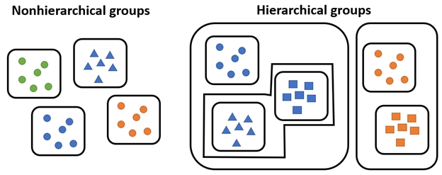
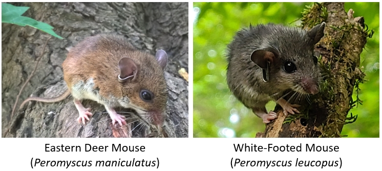

# Clustering for biologists {#sec-clust}

## Introduction {#sec-clust-intro}

Now that we have a way of quantifying multivariate differences between samples as distance, we can use those measures to explore patterns in data. One application of distance metrics is to use them to organize data into **clusters** or groups consisting of samples that are more similar to each other than they are to other samples. In other words, the **within-group** distances should be smaller than the **between-group** distances.

The figure below illustrates this concept with an imaginary example. The clusters shown cleanly separate red, blue, and green points. For example, the average distance between the red points is smaller than the average distance between the red points and the blue points.

```{r}
#| echo: false
#| fig-width: 7
#| fig-height: 7
#| label: fig-cluster-example1
#| fig-cap: "Hypothetical dataset containing three distinct clusters of observations in two-dimensional space."
#| fig-alt: "Scatterplot showing three spatially separated groups of observations on a white background. Eight red squares form a cluster in the upper left, eight blue triangles form a cluster in the upper right, and eight green circles form a cluster near the bottom center. Observations within each group are relatively close together, with large gaps separating the three groups."


set.seed(123)
n <- 8
x1 <- runif(n, 2, 5)
y1 <- runif(n, 6, 9)

x2 <- runif(n, 7.5, 9.5)
y2 <- runif(n, 7, 9)

x3 <- runif(n, 4, 7)
y3 <- runif(n, 2, 5)

par(mar=c(1,1,1,1), bty="n")
plot(x1, y1, xlim=c(1.5, 10), ylim=c(1.5, 10),
     pch=22, bg="white", col="tomato", cex=2, axes=FALSE, lwd=3)
points(x2, y2, pch=24, bg="white", col="royalblue", cex=2, lwd=3)
points(x3, y3, pch=21, bg="white", col="forestgreen", cex=2, lwd=3)

```

### Types of clustering {#sec-clust-intro-types}

There are many methods for clustering observations. Many methods are **hierarchical**, with groups being nested within other groups. Many biological phenomena are also hierarchical in nature, so these methods are naturally quite useful. Other methods are **non-hierarchical**, where groups are not constrained to be within other groups.

 Most hierarchical methods produce non-overlapping groups. Hierarchical methods are easier to compute in general. However, some authors (see @legendre2012numerical) consider hierarchical cluster methods to be "classification" rather than true clustering. The biological reasoning is clear: the hierarchy produced by a clustering algorithm is analogous to the hierarchies we see in phylogeny or Linnaean taxonomy. 

{#fig-clust-hierarchy fig-align="center" fig-alt="In nonhierarchical clustering, groups are not nested within each other. In hierarchical clustering, samples are partitioned into nested groups."}

Clustering methods also differ in their manner of group construction. Many methods are **agglomerative**, which means that groups are formed by combining samples. Other methods are **divisive**, which means that all samples start in a single group which is then broken up. Divisive techniques are also called **partitioning** techniques. 

{#fig-clust-agglom fig-align="center" fig-alt="Agglomerative clustering starts with all samples completely ungrouped, then puts groups together by combining samples. Divisive clustering or partitioning starts with all samples in the same group, then divides the group until some stopping rule is reached."}

Examples of each class of clustering method are shown below.

| Clustering approach | Group formation | Common methods |
|---|---|---|
| Partitioning (nonhierarchical) | Observations are assigned and reassigned among a specified number of clusters | *K*-means clustering |
| Hierarchical agglomerative | Individual observations or clusters are progressively merged into larger clusters | Ward's method [@ward1963]; single linkage; complete linkage |
| Hierarchical divisive | All observations begin in one cluster, which is progressively divided into smaller clusters | Association analysis [@ludwig1988statistical; @legendre2012numerical]; TWINSPAN [@hill1979; @rolecek2009] |

: Common approaches to clustering and their methods of forming groups. {#tbl-clustering-methods}

## K-means clustering {#sec-clust-kmeans}

### Introduction to K-means clustering {#sec-clust-kmeans-intro}

*K*-means clustering is a method for dividing a dataset with *n* observations, with *p* variables, into *K* categories such that each observation belongs to the cluster with the most similar mean. The “mean” for each category (i.e., group) is really a position in a *p*-dimensional hyperspace called a **centroid**. In this context, centroids are calculated as the point at the central coordinate of each dimension. The mean is most often used, but the median can be a useful alternative.
 
There are several algorithms for *k*-means clustering. One of the most common works like this:

1. Select the desired number of clusters *k*.
2. Make an initial guess of the mean of each cluster. I.e., Start with a *K* random positions in the *p*-dimensional hyperspace. These positions are known as centroids.
3. Calculate the Euclidean distance between each sample and each centroid.
4. Assign each sample to the category corresponding to the nearest centroid.
5. Update the centroids for each cluster by calculating the new centroid for the samples assigned to each cluster. 
6. Repeat steps 3, 4, and 5 until cluster assignments no longer change.

This algorithm is not guaranteed to find the best possible solution, but it quite often finds decent solutions. Distance metrics other than the Euclidean can be used, but Euclidean is most common. Transforming, scaling, and/or standardizing variables so that they are all on the same scale can improve the results. 

The figure below shows the effects of *K*-means clustering on a pretend dataset with 2 variables with $K = 3$. The group assignments were determined because groups with those centroids had the smallest possible set of Euclidean distances between the points and the group centroids (right panel). Centroids are shown with a thick outline.

```{r}
#| echo: false
#| fig-width: 10
#| fig-height: 5
#| label: fig-kmeans-example1
#| fig-cap: "Illustration of K-means clustering in two-dimensional space. The left panel shows the original observations, while the right panel shows their assignment to three clusters. Large, black-outlined symbols indicate cluster centroids, and dashed lines connect individual observations to their respective centroids."
#| fig-alt: "Two-panel scatterplot of observations measured on Variable 1 and Variable 2. The left panel shows 24 black points arranged in three distinct groups. The right panel shows the same observations assigned to three clusters: red squares in the upper left, blue circles in the upper right, and green triangles at the bottom. Each cluster has a large, black-outlined centroid symbol, with dashed lines connecting its observations to the centroid."


set.seed(123)
n <- 8
x1 <- runif(n, 1, 7)
y1 <- runif(n, 6, 14)

x2 <- runif(n, 9, 13)
y2 <- runif(n, 8, 13)

x3 <- runif(n, 5, 10)
y3 <- runif(n, 1, 6)

xx <- c(x1, x2, x3)
yy <- c(y1, y2, y3)

par(mar=c(5,5,1,1), bty="n", mfrow=c(1,2))
plot(xx, yy, xlim=c(0, 15), ylim=c(0, 15),
     pch=19, cex=1.4, 
     xlab="Variable 1", ylab="Variable 2")
plot(xx, yy, xlim=c(0, 15), ylim=c(0, 15),
     type="n", xlab="Variable 1", ylab="Variable 2")
points(x1, y1, pch=15, col="tomato", cex=1.4)
points(x2, y2, pch=16, col="royalblue3", cex=1.4)
points(x3, y3, pch=17, col="forestgreen", cex=1.4)
segments(x1, y1, mean(x1), mean(y1), lty=2, col="tomato")
segments(x2, y2, mean(x2), mean(y2), lty=2, col="royalblue3")
segments(x3, y3, mean(x3), mean(y3), lty=2, col="forestgreen")
points(mean(x1), mean(y1), pch=22, col="black", lwd=3, bg="tomato", cex=2)
points(mean(x2), mean(y2), pch=21, col="black", lwd=3, bg="royalblue3", cex=2)

points(mean(x3), mean(y3), pch=24, col="black", lwd=3, bg="forestgreen", cex=2)


```

How many clusters are appropriate? That’s a good question to ask, and sometimes a tricky question to answer. There are statistical ways to assess how many groups are appropriate...but, you always need to use your biological judgement when interpreting groups. Sometimes you may be justified on biological grounds using 1 group more or less than the numerical summaries indicate. 

One common way to assess the optimal *K* is to try several *K* and calculate the within-cluster sum of squared errors (*WSS*) for all points. The optimal value of *K* is often assumed to be the value at which a plot of *WSS* vs. *K* starts to bend. The example **elbow plot** below illustrates this method for the data above.

```{r}
#| fig-width: 8
#| fig-height: 6
#| label: fig-kmeans-wss-plot
#| fig-cap: "Elbow plot showing the relationship between the number of clusters (K) and total within-cluster sum of squares (WSS) in K-means clustering. WSS decreases as the number of clusters increases, with a pronounced reduction up to approximately four clusters, suggesting that K = 4 may be a reasonable choice."
#| fig-alt: "Line graph showing total within-cluster sum of squares (WSS) on the vertical axis and number of clusters (K) from 2 to 8 on the horizontal axis. WSS decreases sharply from approximately 415 at K = 2 to 180 at K = 3 and 130 at K = 4. The curve is nearly flat between K = 4 and 6, then decreases again to approximately 77 at K = 7 and 56 at K = 8."

# generate a random dataset with 3 clusters
set.seed(1234)
x <- c(rnorm(20, 5, 2), rnorm(10, 12, 2))
y <- c(rnorm(10, 3, 2), rnorm(10, 10, 2), rnorm(10, 14, 2))
dx <- data.frame(x,y)

# perform k-means clustering with k from 2 to 8
kvec <- 2:8
nk <- length(kvec)
k.list <- vector("list", nk)
for(i in 1:nk){
  k.list[[i]] <- kmeans(dx, kvec[i])
}

# gather WSS for each k
wss <- sapply(k.list, function(x){x$tot.withinss})

# plot WSS vs. k
par(mfrow=c(1,1), mar=c(5,5,1,1))
plot(kvec, wss, type="o",
     lwd=3, pch=1.5,
     xlab="Clusters (k)",
     ylab="Total WSS")
```

Notice that total *WSS* drops off much more slowly above 3 clusters. That is, going from 3 to 4 clusters reduces *WSS* much less than going from 2 to 3 clusters. The result above could reasonably justify 3 or 4 clusters. The figure below shows how the data are divided into 3 and 4 clusters.

```{r}
#| fig-width: 10
#| fig-height: 5
#| label: fig-kmeans-example2
#| fig-cap: "Comparison of K-means clustering solutions with three clusters (left) and four clusters (right) for the same hypothetical dataset. Increasing K from 3 to 4 divides the upper-right group into two smaller clusters, illustrating how the number of clusters influences group assignments and centroid locations."
#| fig-alt: "Two-panel scatterplot showing K-means clustering of observations measured on Variable 1 and Variable 2. The left panel (K = 3) shows three clusters: red squares in the upper left, blue triangles in the upper right, and green circles at the bottom. The right panel (K = 4) retains the bottom green cluster but divides the upper observations into purple diamonds on the left, cyan triangles in the middle right, and red squares at the upper right. Yellow-filled, colored-outlined circles mark cluster centroids, with dashed lines connecting observations to their respective centroids."

# assemble values needed for plots
## get clusters
dx$k3 <- k.list[[which(kvec == 3)]]$cluster
dx$k4 <- k.list[[which(kvec == 4)]]$cluster

## coordinates of group centroids
km3 <- k.list[[which(kvec == 3)]]
km4 <- k.list[[which(kvec == 4)]]

dx$cenx3 <- km3$centers[dx$k3,1]
dx$ceny3 <- km3$centers[dx$k3,2]
dx$cenx4 <- km4$centers[dx$k4,1]
dx$ceny4 <- km4$centers[dx$k4,2]

## colors for each group
dx$col3 <- rainbow(3)[dx$k3]
dx$col4 <- rainbow(4)[dx$k4]

## symbols for each group
dx$pch3 <- (15:17)[dx$k3]
dx$pch4 <- (15:18)[dx$k4]

# make plot
par(mfrow=c(1,2), mar=c(5, 5, 2, 1))
plot(x,y, pch=dx$pch3, col=dx$col3, cex=1.4,
    xlab="Variable 1", ylab="Variable 2",
    main=expression(italic(k)==3))
segments(dx$cenx3, dx$ceny3, dx$x, dx$y,
    col=dx$col3, lwd=2, lty=2)
points(dx$cenx3, dx$ceny3, pch=21, cex=2,
    bg="yellow", col=dx$col3, lwd=4)

plot(x,y, pch=dx$pch4, col=dx$col4, cex=1.4,
    xlab="Variable 1", ylab="Variable 2",
    main=expression(italic(k)==4))
segments(dx$cenx4, dx$ceny4, dx$x, dx$y,
    col=dx$col4, lwd=2, lty=2)
points(dx$cenx4, dx$ceny4, pch=21, cex=2,
    bg="yellow", col=dx$col4, lwd=4)
```

Most of the group assignments stayed the same, but the algorithm split the blue group when *K* increased from 3 to 4. Accepting the 3 cluster or 4 cluster solution is as much of a biological decision as it is a statistical one. When you get to this point, you need to think about whether the groups make sense or not. Notice that *K*-means clustering does not necessarily result in groups of equal sizes. This may or may not be a problem depending on the structure of your dataset and the question you are trying to answer.

### Example with NEON data {#sec-clust-kmeans-example}

Let's revisit the NEON small mammal data. Download the [individual measurement dataset](../datasets/data-neon-ind-meas.csv) and the [taxonomic dataset](../datasets/data-neon-taxa.csv) and put them in your working directory.

```{r}
#| include: false
tax <- read.csv("../datasets/data-neon-taxa.csv")
ind <- read.csv("../datasets/data-neon-ind-meas.csv")

```

```{r}
#| eval: false
tax <- read.csv("data-neon-taxa.csv")
ind <- read.csv("data-neon-ind-meas.csv")
```

We are going to use these data to try out a few common clustering techniques. First we need to organize the data. Cut the measurement data down to just the columns we need: individual, species, and the four standard measurements.

```{r}
use.cols <- c("tagID", "abb", "totalLength",
              "tailLength", "hindfootLength", "earLength" )
dx <- ind[,use.cols]

# only want individuals with no missing measurements
dx <- dx[complete.cases(dx),]

# pick Peromyscus maniculatus (Perman) and
# P. leucopus (Perleu). These species are
# notoriously difficult to tell apart in
# the field. Let's see if we can do it with clustering.
use.spp <- c("Perleu", "Perman")
dx <- dx[dx$abb %in% use.spp,]

# assign colors and shapes for plotting later
cols <- c("tomato", "royalblue")
pchs <- 1:2
names(cols) <- use.spp
names(pchs) <- use.spp
dx$col <- cols[dx$abb]
dx$pch <- pchs[dx$abb]
```

The Eastern Deer Mouse (*Peromyscus maniculatus*) and the White-Footed Mouse (*P. leucopus*) are two morphologically similar species of mice that are widespread throughout much of North America. Among mammalogists, they are notoriously difficult to tell apart in the field. This is a problem, because they are both habitat generalists and co-occur in many places (@light2021morphological).

{#fig-clust-2mice fig-align="center" fig-alt="The Eastern Deer Mouse (Peromyscus maniculatus) and the White-Footed Mouse (P. leucopus)."}

Several field characters or suites of characters have been shown to differentiate them, with some success (@rich1996morphological), but regional variation in both species confounds these methods. Some studies have found that over a third of species in museum collections may have been misidentified (@light2021morphological). For this example analysis, we are going to assume that all individuals in the dataset have been identified correctly. 

Let's apply *K*-means clustering to see if we can identify any groups of similar individuals. If the species can be distinguished morphologically, then the clusters may recover the species. We expect to find 2 clusters, but there may be more. We will test $K$ from 2 through 8. 

Unlike most of the multivariate methods in this guide, we won't need the package `vegan`: `kmeans()` is a base function.

```{r}
#| fig-width: 8
#| fig-height: 6
#| label: fig-kmeans-mice1
#| fig-cap: "Elbow plot showing the relationship between the number of clusters (K) and total within-cluster sum of squares (WSS) for K-means clustering of morphological measurements. WSS decreases as K increases, but the absence of a clearly defined elbow makes it difficult to identify an optimal number of clusters."
#| fig-alt: "Line graph showing total within-cluster sum of squares (WSS) against the number of clusters (K) from 2 to 8. WSS decreases from approximately 262,000 at K = 2 to 163,000 at K = 3, 127,000 at K = 4, and 102,000 at K = 5. The decline becomes progressively smaller, reaching approximately 73,000 at K = 8, without a distinct breakpoint."
#| 
# numbers of groups to test
kvec <- 2:8

# set up a list to catch results
nk <- length(kvec)
k.list <- vector("list", nk)

# columns with measurements
meas.cols <- c("totalLength", "tailLength",
               "hindfootLength","earLength")

# fit clusters in a group
for(i in 1:nk){
    k.list[[i]] <- kmeans(dx[,meas.cols], kvec[i])
}

# gather within-group sums of squares (wss)
# from each K for scree plot
wss <- sapply(k.list, function(x){x$tot.withinss})

# plot wss vs. K
par(mar=c(5,5,1,1))
plot(kvec, wss, type="o", lwd=3, pch=1.5,
    xlab="Clusters (k)",
    ylab="Total WSS")

```

Unlike our first example (@fig-kmeans-wss-plot), this curve doesn't have a clear break point. It is definitely leveling out by 4 to 6 clusters, but there isn't as clean of an answer as the plot for the data that I made up earlier. Let's explore the potential clusters in an **ordination plot**. This is a way to visualize multivariate data that we will cover in @sec-ord. For now, just understand that *points that are closer together are more similar to each other*.

```{r}
library(vegan)

# quick pca on scaled and centered data
pca.dx <- scale(dx[,meas.cols])
p1 <- pca(dx[,meas.cols])
summary(p1)
```

First, plot the PCA and symbolize the points by species.

```{r}
#| fig-width: 8
#| fig-height: 8
#| label: fig-kmeans-mice-pca
#| fig-cap: "Principal components analysis (PCA) of four morphological measurements from *Peromyscus leucopus* and *P. maniculatus* collected at NEON sites. The first two principal components explain 98.7% of the total variation. Although the species differ somewhat along PC1, their distributions overlap substantially, indicating that the morphological measurements do not clearly separate the two species."
#| fig-alt: "PCA scatterplot showing P. leucopus as red open circles and P. maniculatus as blue open triangles. PC1 (horizontal axis) explains 90.4% of the variance, and PC2 (vertical axis) explains 8.3%. Most observations form a dense, horizontally elongated cloud centered near the origin. P. leucopus observations are concentrated toward positive PC1 values and slightly negative PC2 values, while P. maniculatus observations tend toward negative PC1 values and slightly positive PC2 values. The two species overlap extensively, with several outlying observations."

xy <- scores(p1, 1:4, "sites")

par(mar=c(5,5,1,1))
plot(xy[,1], xy[,2], pch=dx$pch, col=dx$col, cex=1.4,
     xlab="PC1 (90.4%)", ylab="PC2 (8.3%)")
legend("topright", legend=use.spp,
       col=cols, pch=pchs, cex=1.4, bty="n")
```

There is some separation between the species along PC1, with *P. leucopus* having larger PC1 values and *P. maniculatus* having smaller scores on that axis. There is still plenty of overlap though, which makes sense given the difficulty in field identification. We also can't rule out that some *P. leucopus* were misidentified as *P. maniculatus* and vice versa (or, for that matter, that individuals of other species were misidentified as one of *P. leucopus* or *P. maniculatus*).

Let's compare the "known" species to the the assignments under 4, 5, and 6 cluster scenarios.

```{r}
#| fig-width: 8
#| fig-height: 8
#| label: fig-kmeans-mice-pca4
#| fig-cap: "Principal components analysis (PCA) of four morphological measurements from *Peromyscus leucopus* and *P. maniculatus*, showing species identities (upper left) and *K*-means clustering solutions with four (upper right), five (lower left), and six (lower right) clusters. Arrows indicate the contributions of the four morphological measurements to the principal components. Increasing the number of clusters progressively subdivides observations along PC1, which explains 90.4% of the total variation, rather than recovering the two species as distinct groups."
#| fig-alt: "Four-panel PCA scatterplot with PC1 (90.4% of variation) on the horizontal axis and PC2 (8.3%) on the vertical axis. The upper-left panel shows P. leucopus as red circles and P. maniculatus as blue triangles, with substantial overlap between species. The remaining panels show K-means solutions with four, five, and six clusters, distinguished by different colors and symbols. In each clustering solution, observations form approximately vertical bands arranged along PC1, with increasing numbers of narrower bands as K increases. Black arrows representing morphological measurements point predominantly toward positive PC1 values, indicating that the dominant axis reflects variation in overall body size."

# extract clusters
dx$k4 <- k.list[[3]]$cluster # [[1]] == k = 2
dx$k5 <- k.list[[4]]$cluster
dx$k6 <- k.list[[5]]$cluster

# assign symbology
dx$pch4 <- (0:3)[dx$k4]
dx$pch5 <- (0:4)[dx$k5]
dx$pch6 <- (0:5)[dx$k6]

dx$col4 <- rainbow(4)[dx$k4]
dx$col5 <- rainbow(5)[dx$k5]
dx$col6 <- rainbow(6)[dx$k6]

# get measurement scores
zz <- scores(p1, display="species", scaling=2)
zz <- 0.1*zz

par(mar=c(5,5,1,1), mfrow=c(2,2), xpd=NA)
# plot with species
plot(xy[,1], xy[,2], pch=dx$pch, col=dx$col, cex=1.4,
     xlab="PC1 (90.4%)", ylab="PC2 (8.3%)")
legend("topright", legend=use.spp,
       col=cols, pch=pchs, cex=1.4, bty="n")
sc <- 1.03
segments(0, 0, zz[,1], zz[,2], lwd=2)
text(sc*zz[,1], sc*zz[,2], rownames(zz), adj=0)

# plot with 4 clusters
plot(xy[,1], xy[,2], pch=dx$pch4, col=dx$col4, cex=1.4,
     xlab="PC1 (90.4%)", ylab="PC2 (8.3%)")
legend("topright", legend=paste("Group", 1:4),
       col=rainbow(4), pch=0:3, bty="n")
segments(0, 0, zz[,1], zz[,2], lwd=2)
text(sc*zz[,1], sc*zz[,2], rownames(zz), adj=0)

# plot with 5 clusters
plot(xy[,1], xy[,2], pch=dx$pch5, col=dx$col5, cex=1.4,
     xlab="PC1 (90.4%)", ylab="PC2 (8.3%)")
legend("topright", legend=paste("Group", 1:5),
       col=rainbow(5), pch=0:4, bty="n")
segments(0, 0, zz[,1], zz[,2], lwd=2)
text(sc*zz[,1], sc*zz[,2], rownames(zz), adj=0)

# plot with 6 clusters
plot(xy[,1], xy[,2], pch=dx$pch6, col=dx$col6, cex=1.4,
     xlab="PC1 (90.4%)", ylab="PC2 (8.3%)")
legend("topright", legend=paste("Group", 1:6),
       col=rainbow(6), pch=0:5, bty="n")
segments(0, 0, zz[,1], zz[,2], lwd=2)
text(sc*zz[,1], sc*zz[,2], rownames(zz), adj=0)

```

The PCA let's us see something important about the clusters. First, all of the biplot vectors (black lines) go off to the right. This tells us that PC1 is basically a gradient of overall size. That's not inherently a problem; overall size could be a factor that helps differentiate two species. Second, the clusters that the *K*-means algorithm discovered are essentially splitting the individuals up along that gradient of size. The top left panel of @fig-kmeans-mice-pca4 shows that *P. leucopus* and *P. maniculatus* do separate along PC1 somewhat, but they also separate somewhat along PC2. 

Just for fun, let's redraw the figure to show PC1 and PC3 instead of PC1 and PC2. This might allow us to see some better separation.

```{r}
#| fig-width: 8
#| fig-height: 8
#| label: fig-kmeans-mice-pca4-2
#| fig-cap: "Principal components analysis (PCA) of four morphological measurements from *Peromyscus leucopus* and *P. maniculatus*, showing species identities (upper left) and *K*-means clustering solutions with four (upper right), five (lower left), and six (lower right) clusters. PC1 explains 90.4% of the total variation, while PC3 explains 4.2%. Increasing the number of clusters progressively subdivides observations along PC1, with little apparent separation along PC3. The clustering primarily reflects variation in overall body size rather than species identity."
#| fig-alt: "Four-panel PCA scatterplot with PC1 (90.4% of variation) on the horizontal axis and PC3 (4.2%) on the vertical axis. The upper-left panel shows P. leucopus as red open circles and P. maniculatus as blue open triangles, with substantial overlap. The other three panels show K-means solutions with four, five, and six clusters, distinguished by colors and symbols. In each solution, clusters form approximately vertical bands along PC1, with considerable overlap along PC3. Black arrows representing the four morphological measurements point predominantly toward positive PC1 values, with little displacement along PC3."

# get measurement scores
zz <- scores(p1, choices=c(1,3), display="species", scaling=2)
zz <- 0.1*zz

par(mar=c(5,5,1,1), mfrow=c(2,2), xpd=NA)
# plot with species
plot(xy[,1], xy[,3], pch=dx$pch, col=dx$col, cex=1.4,
     xlab="PC1 (90.4%)", ylab="PC3 (4.2%)")
legend("topright", legend=use.spp,
       col=cols, pch=pchs, cex=1.4, bty="n")
sc <- 1.03
segments(0, 0, zz[,1], zz[,2], lwd=2)
text(sc*zz[,1], sc*zz[,2], rownames(zz), adj=0)

# plot with 4 clusters
plot(xy[,1], xy[,3], pch=dx$pch4, col=dx$col4, cex=1.4,
     xlab="PC1 (90.4%)", ylab="PC3 (4.2%)")
legend("topright", legend=paste("Group", 1:4),
       col=rainbow(4), pch=0:3, bty="n")
segments(0, 0, zz[,1], zz[,2], lwd=2)
text(sc*zz[,1], sc*zz[,2], rownames(zz), adj=0)

# plot with 5 clusters
plot(xy[,1], xy[,3], pch=dx$pch5, col=dx$col5, cex=1.4,
     xlab="PC1 (90.4%)", ylab="PC3 (4.2%)")
legend("topright", legend=paste("Group", 1:5),
       col=rainbow(5), pch=0:4, bty="n")
segments(0, 0, zz[,1], zz[,2], lwd=2)
text(sc*zz[,1], sc*zz[,2], rownames(zz), adj=0)

# plot with 6 clusters
plot(xy[,1], xy[,3], pch=dx$pch6, col=dx$col6, cex=1.4,
     xlab="PC1 (90.4%)", ylab="PC3 (4.2%)")
legend("topright", legend=paste("Group", 1:6),
       col=rainbow(6), pch=0:5, bty="n")
segments(0, 0, zz[,1], zz[,2], lwd=2)
text(sc*zz[,1], sc*zz[,2], rownames(zz), adj=0)

```

Nope, PC1 is still dominating the figure. Let's check PC2 and PC3:

```{r}
#| fig-width: 8
#| fig-height: 8
#| label: fig-kmeans-mice-pca4-3
#| fig-cap: "Principal components analysis (PCA) of four morphological measurements from *Peromyscus leucopus* and *P. maniculatus*, showing species identities (upper left) and *K*-means clustering solutions with four (upper right), five (lower left), and six (lower right) clusters. PC2 explains 8.3% of the total variation, while PC3 explains 4.2%. Neither species nor the *K*-means clusters show clear separation along these axes, indicating that the clustering primarily reflects variation along PC1 rather than differences in the secondary components of morphological variation."
#| fig-alt: "Four-panel PCA scatterplot with PC2 (8.3% of variation) on the horizontal axis and PC3 (4.2%) on the vertical axis. The upper-left panel shows P. leucopus as red open circles and P. maniculatus as blue open triangles, with extensive overlap. The remaining panels show K-means solutions with four, five, and six clusters, distinguished by colors and symbols. Unlike plots including PC1, the clusters overlap extensively in all three panels, forming dense clouds centered near the origin. Black arrows representing the four morphological measurements are concentrated near the center of each panel."

# get measurement scores
zz <- scores(p1, choices=c(2,3), display="species", scaling=2)
zz <- 0.1*zz

par(mar=c(5,5,1,1), mfrow=c(2,2), xpd=NA)
# plot with species
plot(xy[,2], xy[,3], pch=dx$pch, col=dx$col, cex=1.4,
     xlab="PC2 (8.3%)", ylab="PC3 (4.2%)")
legend("topright", legend=use.spp,
       col=cols, pch=pchs, cex=1.4, bty="n")
sc <- 1.03
segments(0, 0, zz[,1], zz[,2], lwd=2)
text(sc*zz[,1], sc*zz[,2], rownames(zz), adj=0)

# plot with 4 clusters
plot(xy[,2], xy[,3], pch=dx$pch4, col=dx$col4, cex=1.4,
     xlab="PC2 (8.3%)", ylab="PC3 (4.2%)")
legend("topright", legend=paste("Group", 1:4),
       col=rainbow(4), pch=0:3, bty="n")
segments(0, 0, zz[,1], zz[,2], lwd=2)
text(sc*zz[,1], sc*zz[,2], rownames(zz), adj=0)

# plot with 5 clusters
plot(xy[,2], xy[,3], pch=dx$pch5, col=dx$col5, cex=1.4,
     xlab="PC2 (8.3%)", ylab="PC3 (4.2%)")
legend("topright", legend=paste("Group", 1:5),
       col=rainbow(5), pch=0:4, bty="n")
segments(0, 0, zz[,1], zz[,2], lwd=2)
text(sc*zz[,1], sc*zz[,2], rownames(zz), adj=0)

# plot with 6 clusters
plot(xy[,2], xy[,3], pch=dx$pch6, col=dx$col6, cex=1.4,
     xlab="PC2 (8.3%)", ylab="PC3 (4.2%)")
legend("topright", legend=paste("Group", 1:6),
       col=rainbow(6), pch=0:5, bty="n")
segments(0, 0, zz[,1], zz[,2], lwd=2)
text(sc*zz[,1], sc*zz[,2], rownames(zz), adj=0)

```

That is somehow worse. Okay, let's check the 2 cluster case. We can omit the biplot vectors because they are essentially redundant with PC1.

```{r}
dx$k2 <- k.list[[1]]$cluster
table(dx$abb, dx$k2, useNA="ifany")
```

```{r}
#| fig-width: 8
#| fig-height: 8
#| label: fig-kmeans-mice-pca2
#| fig-cap: "Principal components analysis (PCA) of four morphological measurements from *Peromyscus leucopus* and *P. maniculatus*, comparing species identities (upper left) with a *K*-means clustering solution containing two clusters (upper right and lower panels). The two clusters are separated primarily along PC1, which explains 90.4% of the total variation, with little separation along PC2 or PC3. Although the clustering partially distinguishes the two species, it primarily reflects variation in overall body size rather than species identity."
#| fig-alt: "Four-panel PCA scatterplot showing species identities and a two-cluster K-means solution. The upper-left panel shows P. leucopus as red open circles and P. maniculatus as blue open triangles, with substantial overlap. The upper-right panel shows two K-means clusters, represented by red squares and cyan circles, separated along PC1 (90.4% of variation) but overlapping along PC2 (8.3%). The lower-left panel shows the same clusters plotted against PC1 and PC3 (4.2%), again revealing separation primarily along PC1. The lower-right panel plots PC2 against PC3, showing extensive overlap between the two clusters."
#| 
dx$col2 <- rainbow(2)[dx$k2]
dx$pch2 <- (0:1)[dx$k2]

par(mar=c(5,5,1,1), mfrow=c(2,2))
# plot with species
plot(xy[,1], xy[,2], pch=dx$pch, col=dx$col, cex=1.4,
     xlab="PC1 (90.4%)", ylab="PC2 (8.3%)")
legend("topright", legend=use.spp,
       col=cols, pch=pchs, cex=1.4, bty="n")

# plot with 2 clusters vs. PC1 and PC2
plot(xy[,1], xy[,2], pch=dx$pch2, col=dx$col2, cex=1.4,
     xlab="PC1 (90.4%)", ylab="PC2 (8.3%)")
legend("topright", legend=paste("Group", 1:2),
       col=rainbow(2), pch=0:1, bty="n")

# plot with 2 clusters vs. PC1 and PC3
plot(xy[,1], xy[,3], pch=dx$pch2, col=dx$col2, cex=1.4,
     xlab="PC1 (90.4%)", ylab="PC3 (4.2%)")
legend("topright", legend=paste("Group", 1:2),
       col=rainbow(2), pch=0:1, bty="n")

# plot with 2 clusters vs. PC2 and PC3
plot(xy[,2], xy[,3], pch=dx$pch2, col=dx$col2, cex=1.4,
     xlab="PC2 (8.3%)", ylab="PC3 (4.2%)")
legend("topright", legend=paste("Group", 1:2),
       col=rainbow(2), pch=0:1, bty="n")

```

So what did we learn? First, the variation between samples is overwhelmingly driven by overall size, so the clustering mirrored that. This makes sense mathematically. *K*-means minimizes within-cluster sums of squared Euclidean distances. When nearly all the variation lies along one dimension, the algorithm can reduce that sum of squares most efficiently by dividing observations along that dimension. In other words, the algorithm worked exactly as intended, but it answers a different question than the one we hoped it would.

Second, the clustering was not entirely useless. The contingency table showed that the 2 cluster solution was correct about 69.7% of the time (937 out of 1,345 individuals correctly assigned). However, the accuracy is asymmetric: 77.4% of *P. maniculatus* are in Cluster 2, but only 61.1% of *P. leucopus* are in Cluster 1. So there is a real association between the clusters and species, even though the clusters don't correspond particularly well to species boundaries. A $\chi^2$ test on the frequency table will confirm this lack of independence of cluster and species.

Third, the analysis detected considerable variation in body size that must be associated with age, sex, geography, or some factor (or combination of factors) other than species identity. Indeed, both species exhibit considerable geographic variation, which we will explore in @sec-ord. 

This leads us to an important question: if we already know the species identities, would a supervised classification method have been more appropriate? We will explore one such method, [linear discriminant analysis](#sec-ord-other-lda), in the next chapter.

## Hierarchical clustering {#sec-clust-hier}

### Introduction {#sec-clust-hier-intro} 

Hierarchical clustering works by constructing groups of samples, and then combining samples and groups. Most hierarchical clustering algorithms are agglomerative. The general method is as follows. 

1. **Initialize the clustering.** Each observation begins as the sole member of a cluster with one member.
1. **Calculate distances.** Calculate a distance matrix describing the dissimilarity between every pair of observations. The choice of distance measure (or dissimilarity, for reviewer 2) is important, so think carefully about that.
1. **Find the closest clusters.** Identify the two clusters separated by the smallest distance. Initially, each cluster contains only one observation.
1. **Merge the clusters.** Combine the two closest clusters into a single, larger cluster.
1. **Update the distances.** Calculate the distance between the newly formed cluster and each of the remaining clusters (@fig-clust-lance1966).
1. **Repeat.** Continue merging clusters and updating distances until all observations belong to a single cluster.

The important question is how to calculate distances between clusters containing multiple observations. Several methods are available, and different methods can produce different clustering results. @legendre2012numerical note that many hierarchical agglomerative clustering methods are actually special cases of a general method (@lance1966generalized, @lance1967general). Rather than recalculating distances from all the individual observations after each merger, this method uses distances already calculated in previous steps.

In @fig-clust-lance1966, clusters **b** and **c** have just been merged into a new cluster, **bc**. We already know the distances between clusters **a** and **b**, between **a** and **c**, and between **b** and **c**. The Lance–Williams equation uses these distances, along with the numbers of observations in each cluster, to calculate the new distance $d\left(\mathbf{a},\mathbf{bc}\right)$.

![In combinatorial hierarchical agglomerative clustering methods, the distances between already-existing clusters, along with their sample sizes, are used to determine the next cluster. Here cluster **bc** is already formed from combining clusters **b** and **c**. Cluster **a** is being considered for addition to cluster **bc** to form cluster **abc**. The distance between **a** and **bc**, $d\left(\mathbf{a},\mathbf{bc}\right)$, is a function of the distances between **a** and **b**, **a** and **c**, **b** and **c**, and their respective sample sizes.](../images/cluster-lance1966.jpg){#fig-clust-lance1966 fig-align="center" fig-alt="text."}

Different clustering methods use different rules for this calculation. For example, [**single linkage**](#sec-clust-hier-methods-single), also known as **nearest neighbor** clustering, defines the distance between clusters using their closest pair of observations, whereas [**Ward's method**](#sec-clust-hier-methods-wards) chooses mergers that minimize the increase in within-cluster variation.

### Chaining {#sec-clust-hier-chain} 

One potential pitfall in hierarchical clustering is a phenomenon called **chaining**. This is a situation where new samples are added to a pre-existing cluster one at a time, producing a "chain" of mostly pairwise connections going down one side of the dendrogram. Strong chaining in a dendrogram may indicate a continuous gradient, not a clear partition between groups. Chaining can also arise from outliers, noise, or observations that bridge otherwise distinct groups. Single-linkage agglomeration is the most vulnerable to chaining; Ward's method and complete linkage are much less susceptible.

{#fig-clust-chain fig-align="center" fig-alt="Schematic dendrogram showing 13 observations labeled A through M. On the left, samples B and C form one pair, while D and E form another; these pairs subsequently merge, producing a relatively balanced branching structure highlighted by a blue bracket labeled Partitioning into groups. On the right, samples L and M merge first, followed sequentially by K, J, I, H, and G, forming a long, asymmetrical branching structure highlighted by a red bracket labeled Possible chain. Sample F joins the left cluster at a higher level, and sample A joins the entire tree last."}

@fig-clust-chain shows a dendrogram of a hypothetical clustering result with evidence of possible chaining. Note that on the left side (samples B, C, D, and E), the samples are partitioned into groups with both sides of most splits having a subsequent split. On the right (samples G, H, I, J, K, L, and M), each sample is joined to the tree one at a time. This indicates that variation among these samples may be driven by a continuous gradient rather than some clear grouping structure. 

### Hierarchical clustering methods {#sec-clust-hier-methods}

#### Hierarchical clustering with single linkage {#sec-clust-hier-methods-single}

One of the simplest hierarchical clustering methods is to combine samples based on the shortest pairwise dissimilarities. This is called **single linkage**, or sometimes **nearest neighbor** clustering. "Nearest neighbor" can refer to other methods as well, so we'll refer to this clustering method as "single linkage". The basic idea is to merge the two clusters separated by the smallest distance between any pair of observations, one from each cluster. Because the distance between clusters depends only on their closest observations, individual samples can be added to existing clusters one at a time, producing the phenomenon of chaining.

##### Example using NEON data {#sec-clust-hier-methods-single-ex}

Let's revisit the NEON small mammal data. Download the [site-level capture dataset](../datasets/data-neon-captures-sites.csv) and the [site metadata dataset](../datasets/data-neon-metadata-site.csv) and put them in your working directory.

```{r}
#| include: false
cap <- read.csv("../datasets/data-neon-captures-site.csv")
met <- read.csv("../datasets/data-neon-metadata-site.csv")

```

```{r}
#| eval: false
cap <- read.csv("data-neon-captures-site.csv")
met <- read.csv("data-neon-metadata-site.csv")
```

Let's use hierarchical clustering to look for structure among the sites in terms of their small mammal fauna. We will convert the abundances of each species to presence-absence (1 and 0) and check for empty sites.

```{r}
# organize data frame
dx <- cap
rownames(dx) <- dx$site
dx$X <- NULL
dx$site <- NULL

# convert capture numbers to presence/absence
dx[dx>0] <- 1

# verify that all sites have at least 1 species
# should be TRUE
all(rowSums(dx) > 0)
```

Data frame `dx` has 46 rows (sites) and 134 variables (species presence). Let's try a single-linkage clustering to look for structure among the sites.

```{r}
library(vegan)

# use Bray-Curtis (Sørensen) dissimilarity
D <- vegdist(dx)

# execute clustering
clust1 <- hclust(D, method="single")
```

Now plot the dendrogram

```{r}
#| fig-width: 8
#| fig-height: 6
#| label: fig-clust-single
#| fig-cap: "Hierarchical agglomerative clustering of 46 NEON terrestrial field sites using single linkage (nearest-neighbor clustering) and Sørensen dissimilarity calculated from species presence/absence data. The height of each merger represents the dissimilarity between the two clusters being joined. Several geographically related sites cluster together at relatively low dissimilarities, while the dendrogram also exhibits chaining, with individual sites or small groups joining larger clusters sequentially."
#| fig-alt: "Hierarchical clustering dendrogram showing 46 NEON field sites labeled by their four-letter abbreviations. The vertical axis represents Sørensen dissimilarity, ranging from 0 to approximately 0.7. Several pairs of sites merge at low dissimilarities, including GUAN and LAJA, ABBY and WREF, and DELA and LENO. Larger clusters form at intermediate heights, with many eastern and central North American sites joining into a large group around 0.5. The overall tree is asymmetrical, with several individual sites and small clusters joining existing groups at progressively greater heights, illustrating possible chaining under single-linkage clustering."

plot(clust1)
```

We can superimpose that tree on the actual geography using package `terra`. Grab the [Natural Earth Data 110 m countries dataset](https://www.naturalearthdata.com/downloads/110m-cultural-vectors/) and put it in your working directory. Them import it using `terra`.

```{r}
library(terra)
```

```{r}
#| echo: false
# Read shapefile
world <- vect("../datasets/ne_110m_admin_0_countries.shp")
```

```{r}
#| eval: false
world <- vect("ne_110m_admin_0_countries.shp")
```

```{r}
#| fig-width: 8
#| fig-height: 6
#| label: fig-single-northamerica
#| fig-cap: "Geographic representation of a single linkage tree connecting 46 NEON terrestrial field sites based on Sørensen dissimilarity in species presence/absence. Points indicate sampling locations, and lines connect pairs of sites selected by the single linkage tree algorithm. The connections represent similarities in species composition rather than geographic proximity, although many nearby sites are linked, suggesting a geographic component to community similarity."
#| fig-alt: "Map of North America showing 46 NEON terrestrial field sites as black points, with thin gray lines connecting sites according to a single linkage tree based on Sørensen dissimilarity. Sites are distributed across Alaska, the contiguous United States, and Puerto Rico. Many geographically nearby sites are connected, including sites within Alaska, the northeastern United States, and the Southeast. Several long lines connect distant regions, including Alaska to the contiguous United States and the southeastern United States to Puerto Rico, indicating compositional similarities between geographically distant sites."

# crop to North America
na <- crop(world, ext(-160, -60, 15, 75))

# Create spatial points
coords <- met[,c("lat", "lon")]
pts <- vect(coords, geom = c("lon", "lat"), crs = "EPSG:4326")

# Project to a suitable planar CRS before computing centroids
pts.pr <- project(pts, "EPSG:5070")  # CONUS Albers; change if needed
na.proj <- project(na, "EPSG:5070")

xy <- crds(pts.pr)

# Initialize coordinates for all nodes
n <- nrow(xy)
nodes <- matrix(NA_real_, nrow = n - 1, ncol = 2)

# Plot sampling locations
par(mar=c(5,5,1,1))
plot(na.proj)
plot(pts.pr, pch = 19, add=TRUE)

# Draw connections for each merger
for (i in seq_len(n - 1)) {

  children <- clust1$merge[i, ]

  # Get coordinates for each child
  get_xy <- function(j) {
    if (j < 0) xy[-j, ] else nodes[j, ]
  }

  a <- get_xy(children[1])
  b <- get_xy(children[2])

  # New node at midpoint of child nodes
  nodes[i, ] <- (a + b) / 2

  # Draw branches
  segments(a[1], a[2], nodes[i, 1], nodes[i, 2], col = "gray50")
  segments(b[1], b[2], nodes[i, 1], nodes[i, 2], col = "gray50")
}

points(xy, pch = 19)
```

The results are pretty interesting. For the most part, nearby sites are linked directly together. That make sense, because sites that are close together should have more similar environmental conditions, and overlap the same species distributions.

There are other ways to explore the results. A dendrogram simplifies a complex dissimilarity matrix into a hierarchical structure. One way to assess how much information is preserved is the **cophenetic correlation coefficient**.

The **cophenetic distance** between two sites is the height at which they first join the same cluster in the dendrogram. We can check the correlation between that distance and the original Sørensen dissimilarity matrix. Values closer to 1 indicate that the dendrogram preserves the original dissimilarity relationships relatively well.

```{r}
# D is your original Sørensen dissimilarity matrix
# clust1 is your hclust result

cd <- cophenetic(clust1)

cor(D, cd)
```

A cophenetic *r* of 0.775 is pretty good. We can visualize this on a scatterplot.

```{r}
#| fig-width: 8
#| fig-height: 6
#| label: fig-single-cophenetic
#| fig-cap: "Relationship between original Sørensen dissimilarities and cophenetic distances from single-linkage hierarchical clustering of 46 NEON terrestrial field sites. Each point represents a pair of sites, with the cophenetic distance indicating the height at which the two sites first join the same cluster in the dendrogram. The red line shows the fitted linear regression. The positive relationship indicates that the dendrogram preserves some of the original dissimilarity structure, although considerable scatter suggests imperfect representation."
#| fig-alt: "Scatterplot of Sørensen dissimilarity on the horizontal axis (0–1) and cophenetic distance on the vertical axis (0–0.7). Open black circles represent pairwise comparisons among 46 NEON sites. Points generally increase from lower left to upper right, but form several prominent horizontal bands at cophenetic distances near 0.3, 0.5, 0.6, and 0.65. A red fitted regression line slopes upward through the data. Considerable vertical scatter is visible, particularly at higher Sørensen dissimilarities."


plot(as.vector(D), as.vector(cd),
     xlab = "Sørensen dissimilarity",
     ylab = "Cophenetic distance")
# specify intercept = 0 because of 
# properties of distance/dissimilarity
abline(lm(as.vector(cd) ~ 0+as.vector(D)), col = "red")
```

This is particularly useful for comparing different hierarchical clustering methods. Just keep in mind that cophenetic correlation measures fidelity to the original dissimilarities, not whether the resulting groups are biologically meaningful.

Another way to interpret the clustering result is to identify clusters by cutting the dendrogram. The dendrogram represents a hierarchy, but you can choose a particular level to define discrete groups.

For example, suppose you want four clusters:

```{r}
#| fig-width: 8
#| fig-height: 6
#| label: fig-single-groups
#| fig-cap: "Single-linkage hierarchical clustering of 46 NEON terrestrial field sites based on Sørensen dissimilarity in species presence/absence. Colored rectangles indicate four groups identified by cutting the dendrogram at approximately 0.64. Three relatively small clusters contain sites in Puerto Rico, the Pacific coastal mountains, and the Rocky Mountains, while the fourth contains the remaining 36 sites. The highly unequal cluster sizes illustrate how single-linkage clustering can produce large, heterogeneous groups."
#| fig-alt: "Hierarchical clustering dendrogram with 46 NEON field sites labeled by four-letter abbreviations. The vertical axis shows clustering height from 0 to 0.7. Four colored rectangles identify clusters: a red rectangle around GUAN and LAJA; a green rectangle around SJER, SOAP, TEAK, ABBY, and WREF; a blue rectangle around YELL, NIWO, and RMNP; and a large cyan rectangle encompassing the remaining 36 sites. The largest cluster contains many smaller branches that merge at progressively increasing heights, while the other three clusters remain separate until relatively high dissimilarity levels."


groups <- cutree(clust1, k = 4)

plot(clust1)
rect.hclust(clust1, k = 4, border = 2:5)
```

Four groups puts sites GUAN and LAJA in one group; SJER, SOAP, TEAK, ABBY, and WREF in another; YELL, NIWO, and RMNP in a third, and every other site in the last group. Geographically this makes sense: GUAN and LAJA are both in southwestern Puerto Rico. The second group consists of sites in the Pacific coastal mountain regions of California and Washington. The third consists of mountainous sites in the Rocky Mountains of Wyoming and Colorado. The lumping of the other 36 sites is a bit concerning, though. That group includes sites in Alaska and throughout the continental US east of the Rockies. Let's see what happens if we allow for 7 groups instead of 4.

```{r}
#| fig-width: 8
#| fig-height: 6
#| label: fig-single-groups2
#| fig-cap: "Single-linkage hierarchical clustering of 46 NEON terrestrial field sites based on Sørensen dissimilarity in species presence/absence. Colored rectangles identify six groups obtained by cutting the dendrogram at approximately 0.60. Compared with the four-group solution, the Pacific coastal mountain sites are divided into two clusters, and the Arctic site BARR forms its own cluster. However, most sites remain together in one large group, illustrating the tendency of single-linkage clustering to produce unevenly sized clusters."
#| fig-alt: "Hierarchical clustering dendrogram showing 46 NEON field sites labeled by four-letter abbreviations, with clustering height ranging from 0 to 0.7 on the vertical axis. Six colored rectangles identify clusters: GUAN and LAJA (red); SJER and SOAP (green); TEAK, ABBY, and WREF (blue); YELL, NIWO, and RMNP (cyan); BARR alone (magenta); and JORN, SRER, TOOL, and the remaining sites (orange and gray rectangles, respectively). The largest cluster contains most of the sites and exhibits numerous sequential mergers, while five smaller clusters remain distinct until relatively high dissimilarity levels."


groups <- cutree(clust1, k = 7)

plot(clust1)
rect.hclust(clust1, k = 7, border = 2:8)
```

This time we still have a "most of the continental US" group, but a few were peeled off into their own groups. Now BARR (Utqiaġvik, Alaska; arctic tundra) is in its own group. JORN (near Las Cruces, New Mexico) and SRER (near Tucson, Arizona) ar both in the arid southwest. Let's try 12 groups.

```{r}
#| fig-width: 8
#| fig-height: 6
#| label: fig-single-groups12
#| fig-cap: "Single-linkage hierarchical clustering of 46 NEON terrestrial field sites based on Sørensen dissimilarity in species presence/absence. Colored rectangles identify 12 groups obtained by cutting the dendrogram at approximately 0.49. Compared with the four- and six-group solutions, the 12-group solution reveals more geographically and ecologically recognizable clusters, including sites in Alaska, the Rocky Mountains, the Pacific Northwest, the southwestern deserts, and the southeastern United States."
#| fig-alt: "Hierarchical clustering dendrogram showing 46 NEON terrestrial field sites labeled by four-letter abbreviations, with clustering height ranging from 0 to 0.7 on the vertical axis. Twelve colored rectangles identify groups at a clustering height of approximately 0.49. Small clusters on the left include Puerto Rican sites GUAN and LAJA, Pacific Northwest sites ABBY and WREF, Rocky Mountain sites YELL, NIWO, and RMNP, and the isolated Arctic site BARR. Larger clusters toward the right include groups of Alaskan, Great Plains, southeastern, and eastern North American sites. Cluster sizes vary considerably, with several small groups and two relatively large groups."


groups <- cutree(clust1, k = 12)

plot(clust1)
rect.hclust(clust1, k = 12, border = 2:13)
```

Now we're getting somewhere! Jumping up to 12 groups gives us a bit more separation within the "rest of the US" group. Let's see what these groups might be:

```{r}
sort(groups)
```

| Group | Sites | Description |
|---|---|---|
| 1 | ABBY, WREF | Pacific Northwest; Cascade Range forests |
| 2 | BARR | Arctic tundra of northern Alaska |
| 3 | BART, BLAN, DCFS, GRSM, HARV, MLBS, NOGP, ORNL, SCBI, SERC, STEI, TREE, UNDE, WOOD | Primarily eastern and central North American temperate forests, with some grassland and transitional sites |
| 4 | BONA, DEJU, HEAL, TOOL | Interior Alaska; boreal forests and tundra |
| 5 | CLBJ, CPER, KONA, KONZ, OAES, STER, UKFS | Central and southern Great Plains; grasslands, savannas, and transitional habitats |
| 6 | DELA, DSNY, JERC, LENO, OSBS, TALL | Southeastern United States; coastal plain, wetlands, and subtropical forests |
| 7 | GUAN, LAJA | Southwestern Puerto Rico; tropical dry forests |
| 8 | JORN, SRER | Southwestern United States; desert grasslands and shrublands |
| 9 | MOAB, ONAQ | Interior western United States; arid shrublands and desert environments |
| 10 | NIWO, RMNP, YELL | Rocky Mountains; montane and subalpine environments |
| 11 | SJER, SOAP | California Sierra Nevada; foothill and montane forests |
| 12 | TEAK | California Sierra Nevada; higher-elevation coniferous forest |

: Geographic and ecological characterization of 12 clusters of NEON terrestrial field sites based on Sørensen dissimilarities in species presence/absence. {#tbl-neon-clusters}

Some of these descriptions are more ecologically coherent than others. A few interesting features stand out. Groups 3 and 5 encompass sites spread across substantial geographic distances, suggesting that similar communities can occur across broad regions. Groups 2 and 12 contain single sites, potentially indicating distinctive species compositions. And Groups 11 and 12 separate TEAK from SJER and SOAP, despite all three being in the Sierra Nevada, which might reflect differences in elevation or vegetation.

Let's plot the sites on a map, symbolized by their group.

```{r}
#| fig-width: 8
#| fig-height: 6
#| label: fig-single-map12
#| fig-cap: "Geographic distribution of 12 clusters of NEON terrestrial field sites identified using single-linkage hierarchical clustering and Sørensen dissimilarity in species presence/absence. Colors and symbols distinguish clusters, while gray lines illustrate the hierarchical relationships between sites projected onto geographic space. Many clusters correspond to recognizable geographic or ecological regions, although some geographically distant sites belong to the same cluster and nearby sites sometimes belong to different clusters."
#| fig-alt: "Map of North America showing 46 NEON terrestrial field sites distributed across Alaska, the contiguous United States, and Puerto Rico. Sites are represented by 12 combinations of colored symbols indicating their cluster assignments. Several groups are geographically concentrated, including olive triangles in interior Alaska, blue circles in the southwestern interior, green diamonds in the Great Plains, and green crosses in the southeastern United States. Gold circles represent a larger group distributed across eastern and central North America. Gray lines connect sites according to the hierarchical clustering structure, including several long connections between distant regions. A legend on the left identifies the 12 groups."

# colors and symbols for points
cols <- hcl.colors(12, palette = "Dark 3")
use.cols <- cols[groups]
pchs <- rep(c(0, 15:18, 4), times=2)
use.pch <- pchs[groups]

# Plot sampling locations
par(mar=c(5,5,1,1))
plot(na.proj)
plot(pts.pr, pch=46, add=TRUE)

# Draw connections for each merger
for (i in seq_len(n - 1)) {

  children <- clust1$merge[i, ]

  # Get coordinates for each child
  get_xy <- function(j) {
    if (j < 0) xy[-j, ] else nodes[j, ]
  }

  a <- get_xy(children[1])
  b <- get_xy(children[2])

  # New node at midpoint of child nodes
  nodes[i, ] <- (a + b) / 2

  # Draw branches
  segments(a[1], a[2], nodes[i, 1], nodes[i, 2], col = "gray50")
  segments(b[1], b[2], nodes[i, 1], nodes[i, 2], col = "gray50")
}

points(xy, col=use.cols, cex=1.5, pch = use.pch)
legend("bottomleft", legend=paste("Group", 1:12),
       pch=pchs, col=cols, cex=1.3)
```

We can see from the map that while the groups are certainly associated with geography, they are not totally determined by it. Some of the groups appear to reflect biogeographic regions rather than geographic proximity alone. The Alaskan sites, Rocky Mountain sites, southwestern deserts, and southeastern sites form fairly recognizable groups. Meanwhile, some geographically close sites belong to different clusters, presumably because their habitats or species assemblages differ.

There are two particularly interesting interpretations:

- Geographic distance-decay: Nearby sites tend to share more species, producing geographically coherent clusters. We could check on that with a scatterplot of Sørensen dissimilarity and geographic distance. Hey, why not? (@fig-single-sor-vs-geo).
- Environmental filtering: Sites with similar environments may share species even when separated by substantial distances. Conversely, nearby sites in different habitats may have quite different assemblages.

Of course, the map alone can't distinguish those mechanisms.

Here is the plot of Sørensen dissimilarity vs. geographic distance.

```{r}
#| fig-width: 8
#| fig-height: 6
#| label: fig-single-sor-vs-geo
#| fig-cap: "Relationship between geographic distance and Sørensen dissimilarity in species composition among 46 NEON terrestrial field sites. Each point represents a pair of sites, with geographic distance (km, logarithmic scale) on the X-axis and Sørensen dissimilarity on the Y-axis. Species composition generally becomes more dissimilar as geographic distance increases, suggesting a pattern of distance decay in community similarity. However, considerable variation exists among site pairs, indicating that geographic distance alone does not explain differences in species composition."
#| fig-alt: "Scatterplot of pairwise geographic distance versus Sørensen dissimilarity for NEON terrestrial field sites. The X-axis shows geographic distance from approximately 10 to 10,000 km on a logarithmic scale, and the Y-axis shows Sørensen dissimilarity from 0 to 1. Open circles represent pairs of sites. At short geographic distances, dissimilarities are generally low but variable. At greater distances, most pairs exhibit high dissimilarity, with many reaching the maximum value of 1. The overall pattern is a positive, nonlinear association between geographic distance and compositional dissimilarity."

dgeo <- distance(pts)/1000
par(mar=c(5,5,1,1))
plot(dgeo, D,
     ylab="Sørensen dissimilarity",
     xlab="Geographic distance (km)",
     log="x")
```

And the correlation:

```{r}
cor(D, log(dgeo))
```

The last thing I'll point out is that the apparent strength of the geographic pattern (and its ecological sensibleness) depends on where we cut the dendrogram. With four groups, most sites fell into one enormous cluster. At twelve groups, much more recognizable geographic structure emerges. Neither solution is necessarily more correct.

#### Hierarchical clustering with Ward's method  {#sec-clust-hier-methods-wards}

**Ward's method** is another hierarchical agglomerative technique, which combines clusters to *minimize the increase in within-cluster variation*, measured by the sum of squared deviations from cluster means. In other words, Ward's method merges the two clusters that will produce the smallest increase in overall within-cluster variation, while single linkage merges the two clusters containing the most similar pair of observations.

For an analogy, think of buying clothes. The single-linkage approach is to buy a new shirt that is most similar to at least one shirt you already own. The Ward's method approach is to buy a new shirt that makes the smallest increase in the overall variation among the shirts in your wardrobe.

##### Example using NEON data {#sec-clust-hier-methods-wards-ex}

Coming soon!

#### Other methods for hierarchical clustering  {#sec-clust-hier-methods-other}

There are other approaches to hierarchical clustering, which we will not cover here, that measure the relationships between clusters differently than single-linkage or Ward's method. All of these are available in the R function `hclust()`.

Some of these methods weight clusters by their number of observations (WPGMA and WPGMC), and the others are unweighted (UPGMA and UPGMC). They also  differ in how updated centroid is calculated. In WPGMA and UPGMA the new centroid is the mean of the previous centroids, while in WPGMC and UPGMC  in whether they use unweighted or weighted pairwise distances, and in whether they calculate centroids using arithmetic means or medians. Of these, UPGMA is probably the most commonly used. 

- **UPGMA**: Unweighted pair-group method using arithmetic averages. The distance between two clusters is the average of all pairwise distances between observations in the two clusters, giving each observation equal weight regardless of cluster size. Use argument `method="average"` in `hclust()`.
- **WPGMA**: Weighted pair-group method using arithmetic averages. Similar to UPGMA, but when clusters are merged, each of the two original clusters contributes equally to the new distance calculations, regardless of how many observations each contains. Use argument `method="mcquitty"` in `hclust()`.
- **UPGMC**: Unweighted pair-group method using centroids. The distance between two clusters is calculated from their centroids (multivariate means), with each observation contributing equally to the centroid of its cluster. Use argument `method="centroid"` in `hclust()`.
- **WPGMC**: Weighted pair-group method using centroids. Similar to UPGMC, but the centroid of a newly merged cluster is calculated by averaging the centroids of the two original clusters, giving each cluster equal weight regardless of its size. Use argument `method="median"` in `hclust()`.
