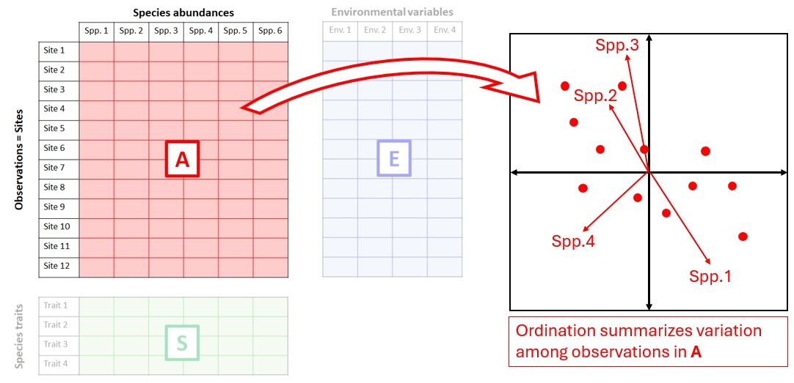
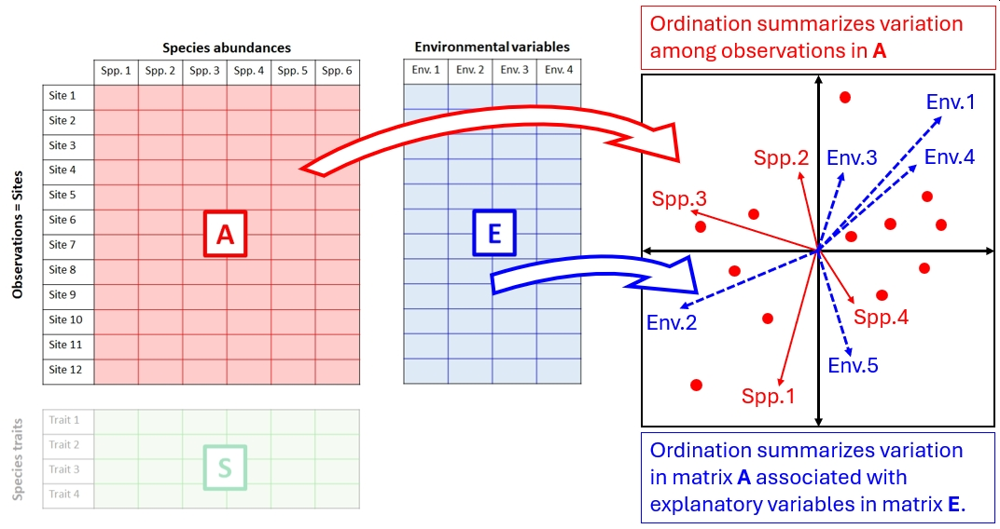

# Ordination {#sec-ord}

## Introduction {#sec-ord-intro}

Humans are visual creatures, relying much more on their sense of vision than other senses like smell for understanding the world. When’s the last time you smelled a dataset? 

Unfortunately, humans are also creatures of 3 spatial dimensions, and that severely limits our ability to “see” patterns in data. Even if patterns in data might exist clearly in 4 or 5 dimensions, our primate brains just won’t see those patterns. Instead, we need ways to bring those high-dimensional patterns down to 3 or fewer. Or, ways to bring 3 dimensional patterns down to 1 or 2, for ease of interpretation. These practices all fall under the umbrella of **dimension reduction**. One very powerful set of techniques for dimension reduction is **ordination**. A good ordination will reveal previously unseen (or unseeable) patterns in data, allow cluster identification, or even show gradients in the data that researchers didn't know they were looking for.

**Ordination** is literally ordering observations along two or more axes. We put observations in order by translating them into a new coordinate system. How that translation is done varies wildly among ordination techniques. No matter how they work, all ordination methods have the same goal: representing patterns in fewer dimensions than there are variables. This makes ordination an approach to **exploratory data analysis**. Most ordination techniques allow to better see patterns, but they are not inferential tests themselves. 

![Ordination describes observations using a new coordinate system. (Left) Observations are positioned according to their values for two original variables. (Middle) A new coordinate system is defined using axes oriented differently from the original variables. (Right) The observations are represented relative to the new axes, revealing a major gradient of variation along Ordination Axis 1. In this simplified example, the number of dimensions remains unchanged, but the observations could be reasonably summarized using only the first ordination axis.](../images/ord-basicidea.jpg){#fig-ord-basicidea fig-alt="Illustration of ordination as a change in coordinate systems. Left: Observations plotted against two original variables form a diagonal pattern. Middle: A new, rotated coordinate system is superimposed on the observations. Right: The same observations are plotted relative to the new axes, with most variation occurring along Ordination Axis 1."}

The applications of ordination overlap with those of the multivariate techniques that we have already seen:

1. **Dimension reduction:** Summarizing variation across many variables using a smaller number of synthetic axes, making complex multivariate datasets easier to visualize and interpret.
1. **Gradient discovery:** Identifying major patterns of variation among observations, which may represent underlying biological or environmental gradients.
1. **Group identification:** Visualizing similarities and differences among observations, including identifying potential clusters of observations that share similar characteristics.

These goals are not mutually exclusive. Dimension reduction is accomplished by finding gradients in the data that are not necessarily equivalent to any of the original variables. The first is what ordination does mathematically; the second is often what we hope to find biologically. Group identification can occur when we find observations forming clusters in an ordination plot, which is itself created by plotting observations against the latent gradients identified by the algorithm. The connection to [clustering](#sec-clust) from the previous chapter should be obvious.

### Ordination terminology {#sec-ord-terms}

Ordination is a very different approach to statistics than we have seen so far in this course. We have largely stepped outside of the world of modeling and hypothesis testing, because most ordination methods are not hypothesis tests. But, we are still using many of the building blocks of inferential statistics that we have already learned. For example, the concepts of variance and covariance are of central importance in many ordination techniques.

One of the biggest changes is that we need to start thinking of *variables* as being equivalent to **axes**. This is directly related to the notion of (spaces and coordinate systems)[#sec-diss-space-coord] that we explored in @sec-diss. The dataset defines one coordinate systemThis is somewhat similar to how in @sec-diss we started thinking of observations as equivalent to **vectors**. 

### Types of ordination {#sec-intro-types}

There are many methods of ordination, which differ in how they construct ordination axes and what kinds of patterns they are designed to reveal. We can classify these methods in two ways: whether the ordination is constrained by explanatory variables, and how the ordination axes are calculated.

#### Constrained vs. unconstrained ordination {#sec-intro-types-constraint}

In **unconstrained ordination**, the axes are calculated from the variation among observations without using external explanatory variables. For example, we might use measurements of several morphological traits to ordinate specimens, allowing us to identify major patterns of morphological variation. We could then investigate whether those patterns correspond to differences among species, habitats, or other characteristics. @fig-ord-unconstrained below shows how an unconstrained ordination is constructed using the [A-E-S matrix schema](#fig-multi-tables) that we saw in @sec-mdata-matrices.

{#fig-ord-unconstrained fig-alt="Diagram showing a species abundance matrix (A) with a red arrow pointing toward an ordination plot containing observations and species vectors. The environmental variable matrix (E) and species trait matrix (S) are faded to indicate that they do not contribute to the ordination."}

In **constrained ordination**, the axes are constructed to represent variation associated with one or more explanatory variables. For example, we might use environmental variables such as temperature, precipitation, and elevation to explain variation in species composition across sites. Rather than simply finding the major patterns of variation in species composition, constrained ordination focuses on the portion of that variation that can be explained by the environmental variables.

{#fig-ord-constrained fig-alt="Diagram showing a species abundance matrix (A) and an environmental variable matrix (E), both contributing to an ordination plot through red and blue arrows, respectively. The ordination contains observations, species vectors, and environmental vectors. The species trait matrix (S) is faded to indicate that it does not contribute to the analysis."}

Constrained ordination is often called canonical ordination, particularly in ecology. The term **canonical** refers to mathematical methods that identify relationships between sets of variables, as in canonical correlation analysis. In ecological applications, canonical ordination generally refers to methods that construct ordination axes using explanatory variables. However, the term has a broader mathematical meaning and is not always synonymous with constrained ordination.

#### Eigenanalysis vs. optimization {#sec-intro-types-calc}

Ordination methods also differ in the mathematical procedures used to construct their axes.

Some methods, including principal components analysis (PCA) and principal coordinates analysis (PCoA), use **eigenanalysis**: mathematical procedures that decompose a matrix into eigenvalues and eigenvectors. In linear algebra, an **eigenvector** is a vector whose direction is not changed by a linear transformation. An **eigenvalue** describes how an eigenvector is scaled by the transformation (see [this video](https://www.youtube.com/watch?v=PFDu9oVAE-g) for visual explanation). Mathematically, we can write

$$\mathbf{A}\vec{v}=\lambda\vec{v}$$

where $\mathbf{A}$ is the matrix that describes a linear transformation, $\vec{v}$ is an eigenvector, and $\lambda$ is an eigenvalue. Again, go watch [this video](https://www.youtube.com/watch?v=PFDu9oVAE-g).

In @fig-ord-basicidea, the red vectors in the center panel are the eigenvectors which will define the axes of the ordination space. An The eigenvectors are used to construct ordination axes, while the eigenvalues describe the amount of variation represented by those axes. These methods generally produce a solution directly through matrix calculations.

Other methods use **numerical optimization**, an iterative process that searches for a configuration of observations that best satisfies a particular criterion. For example, nonmetric multidimensional scaling (NMDS) arranges observations in a low-dimensional space so that the ranked distances between observations correspond as closely as possible to their ranked dissimilarities in the original dataset. The algorithm repeatedly adjusts the positions of observations to minimize a measure of disagreement called stress.

Both approaches produce ordinations, but they differ in what their axes represent and how faithfully they preserve relationships in the original dataset.  In methods such as PCA, the ordination axes are calculated as linear combinations of the original variables, allowing us to interpret each axis in terms of those variables. Other eigenanalysis methods, such as PCoA, derive their axes from a distance matrix rather than directly from the original variables.

In optimization-based methods such as NMDS, the axes do not have a direct mathematical relationship with the original variables. Instead, the objective is to arrange observations so that distances between them in the ordination space reproduce the ranked dissimilarities in the original dataset as closely as possible. Consequently, an NMDS configuration can be rotated or reflected without changing its meaning, because the relationships among observations remain unchanged. In fact, in `vegan::metaMDS()`, which performs NMDS, the default post-processing includes rotating the configuration so that its first axis aligns with the direction of maximum variance. Although an eigenanalysis-based configuration can also be rotated, doing so generally changes the mathematical interpretation of its axes. For example, rotating a PCA configuration would mean that the first axis no longer necessarily represents the direction of maximum variance.


| Method | Constrained? | Main computational approach |
|---|---|---|
| Principal components analysis (PCA) | No | Eigenanalysis / SVD |
| Principal coordinates analysis (PCoA) | No | Eigenanalysis |
| Nonmetric multidimensional scaling (NMDS) | No | Iterative optimization |
| Redundancy analysis (RDA) | Yes | Regression + eigenanalysis |
| Canonical correspondence analysis (CCA) | Yes | Weighted regression + eigenanalysis |
| Distance-based redundancy analysis (dbRDA) | Yes | Distance-based eigenanalysis + regression |
| Linear discriminant analysis (LDA) | Yes | Generalized eigenanalysis |

: Comparison of common ordination methods, indicating whether the ordination is constrained by explanatory variables and the primary mathematical approach used to calculate the ordination axes. {#tbl-ordination-methods}

## Principal components analysis (PCA) {#sec-ord-pca}


### Introduction {#sec-ord-un-pca-intro}
The first and probably most commonly used ordination technique is **principal component analysis (PCA)**. It works  by finding synthetic gradients that capture most the variation between the observations more efficiently than the original variables. These gradients are calculated by finding linear combinations of the variables. These combinations really define a *rotation*, a kind of linear transformation, of the the original coordinate system. There are an infinite number of ways that we could apply a linear transformation to the data; the principal components are just the eigenvectors of the transformation captures the greatest variance on the first axis; the second greatest variance on the second axis, and so on. 

### What PCA does {#sec-ord-un-pca-what}

To get an intuitive understanding of PCA, work through it using an imaginary dataset with two variables, *Variable 1* and *Variable 2*. You could capture and display all the information about this dataset in a 2-d scatterplot, by simply plotting one variable against the other. Likewise, you could capture and display all of the information about a 3-dimensional dataset with a 3-d plot. For 4 or more dimensions, a true scatterplot can’t be rendered sensibly or even understood by our meat-based brains.

```{r}
#| echo: FALSE
#| fig.width: 8
#| fig.height: 8
#| fig-cap: "Scatterplot of a hypothetical dataset containing two positively correlated variables. The observations form an elongated cloud of points, illustrating a pattern that can be summarized using principal component analysis (PCA)."
#| fig-alt: "Scatterplot of Variable 1 on the horizontal axis and Variable 2 on the vertical axis. Approximately 50 black points form an elongated cloud trending upward from lower left to upper right, indicating a positive relationship between the variables."
#| label: fig-pca-explain1


set.seed(123)
n <- 50
x <- runif(n, 1, 20)
y <- 1.2 + 1.7*x + rnorm(n, 0, 8)
x.orig <- x
y.orig <- y

par(mfrow=c(1,1), mar=c(5.1, 5.1, 1.1, 1.1),
    lend=1, las=1, bty="n",
    cex.lab=1.3, cex.axis=1.3)
plot(x, y, xlab="Variable 1", ylab="Variable 2",
    xlim=c(0, 20), ylim=c(-10, 50), pch=16, cex=1.2)
``` 

One way to describe the variation among the observations in @fig-pca-explain1 is to think about how the samples vary along each axis. The figure below shows how the variation among samples can be broken down into the variation in Variable 1 and the variation in Variable 2. When we say “variation in variable 1”, we mean “deviation between the values of variable 1 and the mean of variable 1”. That is what is shown in @fig-pca-explain2 below.

- Each point, or sample, has a Variable 1 coordinate and a Variable 2 coordinate.
- Each point’s value for Variable 1 can be thought of as the difference between that value and the mean of Variable 1.
- Likewise, each point’s value for Variable 2 can be thought of as the difference between that value and the mean of Variable 2.
- The position of each point can thus be reframed as its deviation with respect to the Variable 1, and its deviation with respect to Variable 2. This reframing is the same as centering each variable (i.e., subtracting the mean).
- The total variance among the samples is equal to the variance with respect to Variable 1 plus the variance with respect to Variable 2.

```{r}
#| echo: false
#| fig.width: 10
#| fig.height: 5
#| fig-cap: "Variation in two variables in a hypothetical dataset. The left panel shows horizontal deviations from the mean of Variable 1 (red), while the right panel shows vertical deviations from the mean of Variable 2 (blue). The sums of squared deviations are 1531.9 and 8020.7, respectively, indicating greater variation in Variable 2."
#| fig-alt: "Two scatterplots of the same hypothetical dataset. In the left panel, red horizontal lines connect each observation to the mean of Variable 1, shown by a vertical dashed red line. In the right panel, blue vertical lines connect each observation to the mean of Variable 2, shown by a horizontal dashed blue line. The sums of squared deviations are 1531.9 for Variable 1 and 8020.7 for Variable 2."
#| label: fig-pca-explain2

ymin <- min(y)
ymax <- max(y)
ymu <- mean(y)
xmin <- min(x)
xmax <- max(x)
xmu <- mean(x)

par(mfrow=c(1,2), mar=c(5.1, 5.1, 1.1, 1.1),
    lend=1, las=1, bty="n",
    cex.lab=1.1, cex.axis=1.1)
plot(x, y, xlab="Variable 1", ylab="Variable 2",
    xlim=c(0, 20), ylim=c(-10, 50),
    type="n")
segments(xmu, ymin, xmu, ymax, lwd=3, col="red", lty=2)
segments(xmu, y, x, y, lwd=2, col="red")
points(x, y, pch=16, cex=1.1)
text(12, 10, "Variation in variable 1", adj=0, col="red", cex=1.1, xpd=NA)
text(12, 0, expression(sum((x[i]-bar(x))^2, italic(i)==1, italic(n))==1531.9),
    adj=0, col="red", cex=1.1, xpd=NA)
plot(x, y, xlab="Variable 1", ylab="Variable 2",
    xlim=c(0, 20), ylim=c(-30, 60),
    type="n")
segments(xmin, ymu, xmax, ymu, lwd=3, col="blue", lty=2)
segments(x, ymu, x, y, lwd=2, col="blue")
points(x, y, pch=16, cex=1.1)
text(9, -5, "Variation in variable 2", adj=0, col="blue", cex=1.1)
text(9, -15, expression(sum((y[i]-bar(y))^2, italic(i)==1, italic(n))==8020.7),
    adj=0, col="blue", cex=1.1, xpd=NA)
```

@fig-pca-explain2 above shows how the total variation in the dataset is split up (“partitioned”) into variation in Variable 1 and variation in Variable 2.

Describing each observation as its deviation from the mean of each variable has the effect of **centering** the points at the origin. Notice that the variation, expressed as sums of squared deviations, is unchanged (@fig-pca-explain3). 

@fig-pca-explain3 below shows the data as deviations from the means of each variable. Notice that the variation is each direction is unchanged from @fig-pca-explain2.

```{r}
#| echo: false
#| fig.width: 10
#| fig.height: 5
#| fig-cap: "Variation in two variables after centering the hypothetical dataset by subtracting the mean of each variable. Horizontal red lines (left) and vertical blue lines (right) show deviations from the respective variable means, now located at zero. Centering changes the coordinates of the observations but not the sums of squared deviations."
#| fig-alt: "Two scatterplots of the same mean-centered dataset, with observations forming an upward-trending cloud around the origin. In the left panel, red horizontal lines show deviations from the mean of Variable 1, now at zero, with a sum of squares of 1531.9. In the right panel, blue vertical lines show deviations from the mean of Variable 2, also at zero, with a sum of squares of 8020.7."
#| label: fig-pca-explain3


x <- as.numeric(scale(x, scale=FALSE))
y <- as.numeric(scale(y, scale=FALSE))

ymin <- min(y)
ymax <- max(y)
ymu <- mean(y)
xmin <- min(x)
xmax <- max(x)
xmu <- mean(x)

par(mfrow=c(1,2), mar=c(5, 5, 1, 1),
    lend=1, las=1, bty="n",
    cex.lab=1.1, cex.axis=1.1)
plot(x, y, xlab="Variable 1", ylab="Variable 2",
    xlim=c(-10, 10), ylim=c(-40, 40),
    type="n")
segments(xmu, ymin, xmu, ymax, lwd=3, col="red", lty=2)
segments(xmu, y, x, y, lwd=2, col="red")
points(x, y, pch=16, cex=1.1)
text(1, -20, "Variation in variable 1", adj=0, col="red", cex=1.1, xpd=NA)
text(1, -30, expression(sum((x[i]-bar(x))^2, italic(i)==1, italic(n))==1531.9),
    adj=0, col="red", cex=1.1, xpd=NA)
plot(x, y, xlab="Variable 1", ylab="Variable 2",
    xlim=c(-10, 10), ylim=c(-40, 40),
    type="n")
segments(xmin, ymu, xmax, ymu, lwd=3, col="blue", lty=2)
segments(x, ymu, x, y, lwd=2, col="blue")
points(x, y, pch=16, cex=1.1)
text(-1, -20, "Variation in variable 2", adj=0, col="blue", cex=1.1)
text(-1, -30, expression(sum((y[i]-bar(y))^2, italic(i)==1, italic(n))==8020.7),
    adj=0, col="blue", cex=1.1, xpd=NA)
```

Next, we **standardize** each variable to have a variance of 1. This means that the original values are converted to Z-scores by subtracting the mean and dividing by the SD (i.e., they are **z-scaled**). Recall from @sec-trans-common-zscore that the *z*-score of an observation $x$ is

$$z\left(x\right)=\frac{x-\mu}{\sigma}$$

Doing PCA without standardizing variables will distort the results because each variable's importance in the PCA will depend on its magnitude, not its relationship to other variables. Standardization puts variation along any axis on equal footing. @fig-pca-explain4 shows the data as deviations from the variable means after standardization. Compare this figure to @fig-pca-explain3 above. All that changed are the axis scales and the sum of squared deviations. Note that the sums of squares are equal for both variables now.

```{r}
#| echo: false
#| fig.width: 10
#| fig.height: 5
#| fig-cap: "Variation in two variables after centering and standardizing the hypothetical dataset. Horizontal red lines (left) and vertical blue lines (right) show deviations from the respective variable means, now zero. Standardization gives both variables a standard deviation of one, resulting in equal sums of squared deviations (49) despite their different original variances."
#| fig-alt: "Two scatterplots of the same standardized dataset, with observations forming an upward-trending cloud centered at the origin. In the left panel, red horizontal lines show deviations from the mean of Variable 1, with a sum of squares of 49. In the right panel, blue vertical lines show deviations from the mean of Variable 2, also with a sum of squares of 49. Both variables now range approximately from minus two to plus two."
#| label: fig-pca-explain4


x <- as.numeric(scale(x.orig))
y <- as.numeric(scale(y.orig))

ymin <- min(y)
ymax <- max(y)
ymu <- mean(y)
xmin <- min(x)
xmax <- max(x)
xmu <- mean(x)

par(mfrow=c(1,2), mar=c(5.1, 5.1, 1.1, 1.1),
    lend=1, las=1, bty="n",
    cex.lab=1.1, cex.axis=1.1)
plot(x, y, xlab="Variable 1", ylab="Variable 2",
    xlim=c(-2, 2), ylim=c(-2.5, 2.5),
    type="n")
segments(xmu, ymin, xmu, ymax, lwd=3, col="red", lty=2)
segments(xmu, y, x, y, lwd=2, col="red")
points(x, y, pch=16, cex=1.1)
text(0.2, -1, "Variation in variable 1", adj=0, col="red", cex=1.1, xpd=NA)
text(0.2, -1.75, expression(sum((x[i]-bar(x))^2, italic(i)==1, italic(n))==49),
    adj=0, col="red", cex=1.3, xpd=NA)
plot(x, y, xlab="Variable 1", ylab="Variable 2",
    xlim=c(-2, 2), ylim=c(-2.5, 2.5),
    type="n")
segments(xmin, ymu, xmax, ymu, lwd=3, col="blue", lty=2)
segments(x, ymu, x, y, lwd=2, col="blue")
points(x, y, pch=16, cex=1.1)
text(-0.2, -1, "Variation in variable 2", adj=0, col="blue", cex=1.1)
text(-0.2, -1.75, expression(sum((y[i]-bar(y))^2, italic(i)==1, italic(n))==49),
    adj=0, col="blue", cex=1.1, xpd=NA)
```

The goal of PCA is to find a new coordinate system that puts the most variance possible on its first axis, then the second most variance on its second axis, and so on. This new coordinate system will have the same number of dimensions as the original dataset. But whereas in the standardized dataset all variables (axes) have the same amount of variation associated with them, in the PCA coordinate system some axes will explain more variation than others. 

The variation among the observations is defined in terms of Variable 1 and Variable 2, and Variable 1 and Variable 2 contributed equally to the total variation. But, we could describe most of the variation between points with just one variable, or axis, the red line (@fig-pca-explain5). Any remaining variation will be in the direction perpendicular to the red axis, the blue axis (dashed line). 

```{r}
#| echo: false
#| fig.width: 8
#| fig.height: 8
#| fig-cap: "Principal component axes for the standardized hypothetical dataset. The first principal component (solid red line) follows the direction of greatest variation among observations, while the second principal component (dashed blue line) is perpendicular to the first and represents the remaining variation."
#| fig-alt: "Scatterplot of standardized Variable 1 and Variable 2, with approximately 50 black points forming an elongated cloud trending upward from left to right. A solid red line passes through the origin along the long axis of the point cloud, representing PC1. A dashed blue line passes through the origin perpendicular to the red line, representing PC2."
#| label: fig-pca-explain5

########### illustrate rotation to PCs
fit1 <- lm(y~x)
mod1 <- coef(fit1)

# get coefficients for model
beta0 <- mod1[1]
beta1 <- mod1[2]
alpha1 <- (-1)/beta1
alpha0 <- 0-alpha1*0

# plot with arrows
# note: will not be perpendicular unless axes are the same!
par(mfrow=c(1,1), mar=c(5.1, 5.1, 1.1, 1.1),
    lend=1, las=1, bty="n",
    cex.lab=1.1, cex.axis=1.1)
plot(x, y, xlab="Variable 1", ylab="Variable 2",
    xlim=c(-2.5, 2.5), ylim=c(-2.5, 2.5),
    type="n")
points(x, y, pch=16, cex=1.1)
red1 <- -2
red2 <- 2
segments(red1, beta0+beta1*(red1), 
    red2, beta0+beta1*red2, 
    lwd=3, col="red")
blue1 <- -1
blue2 <- 1
segments(blue1, alpha0 + alpha1*blue1,
         blue2, alpha0 + alpha1*blue2,
         lwd=3, col="blue", lty=2)
```

The red axis is a vector that contains information about both Variable 1 and Variable 2. It is tricky, but not too hard, to calculate each observation’s deviations from the mean of the red axis (left panel below) (@fig-pca-explain6). We can also calculate the deviations along a perpendicular vector, because even after describing the variation in the red direction, there is still some variation in the blue direction (right panel).

```{r}
#| echo: false
#| fig.width: 10
#| fig.height: 5
#| fig-cap: "Variation along the two principal component axes of the standardized hypothetical dataset. Dashed lines show the projections of observations onto PC1 (red, left panel) and PC2 (blue, right panel). The sum of squared deviations is much greater along PC1 (88.01) than PC2 (9.99), illustrating how PCA identifies the direction of greatest variation and a perpendicular axis accounting for the remaining variation."
#| fig-alt: "Two scatterplots of the same standardized dataset, showing approximately 50 black points and two perpendicular principal component axes. In the left panel, dashed red lines project observations onto the solid red PC1 axis, which slopes upward from left to right. In the right panel, dashed blue lines project observations onto the solid blue PC2 axis, which slopes downward from left to right. The sums of squared deviations along PC1 and PC2 are 88.01 and 9.99, respectively."
#| label: fig-pca-explain6


## for each point, need dy, height between PC1 and point
dy <- y-(beta0 + beta1 * x)

## each point intersects with a line perpendicular to PC1:
## y = alpha0 + alpha1*x = (dy + beta0) + beta1 * x
## let slope of perpendicular line = alpha1 = -1/beta1
alpha1 <- -1/beta1
## let intercept of perpendicular line = alpha0
alpha0 <- (dy+beta0) + beta1*x - alpha1*x

# the lines defined by alpha0 and alpha1 intersect with PC1 at
# x coordinates intx and y coordinates inty
intx <- (beta0-alpha0)/(alpha1-beta1) 
inty <- beta0 + beta1*intx

# intercepts for line parallel to PC1 (intersect PC1)
b0.vec <- dy + beta0

# points where parallel lines and PC2 intercept
## intercept of PC2
a0dot <- (beta0+beta1*x)/(alpha1*x)


###for(i in 1:n){abline(b0.vec[i], beta1, col="green")}
## x coordinates of intersections
xint1 <- (alpha0-b0.vec)/(beta1-alpha1)
yint1 <- alpha0 + alpha1*xint1
###points(xint, yint, pch=17, col="purple")

# add variation along PC2
## intercepts for lines passing though each point
a0.vec <- y-alpha1*x
###for(i in 1:n){abline(a0.vec[i], alpha1, col="green")}

## x coordinates of intersections
xint2 <- (beta0-a0.vec)/(alpha1-beta1)
yint2 <- beta0+beta1*xint2


# put it all together
dy <- y-(beta0 + beta1 * x)
alpha1 <- -1/beta1
alpha0 <- (dy+beta0) + beta1*x - alpha1*x
intx <- (beta0-alpha0)/(alpha1-beta1) 
inty <- beta0 + beta1*intx

intx2 <- (dy+beta0)/(alpha1-beta1)
inty2 <- alpha1*intx2

#sum(((x-intx)^2) + ((y-inty)^2))
#sum(((x-intx2)^2) + ((y-inty2)^2))

xred <- c(-3, 3)
yred <- c(-3, 3)

use.cex <- 0.9
par(mfrow=c(1,2), mar=c(5.1, 5.1, 1.1, 1.1),
    lend=1, las=1, bty="n",
    cex.lab=1.1, cex.axis=1.1)
plot(x, y, xlab="Variable 1", ylab="Variable 2",
    xlim=c(xred[1], xred[2]), ylim=c(yred[1], yred[2]),
    type="n")
segments(xred[1], beta0+beta1*(xred[1]), 
    xred[2], beta0+beta1*xred[2], 
    lwd=3, col="red")
segments(blue1, alpha1*blue1,
    blue2, alpha1*blue2,
    lwd=3, col="blue")
segments(x, y, intx2, inty2, lwd=2, col="red", lty=2)
points(x, y, pch=16, cex=1.2)
text(xred[1], -2.8, "Variation in red direction", col="red", adj=0, cex=use.cex)
text(xred[2], -2.8,
    expression(sum((italic(red[i])-bar(italic(red)))^2, italic(i)==1, italic(n))==88.01),
    adj=1, col="red", cex=use.cex)

plot(x, y, xlab="Variable 1", ylab="Variable 2",
    xlim=c(xred[1], xred[2]), ylim=c(yred[1], yred[2]),
    type="n")
segments(xred[1], beta0+beta1*(xred[1]), 
    xred[2], beta0+beta1*xred[2], 
    lwd=3, col="red")
segments(blue1, alpha1*blue1,
    blue2, alpha1*blue2,
    lwd=3, col="blue")
segments(x, y, intx, inty, lwd=2, col="blue", lty=2)
points(x, y, pch=16, cex=1.2)
text(xred[1], -2.8, "Variation in blue direction", col="blue", adj=0, cex=use.cex)
text(xred[2], -2.8,
    expression(sum((italic(blue[i])-bar(italic(blue)))^2, italic(i)==1, italic(n))==9.99),
    adj=1, col="blue", cex=use.cex)
```

We know that the variation along the red and blue axes is the same as the variation on the Variable 1 and Variable 2 axes, because the sums of squares are the same ($76.6 + 21.4 = 49 + 49$) . The red and blue axes are just different ways of orienting the data to express the same patterns. All we really did was rotate the original coordinate system (defined by Variables 1 and 2) to a new coordinate system (@fig-pca-explain7).

```{r}
#| echo: false
#| fig.width: 10
#| fig.height: 5
#| fig-cap: "Rotation of the coordinate system in principal component analysis (PCA). The left panel shows the original standardized variables and their coordinate grid (gray), overlaid with the new principal component axes (red for PC1, blue for PC2) and their rotated grid lines. The right panel shows the same observations expressed in the new coordinate system, with PC1 and PC2 as the horizontal and vertical axes, respectively. The rotation preserves the relative positions and distances among observations while concentrating most of the variation along PC1."
#| fig-alt: "Two scatterplots illustrating a rotation of coordinate axes. The left panel shows black observations on the original Variable 1 and Variable 2 axes, with a gray grid and diagonal red and blue grid lines representing the principal component coordinate system. Thick red and blue lines mark PC1 and PC2. The right panel shows the same observations in the rotated coordinate system, with PC1 horizontal and PC2 vertical. Most of the spread is now horizontal along PC1, while relatively little variation remains along PC2."
#| label: fig-pca-explain7


xred <- c(-3, 3)
yred <- c(-3, 3)

use.cex <- 0.9
par(mfrow=c(1,2), mar=c(5.1, 5.1, 1.1, 1.1),
    lend=1, las=1, bty="n",
    cex.lab=1.1, cex.axis=1.1)
plot(x, y, xlab="Variable 1", ylab="Variable 2",
    xlim=c(xred[1], xred[2]), ylim=c(yred[1], yred[2]),
    type="n")
grid1 <- seq(-3, 3, length=10)
segments(grid1, -3, grid1, 3, col="grey60")
segments(-3, grid1, 3, grid1, col="grey60")

gxred <- seq(-10, 10, by=1)

segments(-3, beta0+beta1*(-3)+gxred,
         3, beta0+beta1*(3)+gxred, col="red")
segments(-3, alpha1*(-3)+gxred,
         3, alpha1*(3)+gxred, col="blue")

segments(xred[1], beta0+beta1*(xred[1]), 
    xred[2], beta0+beta1*xred[2], 
    lwd=5, col="red")
segments(blue1, alpha1*blue1,
    blue2, alpha1*blue2,
    lwd=5, col="blue")
points(x, y, pch=16, cex=1.2)

plot(x, y, xlab="PC1", ylab="PC2",
    xlim=c(-4, 4), ylim=c(-4, 4),
    type="n")
grid2 <- seq(-4, 4, length=10)
segments(grid2, -4, grid2, 4, col="blue")
segments(-4, grid2, 4, grid2, col="red")

theta <- atan(0.813)

# Rotate observations into PC coordinates
pc1 <- x * cos(theta) + y * sin(theta)
pc2 <- -x * sin(theta) + y * cos(theta)

# Right panel
points(pc1, pc2, pch=16, cex=1.2)

# Function to rotate coordinates
rotate <- function(x, y, theta) {
  data.frame(
    x = x * cos(theta) + y * sin(theta),
    y = -x * sin(theta) + y * cos(theta)
  )
}

# Original grid: vertical lines (constant x)
for (a in seq(-6, 6, by=1)) {
  p <- rotate(c(a, a), c(-6, 6), theta)
  lines(p$x, p$y, col="grey60", lwd=0.5)
}

# Original grid: horizontal lines (constant y)
for (b in seq(-6, 6, by=1)) {
  p <- rotate(c(-6, 6), c(b, b), theta)
  lines(p$x, p$y, col="grey60", lwd=0.5)
}


```

### Example using `vegan` {#sec-ord-pca-example}

#### Data import and preparation {#sec-ord-pca-example-data}

For an example PCA analysis, let's revisit the small mammal measurement data from @sec-clust-kmeans-example. Download the [individual measurement dataset](../datasets/data-neon-ind-meas.csv) and the [taxonomic dataset](../datasets/data-neon-taxa.csv) and put them in your working directory.

```{r}
#| include: false
tax <- read.csv("../datasets/data-neon-taxa.csv")
ind <- read.csv("../datasets/data-neon-ind-meas.csv")

```

```{r}
#| eval: false
tax <- read.csv("data-neon-taxa.csv")
ind <- read.csv("data-neon-ind-meas.csv")
```

We are going to use PCA to explore variation in small mammal morphology. First we need to organize the data. Cut the measurement data down to just the columns we need: individual, species, body mass, and the four standard measurements. 

```{r}
use.cols <- c("tagID", "abb", "totalLength",
              "tailLength", "hindfootLength",
              "earLength", "weight")
dx <- ind[,use.cols]

# only want individuals with no missing measurements
dx <- dx[complete.cases(dx),]
```

How many individuals do we have of each species?

```{r}
rev(sort(table(dx$abb)))
```

There is quite a wide range of numbers of individuals between species. To prevent the species with many individuals from having too much influence over the analysis, let's randomly select 50 individuals from every species with at least 50 individuals. That will give us 16 species. Note that this is not what we would do in a real analysis. Instead, this is just a strategy to make the ordination easier to understand as a teaching example. If you want to do the example with all individuals, just uncomment the line indicated below.

```{r}
set.seed(7410)

sp <- names(which(table(dx$abb) >= 50))
out <- vector("list", length(sp))

for (i in seq_along(sp)) {
  d <- dx[dx$abb == sp[i], ]
  out[[i]] <- d[sample(nrow(d), 50), ]
}

dx.pca <- do.call(rbind, out)

# if you want to try the analysis with all
# of the species, uncomment and run this line:
#dx.pca <- dx

dx.pca <- merge(dx.pca, tax[,c("abb", "species", "family")])

table(dx.pca$species)
```

How many families do we have, and how many specie each?
```{r}
table(dx.pca$family)
```

#### Fit the PCA {#sec-ord-pca-example-pca}
 
We will use package `vegan` for ordination. Load it and run the PCA. We will leave body mass out of the ordination for now...that will be important [later](#sec-ord-pca-example-out).

Use argument `scale=TRUE` to standardize the variables first. The default in `vegan::pca` is to not scale the variables, because that usually isn't necessary (or even sensible) with the default distance measure.

```{r}
library(vegan)

pca.cols <- c("totalLength", "tailLength",
              "hindfootLength", "earLength")
p1 <- pca(dx.pca[,pca.cols], scale=TRUE)
summary(p1)
```

The result shows us that PC1 explains about 75.3% of the variation in measurements. PC2 adds another 17.1%. Just the first two PCs account for 92.4% of the variation. Because we are ordinating on measurements, and the first PC captures a large percentage of the variation, there is a good chance that the first PC is capturing a size gradient (as we saw in @fig-kmeans-mice-pca4).


#### Plot the PCA {#sec-ord-pca-example-biplot}

The `plot` and `biplot` methods for `pca` objects will produce a quick graph, but it's not very helpful. I prefer to extract the useful parts of the results and build a plot using base graphics.

What we need are the PC scores of the observations and the biplot arrows of the original variables. The "scores" are what we call the coordinates in the PC coordinate system. The positions of the observations in the ordination space reflect their similarity and dissimilarity relative to each other. The biplot arrows start at the origin and show the relationship between the original variables and the ordination space. You can think of them as the "shadows" you would get if you projected the original axes onto the plane of the figure (remember that we obtained the PCA space by rotating the original space).

First, let's assign some colors and shapes to the species and families. This will help us make sense of the ordination plot.

```{r}
spps <- sort(unique(dx.pca$species))
fams <- sort(unique(dx.pca$family))

col.spps <- hcl.colors(length(spps), palette = "Dark 3")
col.fams <- hcl.colors(length(fams), palette = "Dark 3")
pch.fams <- 15:18

names(col.spps) <- spps
names(col.fams) <- fams
names(pch.fams) <- fams
```

Next, we extract the scores of the observations. The ordination scores can be calculated in one of two ways, referred to as **scaling** (see @sec-ord-pca-example-biplot-scaling). For examining clusters of observations, we should use scaling 1. The function `scores()` will extract the scores we need. Note that in ordination functions in package `vegan`, observations are always referred to as `sites`, and variables as `species`. This is a result of the origin of `vegan` in community ecology.


```{r}
#| fig.width: 8
#| fig.height: 9
#| fig-cap: "PCA biplot of four standardized morphological measurements from 16 small mammal species, using scaling type 1 (distance scaling). Each point represents an individual specimen, with colors and symbols identifying species. PC1 explains 75.3% of the variation and PC2 explains 17.1%. Black vectors indicate the directions in which total length, tail length, hindfoot length, and ear length increase. Scaling type 1 emphasizes distances among specimens rather than correlations among morphological variables."
#| fig-alt: "PCA biplot showing individual specimens from 16 small mammal species, distinguished by colored symbols. PC1 (horizontal, 75.3%) separates specimens primarily along a body-size gradient, while PC2 (vertical, 17.1%) distinguishes specimens partly by ear length. Black vectors for total length, tail length, and hindfoot length point toward the lower left and overlap considerably. The ear-length vector points steeply upward and slightly left. Species form several recognizable clusters, including Rattus rattus at far left and Peromyscus truei toward the upper center."
#| label: fig-pca-pca-neon1

# extract scores with scaling 1
xy.samp1 <- scores(p1, display="sites",
                  choices=1:2, scaling=1)
xy.vars1 <- scores(p1, display="species",
                  choices=1:2, scaling=1)

par(mar=c(5,5,7,1), bty="n", xpd=NA)
plot(xy.samp1[,1], xy.samp1[,2],
     pch=pch.fams[dx.pca$family],
     col=col.spps[dx.pca$species],
     xlab="PC1 (75.3%)", ylab="PC2 (17.1%)")
# shorten the biplot vectors to fit on the plot area
scal <- 0.04
segments(0, 0, scal*xy.vars1[,1], scal*xy.vars1[,2], lwd=2)
# move the biplot labels out by 2%
moveout <- 1.02
text(moveout*scal*xy.vars1[,1], moveout*scal*xy.vars1[,2],
     rownames(xy.vars1), cex=1.2)
legend(-0.9, 0.45, legend=spps,
       col=col.spps,
       pch=pch.fams[tax$family[match(spps, tax$species)]],
       ncol=3, 
       text.font=3, bty="n")


```

@fig-pca-pca-neon1 shows that many of the species form recognizable clusters. For example, the brown circles in the bottom left are Ord's kangaroo rat, *Dipodomys ordii*, and that cluster is well separated from the pink circles in the bottom middle, which is its confamilial *Chaetodipus hispidus*, the hispid pocket mouse. On the other hand, all of the *Peromyscus* species (blue and greenish squares) do not separate cleanly from each other and instead form a big mess of overlapping clouds along the right side of the figure. From this we can infer that *D. ordii* and *C. hispidus* are more distinct from each other than the *Peromyscus* species are, despite being in the same family. 

Another pattern we can see is that three of the four morphological variables point to the left and slightly down, almost but not quite parallel to PC1. Ear length points in a different direction, positively correlated with PC2 but negatively with PC1. So we can tentatively interpret PC1 as a gradient representing overall size: animals increase in size from right to left. This pattern is very commonly seen when ordinating morphological measurements. However, with scaling type 1, we cannot interpret angles between vectors as correlations. For that, we need scaling type 2.

Extract the scores and make another biplot, this time with scaling 2.

```{r}
#| fig.width: 8
#| fig.height: 9
#| fig-cap: "PCA biplot of four standardized morphological measurements from 16 small mammal species, using scaling type 2 (correlation scaling). Each point represents an individual specimen, with colors and symbols identifying species. PC1 explains 75.3% of the variation and PC2 explains 17.1%. Black vectors represent the morphological measurements, with their directions and angles emphasizing correlations among variables and their relationships with the principal components. Total length, tail length, and hindfoot length are strongly associated with PC1, while ear length is more strongly associated with PC2."
#| fig-alt: "PCA biplot showing specimens from 16 small mammal species, distinguished by colored symbols. PC1 is horizontal and explains 75.3% of the variation; PC2 is vertical and explains 17.1%. Black vectors for total length, tail length, and hindfoot length point almost horizontally to the left, indicating strong negative correlations with PC1. The ear-length vector points diagonally toward the upper left, indicating a negative correlation with PC1 and a positive correlation with PC2. Rattus rattus specimens cluster at the far left, while Peromyscus truei specimens occupy the upper central region."
#| label: fig-pca-pca-neon2

# extract scores with scaling 1
xy.samp2 <- scores(p1, display="sites",
                  choices=1:2, scaling=2)
xy.vars2 <- scores(p1, display="species",
                  choices=1:2, scaling=2)

par(mar=c(5,5,7,1), bty="n")
plot(xy.samp2[,1], xy.samp2[,2],
     pch=pch.fams[dx.pca$family],
     col=col.spps[dx.pca$species],
     xlab="PC1 (75.3%)", ylab="PC2 (17.1%)")
scal <- 0.2
segments(0, 0, scal*xy.vars2[,1], scal*xy.vars2[,2], lwd=2)
moveout <- 1.03
text(moveout*scal*xy.vars2[,1], moveout*scal*xy.vars2[,2],
     rownames(xy.vars2), cex=1.2, xpd=NA)
legend(-1, 1.1, legend=spps, xpd=NA,
       col=col.spps,
       pch=pch.fams[tax$family[match(spps, tax$species)]],
       ncol=3, 
       text.font=3, bty="n")


```

@fig-pca-pca-neon2 uses scaling 2 instead of scaling 1. The point clouds look largely the same, but notice how the axis scales have changed. Under scaling 2, the angles between the biplot vectors *are* interpretable as correlations between variables. We also see that total length, tail length, and hindfoot length are much closer to parallel with PC1, reflecting their strong loading on that axis. 

##### A note on biplot scaling {#sec-ord-pca-example-biplot-scaling}

You may have noticed that we used the argument `scaling=2` when extracting the scores for the biplot in @fig-pca-pca-neon1. This argument controls how the observation and variable scores are scaled relative to each other.

- In **scaling type 1 (distance scaling)**, the emphasis is on preserving distances among observations. This is useful when comparing observations or identifying clusters. The observation scores preserve Euclidean distances among observations as well as possible in the reduced ordination space. Variable scores are not proportional to their correlations with other variables.
- In **scaling type 2 (correlation scaling)**, the emphasis is on representing relationships among variables. Variable scores are proportional to their correlations with the principal components. Angles between variable vectors approximate correlations among the original variables, assuming the displayed axes adequately represent those variables.

The take-home is that scaling 1 emphasizes distances among observations, while scaling 2 emphasizes correlations among variables. In either case, the variable vectors indicate the directions in which variables increase across the ordination, but angles between vectors should be interpreted as correlations only under scaling 2.

Neither scaling type is inherently better; they emphasize different aspects of the same ordination. For our [first biplot above](#fig-pca-pca-neon1), we used scaling type 1 because we wanted to see relationships between the observations. For the [second biplot](#fig-pca-pca-neon2), we used scaling type 2 because we wanted to interpret the relationships among the morphological measurements and their associations with the principal components.

For example, in @fig-pca-pca-neon1, the vectors for total length and tail length point in nearly the same direction, indicating that these measurements are strongly positively correlated. The angle between total length and ear length is larger, suggesting a weaker positive correlation. These interpretations are approximate because the biplot displays only the first two principal components rather than all four dimensions of the original dataset.

@tbl-pca-scaling sums up the differences between the two scaling types and their typical use cases.

| Feature | Scaling 1 (distance scaling) | Scaling 2 (correlation scaling) |
|---|---|---|
| Primary emphasis | Distances among observations | Correlations among variables |
| Best for | Comparing observations, identifying groups, examining gradients | Interpreting variable relationships and associations with PCs |
| Distances between points | Approximate Euclidean distances in the original data | Distances are distorted by the scaling |
| Angles between variable vectors | Not generally interpretable as correlations | Approximate correlations between variables |

: Comparison of scaling types 1 and 2 for PCA biplots. {#tbl-pca-scaling}

When should you use each scaling? 

**Example use case for scaling 1**: Suppose you want to determine whether the 16 mammal species in fig-pca-pca-neon1 form distinct morphological groups. You could plot the specimens using scaling 1, color them by species or family, and examine their separation. Distances between specimens in the PCA plot approximate their multivariate Euclidean distances, insofar as those distances are represented by the displayed PCs.

**Example use case for scaling 2**: Suppose you want to determine which morphological measurements distinguish those species. You'd use scaling 2 to examine the directions and angles of the measurement vectors. In a scaling 2 biplot, variables strongly correlated with a particular principal component tend to have vectors pointing along that axis. Variables associated with multiple components tend to have vectors pointing between the axes. The coordinates of each vector represent its correlations with the components, up to a common scaling factor.

One subtlety: If you're plotting only observation scores, the choice of scaling usually doesn't matter much visually. Switching between scaling 1 and scaling 2 simply rescales the PC axes; it doesn't change the ordering of observations or the underlying PCA. However, the relative scaling of the axes changes, so distances and apparent group separation can look different.


#### Interpret the principal components {#sec-ord-pca-example-pcs}

Both biplots above, especially @fig-pca-pca-neon2, suggest that PC1 might have something to do with overall size, and that PC2 might describe variation in ear size after body size is accounted for. Let's interpret those possible interpretations. We can explore the possible relationships between the original variables and the PCs in 3 somewhat related ways:

1. **Eigenvector coefficients**: coefficients defining each PC as a linear combination of the original variables. Sometimes called the **variable loadings** but see below.
1. **Contributions of variables to each PC**: which variables contribute the most to each PC (exactly what it sounds like).
1. **Correlations between variables and PCs**: also exactly what it sounds like. Also sometimes called "variable loadings".

##### Eigenvector coefficients {#sec-ord-pca-example-pcs-eigen} 

The **eigenvector coefficients** are the coefficients defining how each principal component is calculated as a linear combination of the original variables. Some people call these coefficients the **variable loadings**, but others use that term to describe the [correlations between the variables and the PCs](#sec-ord-pca-example-pcs-corr).

Recall that a **linear combination** or **linear equation** is one where the result is obtained by multiplying each term by a constant and adding up those products (@sec-review-lin-def). For our PCA with four standardized measurements:

$$PC_1=a_{1,1}Z_1+a_{1,2}Z_2+a_{1,3}Z_3+a_{1,4}Z_4$$

where $Z_i$ are the standardized measurements and $a_{i,j}$ are the eigenvector coefficients for principal component $i$, variable $j$. Principal components 2, 3, and 4 are defined the same way:

$$PC_2=a_{2,1}Z_1+a_{2,2}Z_2+a_{2,3}Z_3+a_{2,4}Z_4$$

$$PC_2=a_{2,1}Z_1+a_{2,2}Z_2+a_{2,3}Z_3+a_{2,4}Z_4$$

$$PC_2=a_{2,1}Z_1+a_{2,2}Z_2+a_{2,3}Z_3+a_{2,4}Z_4$$

We can see the eigenvector coefficients like this:

```{r}
p1$CA$v
```

In this case, all variables contributed to PC1, but PC2 is determined mostly by ear length. PC3 is determined mostly by hindfoot length, and PC4 is determined mostly by total length and tail length. It's worth noting that all four measurements are positively correlated with each other, all though ear length is somewhat less correlated with the others.

```{r}
cor(dx.pca[,pca.cols])
```

This pattern of eigenvector coefficients, together with the correlations between the original variables, supports the interpretation of PC1 as a gradient of overall size. All variables have the same moderate coefficient with respect to PC1 with the same sign, and all variables are positively correlated with each other. Subsequent PCs are primarily affected by 1 or 2 measurements. PC2 is dominated by variation in ear length after accounting for the overall size gradient. PC2 is dominated by variation in hindfoot length after accounting for variation in overall size and ear length. And so on.

##### Variable contributions {#sec-ord-pca-example-pcs-load}

The **variable contributions** to each PC tell us how much of a role each variable plays in defining each PC. They are calculated as the squared eigenvector coefficients, rescaled to be percentages.

```{r}
var.contribs <- 100 * p1$CA$v^2
round(var.contribs, 2)
```

These contributions reinforce the interpretations we made by looking at the eigenvector coefficients. This makes sense, because the contributions are just the eigenvector coefficients. squared and scaled. Expressing the contributions on a percentage scale makes is more clear just how much PCs 2 and 3 are dominated by one variable.

Because each eigenvector has unit length, the contributions must sum to 100% for each PC.

```{r}
colSums(var.contribs)
```

##### Variable-PC correlations {#sec-ord-pca-example-pcs-corr}

The **correlations between variables and PCs** are probably the most intuitive way to find biological interpretations of principal components. These correlations are also referred to as **variable loadings**, meaning that this term ambiguous because it can also refer to the [eigenvector coefficients](#sec-ord-pca-example-pcs-eigen). 

We can get these by requesting a correlation matrix between the original variables and the PC scores of the variables.

```{r}
cor(dx.pca[,pca.cols],
    scores(p1, display="sites", choices=1:4))
```

These correlations tell us that PC1 is negatively correlated with every measurement, and in the same direction, supporting our interpretation of this PC as a gradient of overall size. PC2 is strongly correlated with ear length, suggesting that this PC is a gradient of relative ear size. We don't call PC2 a gradient of ear size, because ear size also contributes to PC1 and because variation in PC2 is only calculated *after* accounting for variation in PC1.

These correlations are distinct from, but related to, the variable loadings. The loadings tell us how the original variables are combined to construct each PC. The correlations tell us how strongly each original variabele is associated with each PC.

For a PCA with standardized variables, the loadings and correlations are related by

$$r_{jk}=a_{jk}\sqrt{\lambda_k}$$

where $a_{jk}$ is the loading of variable $j$ onto PC $k$, $\lambda_k$ is the eigenvalue of PC $k$, and $r_{jk}$ is the correlation between variable $j$ and PC $k$. 

:::{.callout-note title="Reviewer 2 alert"}
Different textbooks and different R packages use the term **loading** somewhat differently. In `stats::prcomp()`, the `rotation` part of the output contains the eigenvectors. Other implementations use "loadings" to refer to the correlations between the variables and the PCs. @legendre2012numerical, which I is my primary reference for multivariate statistics, uses the eigenvector coefficient definition. The documentation for package `vegan` emphasizes "species scores" and "site scores" rather than use a single definition of "loading".

We sometimes say that a variable is "loaded onto" a PC if there is some relationship between that variable and the PC. In @fig-pca-pca-neon1, total length, hindfoot length, and tail length all appear to be "loaded onto" PC1. However, what we mean mathematically by "loaded onto" can mean a correlation or can mean an eigenvector coefficient. These things are related but not the same. When (not if) Reviewer 2 objects to your use of "loading", remind them that both meanings are monotonically related by a factor of $\sqrt{\lambda_k}$.

Bottom line: if you say that some variable is "loaded onto" a PC because its biplot vector is mostly parallel with that PC, that isn't incorrect, but it is mathematically ambiguous. Just be clear in your presentation about what you mean.
:::

#### Visualizing patterns in a biplot {#sec-ord-pca-example-vis}

Now that we have a handle on what our biplot vectors do and don't mean, let's explore some more. We'll stick to the scaling 2 version of the biplot. 

One useful thing we can do is examine the group structure. We can superimpose the group **centroids** and **95% confidence ellipses** on the plot to investigate group separation and overlap. Ellipses are added with function `vegan::ordiellipse()`, and we can get centroids from our matrix of PC scores. In @fig-pca-pca-neon3 we will omit the points for clarity (with argument `type="n"` in `plot()`), but you don't have to.

```{r}
#| fig.width: 8
#| fig.height: 8
#| fig-cap: "PCA biplot of four standardized morphological measurements from 16 small mammal species, showing species centroids and ellipses instead of individual specimens. Each symbol represents the centroid of a species, and the surrounding shaded ellipse summarizes the dispersion of specimens belonging to that species. PC1 explains 75.3% of the variation and PC2 explains 17.1%. Black vectors show the relationships of the four morphological measurements with the principal components, using scaling type 2."
#| fig-alt: "PCA biplot showing 16 species centroids as colored symbols outlined in black, each surrounded by a shaded ellipse of the same color. Rattus rattus has a broad ellipse at the far left, Dipodomys ordii is isolated in the lower left, and Peromyscus truei occupies the upper portion of the plot. Several species have overlapping ellipses near the center and right. Black vectors for total length, tail length, and hindfoot length point nearly horizontally left, while the ear-length vector points diagonally toward the upper left."
#| label: fig-pca-pca-neon3

# calculate species centroids
cent.p1.sp <- apply(xy.samp2, 2,
                    function(x){tapply(x, dx.pca$species, mean)})


# alternative shapes
pch.fams2 <- c(22, 21, 24, 23)
names(pch.fams2) <- fams

par(mar=c(5,5,7,1), bty="n")
plot(xy.samp2[,1], xy.samp2[,2],
     type="n",
     xlab="PC1 (75.3%)", ylab="PC2 (17.1%)")
ordiellipse(p1, groups=dx.pca$species,
            col=col.spps,
            draw="polygon", border=NA)
points(cent.p1.sp[,1], cent.p1.sp[,2], type="p", lwd=2,
       pch=pch.fams2[dx.pca$family[match(spps, dx.pca$species)]],
       bg=col.spps)
scal <- 0.2
segments(0, 0, scal*xy.vars2[,1], scal*xy.vars2[,2], lwd=2)
moveout <- 1.03
text(moveout*scal*xy.vars2[,1], moveout*scal*xy.vars2[,2],
     rownames(xy.vars2), cex=1.2, xpd=NA)
legend(-1, 1.1, legend=spps, xpd=NA,
       pt.bg=col.spps, pt.lwd=2,
       pch=pch.fams2[tax$family[match(spps, tax$species)]],
       ncol=3, 
       text.font=3, bty="n")
```

Another way to visualize groups in a biplot is to plot the **minimum convex hull** or **minimum convex polygon**. This is a shape that contains all of the points in a group. We use function `ordihull()`, which works similarly to `ordiellipse()`.

```{r}
#| fig.width: 8
#| fig.height: 8
#| fig-cap: "PCA biplot of four standardized morphological measurements from 16 small mammal species, showing species centroids and convex hulls generated using `vegan::ordihull()`. Each symbol represents a species centroid, and the surrounding shaded polygon encloses the outermost specimens of that species in the two-dimensional ordination. Unlike ellipses, convex hulls show the observed extent of each species rather than a statistical summary of its dispersion. PC1 explains 75.3% of the variation and PC2 explains 17.1%. Black vectors represent the morphological measurements using scaling type 2."
#| fig-alt: "PCA biplot showing 16 species centroids as colored symbols outlined in black, surrounded by translucent convex polygons of matching colors. The polygons vary in size and shape, with a large purple hull for Rattus rattus extending across the left side, a blue hull for Peromyscus truei near the top, and several overlapping polygons near the center and right. Black vectors for total length, tail length, and hindfoot length point nearly horizontally left, while the ear-length vector points diagonally toward the upper left."
#| label: fig-pca-pca-neon4

par(mar=c(5,5,7,1), bty="n")
plot(xy.samp2[,1], xy.samp2[,2],
     type="n",
     xlab="PC1 (75.3%)", ylab="PC2 (17.1%)")
ordihull(p1, groups=dx.pca$species,
            col=col.spps,
            draw="polygon", border=NA)
points(cent.p1.sp[,1], cent.p1.sp[,2],
       type="p", lwd=2,
       pch=pch.fams2[dx.pca$family[match(spps, dx.pca$species)]],
       bg=col.spps)
scal <- 0.2
segments(0, 0, scal*xy.vars2[,1], scal*xy.vars2[,2], lwd=2)
moveout <- 1.03
text(moveout*scal*xy.vars2[,1], moveout*scal*xy.vars2[,2],
     rownames(xy.vars2), cex=1.2, xpd=NA)
legend(-1, 1.1, legend=spps, xpd=NA,
       pt.bg=col.spps, pt.lwd=2,
       pch=pch.fams2[tax$family[match(spps, tax$species)]],
       ncol=3, 
       text.font=3, bty="n")
```

We can embellish the group polygons with `ordispider()`, which draws a segment from the group centroid to every vertex of the minimum convex polygon. The function is `ordispider()`. Note that this can make a plot very busy and hard to interpret.

```{r}
#| fig.width: 8
#| fig.height: 8
#| fig-cap: "PCA biplot of four standardized morphological measurements from 16 small mammal species, showing species centroids, convex hulls, and lines connecting individual specimens to their species centroids using `vegan::ordispider()`. Each colored line connects an individual specimen to its species centroid, illustrating within-species variation in the ordination. Shaded polygons generated by `vegan::ordihull()` enclose the outermost specimens of each species. PC1 explains 75.3% of the variation and PC2 explains 17.1%. Black vectors represent the morphological measurements using scaling type 2."
#| fig-alt: "PCA biplot showing 16 species centroids as colored symbols outlined in black, surrounded by translucent convex hulls with black borders. Numerous colored lines radiate from each centroid to the positions of individual specimens, forming spider-like patterns that illustrate within-species dispersion. Rattus rattus has a large purple hull on the left, while several species have overlapping hulls near the center and right. Black vectors for total length, tail length, and hindfoot length point nearly horizontally left, while the ear-length vector points diagonally toward the upper left."
#| label: fig-pca-pca-neon5

par(mar=c(5,5,7,1), bty="n")
plot(xy.samp2[,1], xy.samp2[,2],
     type="n",
     xlab="PC1 (75.3%)", ylab="PC2 (17.1%)")
ordihull(p1, groups=dx.pca$species,
            col=col.spps,
            draw="polygon", border="black")
ordispider(p1, groups=dx.pca$species,
            col=col.spps, lwd=2)
points(cent.p1.sp[,1], cent.p1.sp[,2], type="p", lwd=2,
       pch=pch.fams2[dx.pca$family[match(spps, dx.pca$species)]],
       bg=col.spps)
scal <- 0.2
segments(0, 0, scal*xy.vars2[,1], scal*xy.vars2[,2], lwd=2)
moveout <- 1.03
text(moveout*scal*xy.vars2[,1], moveout*scal*xy.vars2[,2],
     rownames(xy.vars2), cex=1.2, xpd=NA)
legend(-1, 1.1, legend=spps, xpd=NA,
       pt.bg=col.spps, pt.lwd=2,
       pch=pch.fams2[tax$family[match(spps, tax$species)]],
       ncol=3, 
       text.font=3, bty="n")
```

Just for fun, let's make a version symbolized only by family. This reveals something interesting. Notice how the teal ellipse for family Muridae (old world rats and mice) is near the center of the plot, when most of its points are on the left? If you look closely at the right side, you can see a little cloud of teal triangles representing House Mouse (*Mus musculus*). They were hard to see in previous biplots because were mixed up with all of the other small mice in family Cricetidae (new world rats and mice). We confirm this in @fig-pca-pca-neon6, which shows the genera, and @fig-pca-pca-neon7, which shows the families.

```{r}
#| fig.width: 8
#| fig.height: 8
#| fig-cap: "PCA biplot of four standardized morphological measurements from 16 small mammal species, grouped by taxonomic family. Each point represents an individual specimen, with colors and symbols identifying the four families. Shaded ellipses generated using `vegan::ordiellipse()` summarize the dispersion of specimens within each family. PC1 explains 75.3% of the variation and PC2 explains 17.1%. Black vectors represent the morphological measurements using scaling type 2. The families differ in their distributions across the ordination, although their ellipses overlap."
#| fig-alt: "PCA biplot showing specimens from four mammal families: Cricetidae (pink squares), Heteromyidae (olive circles), Muridae (teal triangles), and Soricidae (purple diamonds). Cricetidae specimens are concentrated in the upper central region, Heteromyidae specimens primarily occupy the lower portion, Muridae specimens extend broadly from the far left toward the center, and Soricidae specimens form a compact group at the far right. Translucent ellipses summarize each family's dispersion, with substantial overlap among some groups. Black vectors for total length, tail length, and hindfoot length point nearly horizontally left, while the ear-length vector points diagonally toward the upper left."
#| label: fig-pca-pca-neon6


par(mar=c(5,5,4,1), bty="n")
plot(xy.samp2[,1], xy.samp2[,2],
     pch=pch.fams[dx.pca$family],
     col=col.fams[dx.pca$family],
     xlab="PC1 (75.3%)", ylab="PC2 (17.1%)")
ordiellipse(p1, dx.pca$family,
            col=col.fams, draw="polygon",
            border=NA)
scal <- 0.2
segments(0, 0, scal*xy.vars2[,1], scal*xy.vars2[,2], lwd=2)
text(1.03*scal*xy.vars2[,1], 1.03*scal*xy.vars2[,2],
     rownames(xy.vars2), cex=1.2)

legend(-1, 0.9, legend=fams, xpd=NA,
       fill=col.fams, cex=1.4,
       ncol=2, bty="n")
```

```{r}
#| fig.width: 8
#| fig.height: 8
#| fig-cap: "PCA biplot of four standardized morphological measurements from 16 small mammal species, grouped by genus. Shaded ellipses generated using `vegan::ordiellipse()` summarize the dispersion of specimens within each genus, with labels identifying the genera. PC1 explains 75.3% of the variation and PC2 explains 17.1%. Black vectors represent the morphological measurements using scaling type 2. Several genera occupy distinct regions of the ordination, while others overlap, particularly Myodes, Onychomys, Mus, and Reithrodontomys."
#| fig-alt: "PCA biplot showing ten mammal genera represented by labeled, translucent ellipses. Rattus occupies the far left, Dipodomys the lower left, Peromyscus the upper center, and Chaetodipus the lower center. Myodes, Onychomys, Mus, and Reithrodontomys have overlapping ellipses near the center-right, while Perognathus and Sorex form separate groups farther right and below the horizontal axis. Black vectors for total length, tail length, and hindfoot length point nearly horizontally left, while the ear-length vector points diagonally toward the upper left."
#| label: fig-pca-pca-neon7

# pull genus names from tax
dx.pca$genus <- tax$genus[match(dx.pca$abb, tax$abb)]

# unique genera in our dataset
genera <- sort(unique(dx.pca$genus))

# define colors
col.gen <- hcl.colors(length(genera), palette = "Dark 3")
names(col.gen) <- genera

# genus centroids
cent.p1.gen <- apply(xy.samp2, 2,
                    function(x){tapply(x, dx.pca$genus, mean)})

par(mar=c(5,5,4,1), bty="n")
plot(xy.samp2[,1], xy.samp2[,2],
     type="n",
     xlab="PC1 (75.3%)", ylab="PC2 (17.1%)")
ordiellipse(p1, dx.pca$genus,
            col=col.gen, draw="polygon",
            border=NA, alpha=100)
text(cent.p1.gen[,1], cent.p1.gen[,2],
     genera, font=3, cex=0.9)
scal <- 0.2
segments(0, 0, scal*xy.vars2[,1], scal*xy.vars2[,2], lwd=2)
text(1.03*scal*xy.vars2[,1], 1.03*scal*xy.vars2[,2],
     rownames(xy.vars2), cex=1.2)

legend(-1, 0.9, legend=genera, xpd=NA,
       fill=col.gen, 
       ncol=4, bty="n", text.font=3)
```

#### Factoring out body size {#sec-ord-pca-example-out}

Recall that we found that PC1 is a gradient of body size. What if we wanted to use PCA to example body shape with size factored out? One option, if we are confident that PC1 represented only body size, would to simply drop PC1 and look at plots of PCs 2, 3, and 4. A better option might be to regress our measurements on some measurement of body size. Remember in @sec-ord-pca-example-pca when we deliberately left body mass out of our ordination? That was so we could use it now to factor overall size out of our measurements.

The strategy is to regress each standard measurement against body mass, then perform a second PCA on the residuals of those relationships. First, check some scatterplots to get a sense of what we are dealing with:

```{r}
#| fig.width: 8
#| fig.height: 8
#| fig-cap: "Relationships between body mass and four morphological measurements in the small mammal dataset. Total length (upper left), tail length (upper right), hindfoot length (lower left), and ear length (lower right) generally increase with body mass, although the strength and shape of these relationships differ among measurements. Both axes are logarithmically scaled. These relationships illustrate the need to account for body size when investigating variation in morphological proportions."
#| fig-alt: "Four scatterplots showing body mass on the horizontal axis and a morphological measurement on the vertical axis, both on logarithmic scales. Total length, tail length, and hindfoot length show strong positive relationships with body mass, with several distinct clusters of observations. Ear length has a weaker positive relationship with considerable scatter. Each plot contains numerous open black circles representing individual mammal specimens."
#| label: fig-pca-sizeout1

par(mar=c(5,5,1,1), mfrow=c(2,2))
plot(dx.pca$weight, dx.pca$totalLength, log="xy")
plot(dx.pca$weight, dx.pca$tailLength, log="xy")
plot(dx.pca$weight, dx.pca$hindfootLength, log="xy")
plot(dx.pca$weight, dx.pca$earLength, log="xy")
```

@fig-pca-sizeout1 shows that all four measurements have a strong, allometric relationships with body mass. That is, the relationship follows a power law $y=ax^b$ or a linear relationship on the log-log scale. Let's fit those relationships and add the residuals to `dx.pca`.

```{r}
logdx <- log(dx.pca[,pca.cols])
names(logdx) <- paste("log", c("total", "tail", "foot", "ear"), sep="_")
dx.pca <- cbind(dx.pca, logdx)
dx.pca$logmass <- log(dx.pca$weight)

mod.list <- vector("list", length=4)
for(i in 1:4){
    y <- dx.pca[,names(logdx)[i]]
    current.model <- lm(y~dx.pca$logmass)
    mod.list[[i]] <- residuals(current.model)
}

dx.pca.res <- do.call(cbind, mod.list)
colnames(dx.pca.res) <- pca.cols
dx.pca.res <- data.frame(dx.pca.res)
```

Now we can run a new PCA on our size-adjusted measurements.

```{r}
p2 <- pca(dx.pca.res, scale=TRUE)
summary(p2)
```

This is different. In the first PCA that was not size-adjusted, PC1 accounted for over 75% of variation. In the size-adjusted PCA, it's more like 52%. We know that overall size has been factored out, so PC1 cannot be a gradient of overall size.

Check the variable loadings (correlation sense):

```{r}
cor(dx.pca.res, 
    scores(p2, display="sites", choices=1:4))
```

The loadings tell us what to expect in the biplot, and actually make a lot of biological sense. PC1 is correlated with total length and tail length, and to a lesser extent hindfoot length. Total length and tail length in particularly are strongly correlated, so it make sense that they should be correlated with the same axis. PC2, as in the first PCA, is strongly associated with ear length. PC3 is mostly a gradient of hindfoot length. 

Let's check out the biplot:

```{r}
#| fig.width: 8
#| fig.height: 9
#| fig-cap: "PCA biplot of four size-adjusted morphological measurements from 16 small mammal species, using scaling type 2. Measurements were adjusted for body mass before PCA to emphasize variation in morphology independent of overall body size. PC1 explains 52.1% of the remaining variation and PC2 explains 25.0%. Each point represents an individual specimen, with colors and symbols identifying species. Black vectors show the relationships between the size-adjusted measurements and the principal components. Compared with the PCA of unadjusted measurements, the species are distributed along different morphological gradients."
#| fig-alt: "PCA biplot of size-adjusted morphological measurements for 16 small mammal species, distinguished by colored symbols. PC1 is horizontal and explains 52.1% of the variation; PC2 is vertical and explains 25.0%. Onychomys leucogaster forms a cluster toward the far left, while Peromyscus truei occupies the lower central region. Chaetodipus and Sorex specimens are concentrated toward the upper portion of the plot, with considerable overlap among other species. Black vectors for total length, tail length, and hindfoot length point toward the right, while the ear-length vector points downward."
#| label: fig-pca-sizeout2

# extract scores with scaling 1
xy.samp3 <- scores(p2, display="sites",
                  choices=1:4, scaling=2)
xy.vars3 <- scores(p2, display="species",
                  choices=1:4, scaling=2)

par(mar=c(5,5,7,1), bty="n", xpd=NA)
plot(xy.samp3[,1], xy.samp3[,2],
     pch=pch.fams[dx.pca$family],
     col=col.spps[dx.pca$species],
     xlab="PC1 (52.1%)", ylab="PC2 (25.0%)")
# shorten the biplot vectors to fit on the plot area
scal <- 0.1
segments(0, 0, scal*xy.vars3[,1], scal*xy.vars3[,2], lwd=2)
# move the biplot labels out by 2%
moveout <- 1.02
text(moveout*scal*xy.vars3[,1], moveout*scal*xy.vars3[,2],
     rownames(xy.vars3), cex=1.2)
legend(-1.25, 1.1, legend=spps,
       col=col.spps,
       pch=pch.fams[tax$family[match(spps, tax$species)]],
       ncol=3, 
       text.font=3, bty="n")
```

In @fig-pca-sizeout2 we still see PC1 being a gradient of overall size, with ear length being mostly orthogonal to the other variables. The arrangement of the samples is quite different, though. Let's superimpose the species:

```{r}
#| fig.width: 8
#| fig.height: 9
#| fig-cap: "PCA biplot of four size-adjusted morphological measurements from 16 small mammal species, showing species ellipses instead of individual specimens. Shaded ellipses generated using `vegan::ordiellipse()` summarize the dispersion of specimens within each species, with labels identifying the species. PC1 explains 52.1% of the variation and PC2 explains 25.0%. Black vectors represent the size-adjusted morphological measurements using scaling type 2. Several species occupy distinct regions of the ordination, while others exhibit considerable overlap."
#| fig-alt: "PCA biplot showing 16 small mammal species as labeled, translucent ellipses. Onychomys leucogaster and Myodes rutilus occupy relatively distinct regions on the left. Chaetodipus hispidus, C. penicillatus, Perognathus flavus, and Sorex cinereus occupy overlapping regions in the upper center. Several Peromyscus species overlap extensively in the lower center, with P. truei positioned lowest. Black vectors for total length, tail length, and hindfoot length point toward the right, while the ear-length vector points downward. PC1 explains 52.1% and PC2 explains 25.0% of the variation."
#| label: fig-pca-sizeout3

# get species centroids in p2 PCA coordinates
cent.p2.sp <- apply(xy.samp3, 2,
                    function(x){tapply(x, dx.pca$species, mean)})


par(mar=c(5,5,7,1), bty="n", xpd=NA)
plot(xy.samp3[,1], xy.samp3[,2],
     type="n",
     xlab="PC1 (52.1%)", ylab="PC2 (25.0%)")
ordiellipse(p2, dx.pca$species, col=col.spps,
            border=NA, draw="polygon")
text(cent.p2.sp[,1], cent.p2.sp[,2], 
     spps, font=3, cex=0.8)
# shorten the biplot vectors to fit on the plot area
scal <- 0.1
segments(0, 0, scal*xy.vars3[,1], scal*xy.vars3[,2], lwd=2)
# move the biplot labels out by 2%
moveout <- 1.02
text(moveout*scal*xy.vars3[,1], moveout*scal*xy.vars3[,2],
     rownames(xy.vars3), cex=1.2)
legend(-1.4, 1.1, legend=spps,
       fill=col.spps, bty="n", cex=0.8, ncol=3, text.font=3)
```
    
One interesting consequence I see is that now that we factored out overall size, *Rattus* is much closer to the *Mus* and most of the mouse group. We also now see Northern Grasshopper Mouse (*Onychomys leucogaster*) and Northern Red-backed Vole (*Myodes rutilus*) as now much more separated from the rest of the cricetids (*Peromyscus* and *Reithrodontomys*). And, the heteromyids are grouped together more closely than they were when size was driving PC1. I'm a little surprise to see Masked Shrew (*Sorex cinereus*) up there with the heteromyids. In the [first ordination](#fig-pca-pca-neon3) they were simply the smallest species. Does that pattern happen along other PCs?

```{r}
#| fig.width: 8
#| fig.height: 9
#| fig-cap: "PCA biplot of four size-adjusted morphological measurements from 16 small mammal species, showing PC1 and PC3 rather than PC1 and PC2. Shaded ellipses generated using `vegan::ordiellipse()` summarize the dispersion of specimens within each species, with labels identifying the species. PC1 explains 52.1% of the variation and PC3 explains 18.4%. Black vectors represent the size-adjusted morphological measurements using scaling type 2. Several species that overlap on PC1 and PC2 are more clearly distinguished along PC3, particularly Dipodomys ordii."
#| fig-alt: "PCA biplot showing PC1 on the horizontal axis (52.1%) and PC3 on the vertical axis (18.4%). Sixteen small mammal species are represented by labeled, translucent ellipses. Onychomys leucogaster and Myodes rutilus occupy separate regions on the far left, while Dipodomys ordii is isolated in the lower right. Rattus rattus occupies the upper right, and most remaining species have extensively overlapping ellipses near the center. Black vectors for the four size-adjusted morphological measurements are concentrated near the horizontal axis, except for hindfoot length, which points downward and slightly right."
#| label: fig-pca-sizeout4

par(mar=c(5,5,7,1), bty="n", xpd=NA)
plot(xy.samp3[,1], xy.samp3[,3],
     type="n",
     xlab="PC1 (52.1%)", ylab="PC3 (18.4%)")
ordiellipse(p2, dx.pca$species, col=col.spps,
            border=NA, draw="polygon",
            choices=c(1,3))
text(cent.p2.sp[,1], cent.p2.sp[,3], 
     spps, font=3, cex=0.8)
# shorten the biplot vectors to fit on the plot area
scal <- 0.1
segments(0, 0, scal*xy.vars3[,1], scal*xy.vars3[,3], lwd=2)
# move the biplot labels out by 2%
moveout <- 1.02
text(moveout*scal*xy.vars3[,1], moveout*scal*xy.vars3[,3],
     rownames(xy.vars3), cex=1.2)
legend(-1.0, 2, legend=spps,
       fill=col.spps, bty="n", cex=0.8, ncol=3, text.font=3)
```

It appears so:

```{r}
#| fig.width: 8
#| fig.height: 9
#| fig-cap: "PCA biplot of four size-adjusted morphological measurements from 16 small mammal species, showing PC2 and PC3 rather than PC1 and PC2. Shaded ellipses generated using `vegan::ordiellipse()` summarize the dispersion of specimens within each species, with labels identifying the species. PC2 explains 25.0% of the variation and PC3 explains 18.4%. Black vectors represent the size-adjusted morphological measurements using scaling type 2. Several species are more clearly separated along PC2, particularly Chaetodipus hispidus and Dipodomys ordii, while other species overlap extensively."
#| fig-alt: "PCA biplot showing PC2 on the horizontal axis (25.0%) and PC3 on the vertical axis (18.4%). Sixteen small mammal species are represented by labeled, translucent ellipses. Chaetodipus hispidus and C. penicillatus occupy the right side, while Dipodomys ordii forms a separate ellipse in the lower right. Rattus rattus is near the upper center, and several Peromyscus species overlap on the left. Black vectors representing the four size-adjusted morphological measurements are concentrated near the origin, with hindfoot length pointing downward."
#| label: fig-pca-sizeout5

par(mar=c(5,5,7,1), bty="n", xpd=NA)
plot(xy.samp3[,2], xy.samp3[,3],
     type="n",
     xlab="PC2 (25.0%)", ylab="PC3 (18.4%)")
ordiellipse(p2, dx.pca$species, col=col.spps,
            border=NA, draw="polygon",
            choices=c(2,3))
text(cent.p2.sp[,2], cent.p2.sp[,3], 
     spps, font=3, cex=0.8)
# shorten the biplot vectors to fit on the plot area
scal <- 0.1
segments(0, 0, scal*xy.vars3[,2], scal*xy.vars3[,3], lwd=2)
# move the biplot labels out by 2%
moveout <- 1.02
text(moveout*scal*xy.vars3[,2], moveout*scal*xy.vars3[,3],
     rownames(xy.vars3), cex=1.2)
legend(-0.45, 2, legend=spps,
       fill=col.spps, bty="n", cex=0.8, ncol=3, text.font=3)
```

So what did we learn?

1. PCA can help us visualize variation between samples and what variables drive that variation.
1. The closer two samples are together in the ordination space, the more similar they are.
1. Variables get bigger in the direction of their arrow.
1. Size matters.
1. Shrews are weird but neat.

Next let's explore principal coordinates analysis (PCoA), a technique for exploring patterns among samples without the Euclidean distance metric.

## Principal coordinates analysis (PCoA) {#sec-ord-pcoa}

Coming soon!

## Correspondence analysis (CA)  {#sec-ord-ca}

Coming soon!

## Nonmetric multidimensional scaling (NMDS) {#sec-ord-nmds}

### Definition and illustration {#sec-ord-nmds-def}

**Nonmetric multidimensional scaling (NMDS)** is an ordination method that attempts to arrange samples in a lower-dimensional space in a way that preserves the **rank order of the dissimilarity matrix**. It finds this arrangement, or **configuration**, through numerical optimization, rather than eigenanalysis.

NMDS works by finding a way to arrange samples in fewer dimensions while minimizing the distortion of the distance matrix. Imagine a dataset with 3 dimensions (@fig-ord-nmds-distance3d). The distance matrix, represented by the thin grey lines, exists in the same three-dimensional space as the dataset. Differences between the observations are summarized in the distance matrix. It follows that any new representation of the data should preserve that distance matrix.

{#fig-ord-nmds-distance3d fig-alt="Three-dimensional scatterplot with axes labeled Variable 1, Variable 2, and Variable 3. Approximately 50 black points are distributed throughout a cube. Numerous thin gray lines connect pairs of points, forming a dense network that illustrates pairwise distances in three-dimensional space."}

The observations could be represented in two dimensions by projecting them down to the plane defined by Variable 1 and Variable 2. 

{#fig-ord-nmds-distanceproject fig-alt="Three-dimensional scatterplot above a tilted two-dimensional plane. The upper plot contains black points connected by numerous thin gray lines representing pairwise distances in three dimensions. Four red dashed arrows point toward the lower plane, where the same observations are represented using only two coordinates. The resulting network of connecting lines illustrates how pairwise distances change when one dimension is discarded."}

But, there is a problem. If we simply project the points down to 2d, we discard all of the information in the other variables. This has the effect of distorting the distance matrix between the observations. It's the same problem that arises when projecting the Earth's surface onto a flat map: removing the curvature (information in the third dimension) distorts relative distances and directions on the map.

```{r}
#| echo: false
#| fig.width: 8
#| fig.height: 7
#| label: fig-ord-nmds-dist23
#| fig-cap: "Comparison of pairwise Euclidean distances calculated from the original three-dimensional dataset and its two-dimensional projection. Each point represents a pair of observations, with the original three-dimensional distance on the horizontal axis and the projected two-dimensional distance on the vertical axis. The red line indicates equality between the two distances. All points fall on or below this line because removing a dimension cannot increase Euclidean distance. The variation in distance reduction illustrates how simple projection distorts the relationships among observations."
#| fig-alt: "Scatterplot comparing pairwise distances in three dimensions (horizontal axis) with distances after projection into two dimensions (vertical axis). Numerous semitransparent gray points form a triangular cloud below a red diagonal line representing equal distances. Some distances are nearly unchanged by projection, while others become substantially smaller, illustrating unequal distortion of pairwise distances."

library(vegan)

set.seed(42)
x  <- scale(rnorm(60, 15, 2))
y <- scale(rnorm(60, 6, 1))
z  <- scale(rnorm(60, 26, 3))
dx <- data.frame(x=x, y=y, z=z)
d3 <- vegdist(dx, method="euclidean")
d2 <- vegdist(dx[,1:2], method="euclidean")

par(mar=c(5,5,1,1), bty="n", lend=1,
    las=1, cex.lab=1.4, cex.axis=1.4)
plot(d3, d2, pch=16, col="#00000030", 
     xlab="Distance matrix in 3d",
     ylab="Distance matrix in 2d")
polygon(x=c(0, 0, 5.4, 0),
        y=c(0, 5.4, 5.4, 0), border=NA, col="white")
segments(0, 0, 5.4, 5.4, col="red", lwd=2)
```

If we want to represent the relationships between the samples in a 3d space in a 2d space, we need allow the points to move a bit so that information from the third dimension is not entirely discarded. 

```{r}
#| echo: false
#| message: false
#| warning: false
set.seed(123)
dz <- dx
dz$x <- dz$x + min(dz$x) + 0.01
n1 <- metaMDS(dx, distance="euclidean",
              autotransform = FALSE,
              noshare = FALSE,
              wascores = FALSE)
xy <- scores(n1, display="sites", choices=1:2, scaling=1)
```

```{r}
#| fig-width: 5
#| fig-height: 10
#| echo: false
#| message: false
#| warning: false
#| fig-cap: "Comparison of the original two-dimensional projection of a three-dimensional dataset (top) with a two-dimensional configuration obtained using nonmetric multidimensional scaling (NMDS; bottom). Each point represents an observation, and gray lines connect pairs of observations to illustrate their distances. Unlike simple projection, NMDS rearranges the observations to better preserve the rank ordering of pairwise distances in the original three-dimensional space. The NMDS axes do not correspond directly to the original variables."
#| fig-alt: "Two vertically arranged scatterplots showing approximately 50 observations connected by numerous thin gray lines. The upper plot shows the original Variable 1 and Variable 2 coordinates, with open white squares representing observations. The lower plot shows the NMDS configuration, with yellow squares representing the same observations. The positions of the observations and the lengths of the connecting lines differ between the two plots, illustrating how NMDS rearranges points to better represent the original three-dimensional dissimilarities."


combo2d <- combn(1:nrow(dx), 2)
par(mfrow=c(2,1), mar=c(5,5,1,1), bty="n", lend=1,
    las=1, cex.lab=1.4, cex.axis=1.4)
plot(dx$x, dx$y, pch=16, 
     xlab="Variable 1", ylab="Variable 2")
for(i in 1:ncol(combo2d)){
    segments(
        x0=dx$x[combo2d[1,i]],
        y0=dx$y[combo2d[1, i]],
        x1=dx$x[combo2d[2, i]],
        y1=dx$y[combo2d[2, i]],
        col="#00000030")
}
points(dx$x, dx$y, pch=21, cex=1.1, bg="white", lwd=2)
plot(xy[,1], xy[,2], pch=16, 
     xlab="NMDS axis 1", ylab="NMDS axis 2")
for(i in 1:ncol(combo2d)){
    segments(
        x0=xy[combo2d[1,i],1],
        y0=xy[combo2d[1, i],2],
        x1=xy[combo2d[2, i],1],
        y1=xy[combo2d[2, i],2],
        col="#00000030")
}
points(xy[,1], xy[,2], pch=22,
       cex=1.1, bg="yellow", lwd=2)

```

The NMDS configuration looks different than the projection onto the X-Y plane. Did it do a better job at representing the distance matrix?

```{r}
#| fig-width: 10
#| fig-height: 5
#| echo: false
#| message: false
#| warning: false
#| label: fig-nmds-explain1
#| fig-cap: "Comparison of pairwise Euclidean distances in the original three-dimensional dataset with distances in two-dimensional representations. The left panel shows distances after simply projecting the observations into two dimensions, while the right panel shows distances in a two-dimensional configuration obtained using nonmetric multidimensional scaling (NMDS). Each point represents a pair of observations, and the red lines indicate equal distances. Simple projection systematically reduces distances, whereas NMDS rearranges observations to better preserve the rank ordering of their original distances, allowing some distances to increase and others to decrease."
#| fig-alt: "Two scatterplots comparing pairwise distances in the original three-dimensional space (horizontal axes) with distances in two dimensions (vertical axes). The left panel shows a triangular cloud of gray points entirely below a red line of equality, indicating that projection reduces distances. The right panel shows gray points distributed on both sides of the red line, indicating that NMDS produces a new configuration in which some distances are larger and others smaller than their original values."

d4 <- vegdist(xy, method="euclidean")

par(mfrow=c(1,2), mar=c(5,5,1,1), bty="n", lend=1,
    las=1, cex.lab=1.4, cex.axis=1.4)
plot(d3, d2, pch=16, col="#00000030", 
     xlab="Distance matrix in original 3d space",
     ylab="Distance matrix in 2d projection")
polygon(x=c(0, 0, 5.4, 0),
        y=c(0, 5.4, 5.4, 0), border=NA, col="white")
segments(0, 0, 5.4, 5.4, col="white", lwd=4)
segments(0, 0, 5.4, 5.4, col="red", lwd=2)

plot(d3, d4, pch=16, col="#00000030", 
     xlab="Distance matrix in original 3d space",
     ylab="Distance matrix in 2d NMDS space")
segments(0, 0, 5.4, 5.4, col="white", lwd=4)
segments(0, 0, 5.4, 5.4, col="red", lwd=2)
```

The left panel in @fig-nmds-explain1 is the same as @fig-ord-nmds-dist23, showing how the distances in the 2d projection relate to the corresponding distances in the original 3d. The right panel in @fig-nmds-explain1 shows how distances in the 2d NMDS space relate to the original 3d distance matrix. Notice that the discrepancies between the NMDS solution distances and the original distances are both positive and negative, whereas the distances in the 2d projection are always less than their counterparts in 3 dimensions. If we calculate the correlations between the original 3d distances and the two methods of reducing the data to 2 dimensions, we see that the distances in the NMDS solution are much more closely correlated with the original distances than the distances in the 2d projection are.

```{r}
#| echo: false
cat("Correlation between 2d projection distances\nand original 3d distance matrix\n")
cor(d3, d2)

cat("Correlation between 2d NMDS configuration\ndistances and original 3d distance matrix\n")
cor(d3, d4)
```

The example we just stepped through illustrates why we use NMDS: dimension reduction without dissimilarity distortion. 

### Why use NMDS? {#sec-ord-nmds-why}

Now that we understand the goal of NMDS--representing dissimilarities between samples in reduced dimensions--it's worth asking "Why?" The choice of ordination method, like the choice of statistical tests, can have important consequences in an analysis.

NMDS is particularly useful for multivariate datasets containing many variables, especially when observations share relatively few characteristics or when the data contain many zeros. For example, community ecology datasets often contain many species that occur at only a few sites, resulting in sparse matrices with relatively few shared species between sites. In these situations, dissimilarity measures such as Sørensen can be useful because they emphasize shared occurrences without treating joint absences as evidence of similarity. NMDS then represents the dissimilarities among observations in a small number of dimensions, attempting to preserve their *rank ordering* rather than their exact numerical values.

This flexibility makes NMDS useful for exploring complex multivariate patterns that may not be adequately represented by linear relationships. However, datasets containing many pairs of maximally dissimilar observations can be challenging because the ordination has relatively little information about their relative positions.

@mccune2002analysis note that one advantage of NMDS is that it handles data that are nonnormal, discontinuous, or "otherwise questionable scales". This is because of the focus on the *rank order* of the dissimilarity matrix rather than its actual values. Maintaining rank order rather than magnitude makes variables on very diffrent scales or with few values more comparable. They also note that NMDS not only avoids the assumption of linear relationships among variables, it can linearize many relationships because of its reliance on rank order statistics. 

That is not to say that NMDS is without disadvantages. One major issue with NMDS is that its reliance on Monte Carlo (random sampling) methods for optimization can cause it to fail to find the best (global) solution. Another feature which can be a disadvantage is that the axes have no direct mathematical relationship with the variables in the dataset. 

### Details of the algorithm {#sec-ord-nmds-details}

NMDS works by iteratively searching for a configuration of samples that faithfully represents the rank order of the distance matrix of a dataset in a reduced dimensional space. This is a completely different approach than [PCA](#sec-ord-un-pca-what), which achieves dimension reduction by finding eigenvectors in the dataset that capture the variation more efficiently than the original dataset (i.e., it [rotates the dataset](#fig-ord-basicidea)).

NMDS works with the $n\times n$ distance matrix calculated from an $n\times p$-dimensional data matrix, where $n$ is the number of observations and $p$ is the number of variables. It tries to represent the samples in a $k$-dimensional space, where $k<p$. The configuration in $k$ dimensions is optimized to minimize **stress**, which is a measure of how much the distance matrix in $k$ dimensions distorts the distance matrix in $p$ dimensions. The distortion measured by stress is a departure from monotonicity. That is, how much the rank order of the dissimilarity matrix changes.

The basic algorithm for NMDS is as follows.

1. Calculate the distance matrix $\mathbf{\Delta}$ in the original $p$-dimensional space.
1. Assign sample units to a (usually random) starting configuration in the reduced $k$-dimensional space.
1. Calculate $\mathbf{D}_k$, the Euclidean distance matrix of the samples in the *k*-space.
1. Rank the elements of $\mathbf{\Delta}$, and then put the elements of $\mathbf{D}_k$ in the same order as $\mathbf{\Delta}$. 
1. Calculate vector $\hat{\mathbf{D}}_k$, which is a copy of $\mathbf{D}_k$ that replaces elements which break monotonicity. For example, $d_5$ should be a distance that falls between $d_4$ and $d_6$. But, if $d_5<d_4$ or $d_5>d_6$, $d_5$ will be adjusted to become $\hat{d}_5$, which *is* between $d_4$ and $d_6$. The total amount of adjustment needed to adjust every $d_{i}$ to $\hat{d}_{i}$ is used to calculate stress. 
1. The positions of the samples in $k$-space is adjusted according to an algorithm that seeks a lower stress value. 
1. This process is repeated until the stress stops improving.

Because the starting configurations and the re-configurations involve random number sampling ("Monte Carlo methods"), most NMDS software tries several random starts to avoid the possibility of begin trapped in a local solution that is not as optimal as the true global solution. 

{#fig-local-optimum fig-cap="Local versus global optima in numerical optimization. An optimization algorithm may repeatedly explore solutions near a local optimum without discovering the global optimum, which represents the best solution across the entire parameter space."}


You should also set the random number seed, so your analysis results are reproducible. Remember, the NMDS axes are arbitrary, so even though you might repeat the analysis and get two solutions with the same stress value, one of them might be rotated from the other...meaning that you have to re-write your plot code!

### NMDS example using NEON data {#sec-ord-nmds-neon}

#### Data import and preparation {#sec-ord-nmds-neon-data}

For an example NMDS analysis, let's revisit the small mammal capture data from @sec-clust-kmeans-example. Download the [site-level capture dataset](../datasets/data-neon-captures-site.csv), the [site metadata](../datasets/data-neon-metadata-site.csv), and the [taxonomic dataset](../datasets/data-neon-taxa.csv) and put them in your working directory.

```{r}
#| include: false
tax <- read.csv("../datasets/data-neon-taxa.csv")
cap <- read.csv("../datasets/data-neon-captures-site.csv")
met <- read.csv("../datasets/data-neon-metadata-site.csv")
```

```{r}
#| eval: false
tax <- read.csv("data-neon-taxa.csv")
cap <- read.csv("data-neon-captures-site.csv")
met <- read.csv("data-neon-metadata-site.csv")
```

We are going to use NMDS to explore variation in small mammal diversity between sites. First we need to organize the data. We are going to convert the capture numbers in `cap` to presence-absence: 1 for presence, 0 for absence. We will assume that detection at a site at any point indicates presence, and non-detection indicates absence. We will avoid analyzing capture numbers because capture count is a function of sampling effort and trap success as much as it reflects actual presence or abundance.

```{r}
pa <- cap

# fix some columns and set rownames
pa$X <- NULL
rownames(pa) <- pa$site
pa$site <- NULL

# convert capture numbers to presence absence
pa[pa>0] <- 1
```

Now let's check the dataset. We want to screen for potential problems. Chief among these are (1) species present at no sites or 1 site; and (2) sites with no species.

```{r}
# shows that one species is not present at
# any site. Delete this species because it 
# carries no information.
table(colSums(pa)==0)

# leaves 133 species
pa <- pa[,-which(colSums(pa)==0)]
```

Now check for sites with no species.

```{r}
# all 46 sites have >=1 species, 
# so no worries here
table(rowSums(pa)==0)
```

Having one site with no species present might not be a problem, but having more than one would [complicate the distance calculations](#sec-diss-zeros).

Now that we have eliminated the obvious problems, let's explore the distribution of species occurrences and species richnesses.

```{r}
#| fig-width: 10
#| fig-height: 5
#| label: fig-nmds-neon1
#| fig-cap: "Frequency distributions of species occupancy and site richness in a presence–absence dataset. Left: number of sites occupied by each species (column sums of the presence–absence matrix). Right: number of species recorded at each site (row sums). Most species occur at relatively few sites, whereas species richness is more evenly distributed among sites."
#| fig-alt: "Two histograms showing species occupancy and site richness. The left histogram shows that most species occur at fewer than five sites, with a long tail extending to approximately 35 sites. The right histogram shows that most sites contain between 5 and 15 species, with a few containing more than 20."


# shows that most species are present at very
# few sites. Most sites have around 5-15 species,
# but there is a lot of variability. 
par(mfrow=c(1,2))
hist(colSums(pa), main="Sites per species")
hist(rowSums(pa), main="Species per site")
```

The left panel in @fig-nmds-neon1 tell us that the species presence-absence matrix `pa` is quite sparse: most species occur in at <5 sites. This supports the decision to analyze-presence absence rather than abundance because differences between sites are likely to be driven by differences in composition rather than differences in abundance. The right panel in @fig-nmds-neon1 suggests that analyzing composition rather than species richness would be more informative because species richness doesn't vary very between sites.

The left panel in @fig-nmds-neon1 also suggests the use of the Bray-Curtis (Sørensen) dissimilarity measure rather than the Euclidean distance metric. Sørensen dissimilarity is appropriate for presence–absence data because it emphasizes shared occurrences while ignoring joint absences, which provide little evidence of ecological similarity. NMDS then represents these compositional differences in a small number of dimensions without assuming that dissimilarities must correspond linearly to distances in the ordination. However, datasets with many pairs of sites sharing no species can be challenging because those pairs all have the maximum Sørensen dissimilarity.

It is worth noting that the sparsity of the data is a strong argument for the Sørensen dissimilarity, but not an argument for using NMDS over another distance-based ordination method like [PCoA](#sec-ord-pcoa}). The arguments in favor of NMDS are its rank-based representation of potentially nonlinear relationships and lack of assumptions about linearity.

#### Fit the NMDS {#sec-ord-nmds-neon-fit}

The `vegan` function for NMDS is `metaMDS()`. We will use the default dissimilarity, Bray-Curtis, which for binary data is the same as the Sørensen dissimilarity. We will accept the other default arguments in `metaMDS()` too.

```{r}
library(vegan)

set.seed(12)
n1 <- metaMDS(pa, distance="bray", k=2)
```

```{r}
n1
```

The solution has a stress value of about 0.12, which is good but not great. By convention, a stress between 0.1 and 0.2 indicates a usable but imperfect representation of the original dissimilarities. Stress less than 0.1 is preferable, and stress greater than 0.2 means that an ordination is suspect. If you get a stress value greater than 0.2, you can try more random starts, dropping variables with too many 0s or extreme values, or sites with data issues. Or, try another ordination technique.

One important diagnostic for our NMDS fit is called  **stress plot** or **Shepard plot**. This is a figure that shows how the distance matrix in the ordination solution compares to the distance matrix in the original space. This plot should show a very tight correlation between the two distance matrices. This correlation does not have to be linear. Remember, NMDS preserves the *rank order* of the distance matrix, not the actual values. @fig-nmds-stressplot below shows a pretty good correlation, but a big clump of points where the observed dissimilarity is 1. This is unavoidable in this dataset, because about a quarter of the pairs of sites share no species in common and thus have the maximum Sørensen dissimilarity of 1 (check with `length(which(vegdist(pa)==1))`).


```{r}
#| fig-width: 8
#| fig-height: 6
#| label: fig-nmds-stressplot
#| fig-cap: "Shepard plot evaluating the fit of a nonmetric multidimensional scaling (NMDS) ordination. Observed dissimilarities are plotted against distances between points in the ordination. The red line shows the monotonic relationship fitted by NMDS. The high nonmetric R-squared (0.987) indicates that the ordination preserves the rank ordering of observed dissimilarities well."
#| fig-alt: "Scatterplot of observed dissimilarity (horizontal axis, 0 to 1) against ordination distance (vertical axis, 0 to approximately 5.5). Blue open circles generally increase with observed dissimilarity, following a red stepped monotonic curve. Many observations are concentrated near dissimilarity 1.0, where ordination distances vary considerably. Nonmetric R-squared is 0.987 and linear R-squared is 0.941."

par(mar=c(5,5,1,1))
stressplot(n1)
```

#### Inspect and plot {#sec-ord-nmds-neon-plot}

With a stress of about 0.12, we can interpret broad gradients and groups of sites, but should avoid drawing conclusions about small differences between individual samples.

Let's visualize the ordination by extracting the NMDS axis scores and plotting them. The process is similar to what we did for PCA. However, we are not going to extract species scores, because unlike in PCA the axes are not linear combinations of the underlying variables (or any kind of function, for that matter). Instead, we will use function `envfit()`, which finds a vector showing the strongest linear association between a variable and the site coordinates in NMDS space.

```{r}
#| fig-width: 8
#| fig-height: 6
#| label: fig-nmds-neon2
#| fig-cap: "NMDS ordination of mammal communities across sampling sites, with species scores overlaid as red vectors. Black points represent sites, and red vectors indicate the directions of increasing association with individual species. Species with similar distributions across sites tend to have vectors pointing in similar directions."
#| fig-alt: "Two-dimensional NMDS ordination with black points representing sampling sites and red vectors representing mammal species. Sites are scattered across both axes. Most species vectors cluster in three directions: upward, lower left, and lower right. A few species have distinct vectors, including Musmus pointing right and Tamstr pointing nearly straight downward. Species labels overlap extensively near the ends of the vectors."

# scaling doesn't matter as much
# as it did for PCA, so just use 
# type 1
xy <- scores(n1, display="sites", scaling=1)

# fit the species vectors
e1 <- envfit(n1, pa)
sp <- e1$vectors$arrows

# show only species with significant
# associations with the NMDS space
sp <- sp[e1$vectors$pvals < 0.05,]

par(mar=c(5,5,1,1))
plot(xy[,1], xy[,2], pch=19, cex=1.3,
     xlab="NMDS axis 1", ylab="NMDS axis 2")
segments(0, 0, sp[,1], sp[,2], col="red")
text(sp[,1], sp[,2], rownames(sp),
     col="red", cex=0.7)
```

The species names in the biplot are a little hard to read, but we can zoom in if we need with the `xlim` and `ylim` arguments.

```{r}
#| fig-width: 8
#| fig-height: 6
#| label: fig-nmds-neon3
#| fig-cap: "Enlarged view of the upper cluster of species vectors in the NMDS ordination. Species with vectors pointing in similar directions tend to have similar patterns of occurrence across sampling sites. The enlarged view reveals differences among species whose labels overlap in the full ordination."
#| fig-alt: "Magnified view of the upper portion of the NMDS species-vector plot, showing red vectors and abbreviated species names. Species are distributed along NMDS axis 1 from approximately −0.45 to 0.35, with most vector endpoints between 0.90 and 1.00 on NMDS axis 2. Several species form closely spaced groups, while others, including Perman and Sortro, are more isolated. Some labels remain overlapping."

par(mar=c(5,5,1,1))
plot(xy[,1], xy[,2], pch=19, cex=1.3,
     xlab="NMDS axis 1", ylab="NMDS axis 2",
     xlim=c(-0.5, 0.5), ylim=c(0.9, 1.05))
segments(0, 0, sp[,1], sp[,2], col="red")
text(sp[,1], sp[,2], rownames(sp),
     col="red", cex=0.7)
```

We can also zoom in on the lower cluster of samples.

```{r}
#| fig-width: 8
#| fig-height: 6
#| label: fig-nmds-neon4
#| fig-cap: "Enlarged view of the lower-right cluster of species vectors in the NMDS ordination. Several species have closely aligned vectors, indicating similar patterns of occurrence across sampling sites. Other species, including Tamstr, Ochnut, and Sighis, have more distinct positions within this portion of the ordination."
#| fig-alt: "Magnified view of the lower-right portion of the NMDS species-vector plot, showing red vectors, abbreviated species names, and a few black points representing sampling sites. Species vector endpoints extend from approximately −0.95 to −0.67 on NMDS axis 2. Several species cluster near NMDS axis 1 values of 0.45, while Tamstr lies near zero and Sighis is farther to the right. Several species labels overlap near the center of the cluster."

par(mar=c(5,5,1,1))
plot(xy[,1], xy[,2], pch=19, cex=1.3,
     xlab="NMDS axis 1", ylab="NMDS axis 2",
     xlim=c(-0.25, 1), ylim=c(-1, -0.5))
segments(0, 0, sp[,1], sp[,2], col="red")
text(sp[,1], sp[,2], rownames(sp),
     col="red", cex=0.7)
```

@fig-nmds-neon2 suggests that sites form a gradient between two groups of species that tend to co-occur. At high values of NMDS axis 2, we have `Perman`, `Perboy`, `Dipord`, `Reimeg`, `Onyleu`, `Sortro`, `Tammin`, `Tamdou`, and others. Those are Deer Mouse (*Peromyscus maniculatus*), Brush Mouse (*P. boylii*), Ord's Kangaroo Rat (*Dipodomys ordii*), Western Harvest Mouse (*Reithrodontomys megalotis*), Northern Grasshopper Mouse (*Onychomys leucogaster*), Trowbridge's Shrew (*Sorex trowbridgii*), Least Chipmunk (*Tamias minimus*), and Douglas's Squirrel (*Tamiasciurus douglasii*). At lower values of NMDS axis 2, we have `Tamstr`, `Ochnut`, `Perleu`, `Pergos`, `Perpol`, `Orypal`, `Blacar`, `Podflo`, `Neoflo`, and `Sighis` These are Eastern Chipmunk (*Tamias striatus*), Golden Mouse (*Ochrotomys nuttalli*), White-footed Mouse (*Peromyscus leucopus*), Cotton Mouse (*P. gossypinus*), Oldfield Mouse (*P. polionotus*), Marsh Rice Rat (*Oryzomys palustris*), Southern Short-tailed Shrew (*Blarina carolinensis*), Florida Mouse (*Podomys floridanus*), Eastern Woodrat (*Neotoma floridana*), and Hispid Cotton Rat (*Sigmodon hispidus*).

Those two clusters of species suggest that NMDS axis 2 might be an east-west gradient. Let's find out.

#### Fitting environmental variables {#sec-ord-nmds-neon-envfit}

We can fit environmental variables to NMDS solutions just like we can species. Let's use the site metadata in `met`. The rows of `met` are in the same order as `pa`, so we don't need to merge. For convenience, we can make a new data frame `env` that has just the columns we need.

```{r}
env.cols <- c("lat", "lon", "elev",
              "precip", "temp", "npp",
              "seas.pre", "seas.temp")
env <- met[,env.cols]

# fit the vectors
e2 <- envfit(n1, env)
en <- e2$vectors$arrows
en <- en[e2$vectors$pvals < 0.05,]
```

Now add these to the plot.

```{r}
#| fig-width: 8
#| fig-height: 6
#| label: fig-nmds-neon5
#| fig-cap: "NMDS ordination of mammal communities across sampling sites, with species scores and fitted environmental vectors. Black points represent sites, pale red vectors represent species, and blue vectors indicate the directions of increasing values of environmental variables fitted using `envfit()`. The directions of the environmental vectors illustrate associations between community composition and environmental gradients."
#| fig-alt: "Two-dimensional NMDS ordination with black points representing sampling sites, pale red vectors representing mammal species, and blue vectors representing environmental variables. Elevation and precipitation seasonality point toward the upper left; latitude and temperature seasonality point toward the lower left; temperature points nearly horizontally to the right; and longitude and precipitation point toward the lower right. Species vectors form clusters pointing upward, lower left, and lower right."

par(mar=c(5,5,1,1))
plot(xy[,1], xy[,2], pch=19, cex=1.3,
     xlab="NMDS axis 1", ylab="NMDS axis 2")
segments(0, 0, sp[,1], sp[,2], col="#FF000030")
text(sp[,1], sp[,2], rownames(sp),
     col="#FF000030", cex=0.7)
segments(0, 0, en[,1], en[,2], col="blue",
         lwd=2)
text(en[,1], en[,2], rownames(en),
     col="blue", cex=0.7)
```

Our suspicion about NMDS axis 2 representing a longitudinal gradient wasn't far off: `lon` points to the lower right, indicating that lower longitudes (east) are that direction. The vectors for elevation (`elev`) and seasonality of precipitation `seas.pre` seem mroe aligned with the gradient we proposed. 

Another interesting pattern is that the vectors for latitude and temperature point in nearly opposite directions. This makes sense: higher latitudes experience colder temperatures. The species associated with higher latitudes are `Tamhud`, `Micpen`, `Micoec`, `Sorugy`, `Sorcin`, `Sortun`, `Myorut`, `Uropar`, `Dicgro`, `Lemtri`, and `Micmiu`. These are American Red Squirrel (*Tamiasciurus hudsonicus*), Meadow Vole (*Microtus pennsylvanicus*), Tundra Vole (*M. oeconomus*), Barren-ground Shrew (*Sorex ugyunak*), Masked Shrew (*S. cinereus*), Tundra Shrew (*S. tundrensis*), Northern Red-backed Vole (*Myodes rutilus*), Arctic Ground Squirrel (*Urocitellus parryii*), Northern Collared Lemming (*Dicrostonyx groenlandicus*), Nearctic Brown Lemming (*Lemmus trimucronatus*), and Singing Vole (*Microtus miurus*). So, the association between latitude and these species makes sense.

Another option for visualizing how environmental variables may relate to your ordination solution is to fit a *surface*. This is a better way to visualize nonlinear and nonmonotonic patterns.

```{r}
#| fig-width: 8
#| fig-height: 8
#| label: fig-nmds-neon6
#| fig-cap: "NMDS ordination of mammal communities with species scores and a fitted temperature surface. Black points represent sampling sites, pale red vectors represent species, and blue contour lines show temperature values fitted using `ordisurf()`. The curved contours indicate a nonlinear relationship between temperature and community composition, with higher temperatures generally associated with sites toward the right side of the ordination."
#| fig-alt: "Two-dimensional NMDS ordination showing black sampling-site points, pale red species vectors, and blue temperature contours. Contours are labeled from approximately −10 on the far left to 25 on the far right, with temperatures generally increasing from left to right. The contour lines are curved rather than straight, indicating a nonlinear fitted temperature gradient across the ordination."

par(mar=c(5,5,1,1))
plot(xy[,1], xy[,2], pch=19, cex=1.3,
     xlab="NMDS axis 1", ylab="NMDS axis 2")
segments(0, 0, sp[,1], sp[,2], col="#FF000030")
text(sp[,1], sp[,2], rownames(sp),
     col="#FF000030", cex=0.7)
ordisurf(n1, env$temp, add=TRUE, col="blue")

```

In this case, @fig-nmds-neon6 shows a clear gradient of increasing temperature from left to right. Some variables, like elevation, are more complicated:

```{r}
#| fig-width: 8
#| fig-height: 8
#| label: fig-nmds-neon7
#| fig-cap: "NMDS ordination of mammal communities with species scores and a fitted temperature seasonality surface. Black points represent sampling sites, pale red vectors represent species, and blue contour lines show temperature seasonality fitted using `ordisurf()`. Temperature seasonality is generally highest toward the lower-left portion of the ordination and lowest toward the right, with curved contours indicating a nonlinear relationship between temperature seasonality and community composition."
#| fig-alt: "Two-dimensional NMDS ordination showing black sampling-site points, pale red species vectors, and blue contours representing temperature seasonality. Contour values range from approximately 200 on the far right to 1200 in the lower-left portion. The contours curve around a region of relatively high seasonality on the left and lower-left, while lower values occur toward the right side of the plot."

par(mar=c(5,5,1,1))
plot(xy[,1], xy[,2], pch=19, cex=1.3,
     xlab="NMDS axis 1", ylab="NMDS axis 2")
segments(0, 0, sp[,1], sp[,2], col="#FF000030")
text(sp[,1], sp[,2], rownames(sp),
     col="#FF000030", cex=0.7)
ordisurf(n1, env$seas.temp, add=TRUE, col="blue")

```

We can also fit factors using `envfit()` and show them with `ordiellipse()`:

```{r}
#| fig-width: 8
#| fig-height: 8
#| label: fig-nmds-neon8
#| fig-cap: "NMDS ordination of mammal communities with habitat centroids fitted using `envfit()`. Black points represent sampling sites, and colored labels indicate the centroids of different habitat types in ordination space. The centroids summarize the average positions of sites belonging to each habitat type, illustrating associations between habitat classification and community composition."
#| fig-alt: "Two-dimensional NMDS ordination showing black points for sampling sites and colored labels for ten habitat centroids. ShrubScrub and evergreenForest are positioned toward the upper portion of the plot, while woodyWetlands lies toward the lower right. DeciduousForest and mixedForest are close together below the center, and cultivatedCrops and grasslandHerbaceous are above the center. SedgeHerbaceous is isolated at the far lower left."

e3 <- envfit(n1, met$habitat)
hab <- e3$factors$centroids
cols <- hcl.colors(nrow(hab), "Dark 3")

par(mar=c(5,5,1,1))
plot(xy[,1], xy[,2], pch=19, cex=1.3,
     xlab="NMDS axis 1", ylab="NMDS axis 2")
text(hab[,1], hab[,2], rownames(hab),
     col=cols, xpd=NA)
```

#### Dimensionality in NMDS {#sec-ord-nmds-neon-dims}

In the previous example, we decided to fit a two-dimensional solution. However, we could have tried a three or four or more dimensional solution. The choice of how many dimensions to use for your NMDS solution depends on a balance of (1) minimizing stress; while (2) keeping the figure interpretable. We can assess how stress changes by plotting the stress of solutions with different numbers of dimenions. The strategy is similar to how we assessed how many clusters were appropriate in [*K*-means clustering](#fig-kmeans-wss-plot): obtain a fit with different values for *k*, and plot how the stress changes with each additional dimension in the solution.

```{r}
set.seed(123)

K <- 1:8
klist <- vector("list", length=length(K))
for(i in 1:length(K)){
    klist[[i]] <- metaMDS(pa, k=K[i])
}
stress <- sapply(klist, function(x){x$stress})
```

Now extract the stress values for each NMDS fit and plot them against dimensionality.

```{r}
#| fig-width: 8
#| fig-height: 6
#| label: fig-nmds-neon9
#| fig-cap: "Relationship between the number of NMDS dimensions and ordination stress. Stress decreases as the number of dimensions increases, with the largest improvements occurring between one and three dimensions. Additional dimensions continue to improve the fit, but with diminishing returns."
#| fig-alt: "Line graph showing NMDS stress as a function of the number of dimensions, from 1 to 8. Stress decreases monotonically from approximately 0.23 with one dimension to 0.12 with two, 0.07 with three, and 0.02 with eight dimensions. The curve declines steeply at first and then gradually flattens."


par(mar=c(5,5,1,1))
plot(K, stress, type="l", lwd=3,
     xlab="NMDS dimensions (k)",
     ylab="Stress",
     ylim=c(0, max(stress)))
```

There is a large drop in stress from 1 to 2 dimensions, and a smaller drop from 2 to 3, and the gains in stress taper off after that. This plot suggests that 2 is sufficient, although in a real investigation you might want to at least explore the 3-dimensional solution.

## Redundancy analysis (RA) {#sec-ord-ra}

Coming soon!

## Canonical correspondence analysis (CCA)  {#sec-ord-cca}

Coming soon!

## Linear discriminant analysis {#sec-ord-lda}

Coming soon!

## Distance-based RDA (dbRDA) {#sec-ord-dbrda}

Coming soon!
