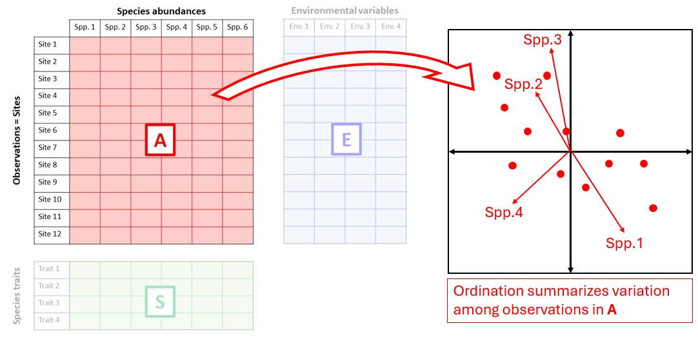
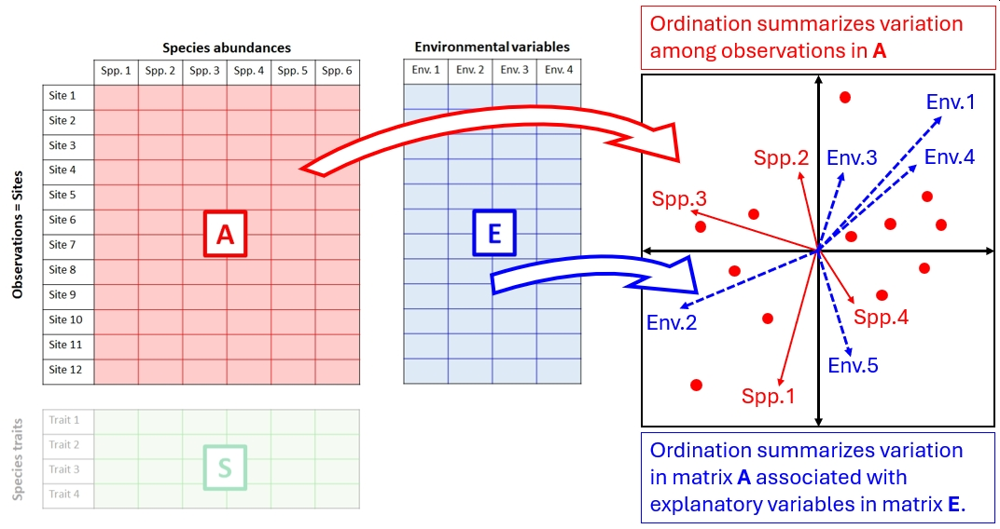

# Ordination {#sec-ord}

## Introduction {#sec-ord-intro}

Humans are visual creatures, relying much more on their sense of vision than other senses like smell for understanding the world. When’s the last time you smelled a dataset? 

Unfortunately, humans are also creatures of 3 spatial dimensions, and that severely limits our ability to “see” patterns in data. Even if patterns in data might exist clearly in 4 or 5 dimensions, our primate brains just won’t see those patterns. Instead, we need ways to bring those high-dimensional patterns down to 3 or fewer. Or, ways to bring 3 dimensional patterns down to 1 or 2, for ease of interpretation. These practices all fall under the umbrella of **dimension reduction**. One very powerful set of techniques for dimension reduction is **ordination**. A good ordination will reveal previously unseen (or unseeable) patterns in data, allow cluster identification, or even show gradients in the data that researchers didn't know they were looking for.

**Ordination** is literally ordering observations along two or more axes. We put observations in order by translating them into a new coordinate system. How that translation is done varies wildly among ordination techniques. No matter how they work, all ordination methods have the same goal: representing patterns in fewer dimensions than there are variables. This makes ordination an approach to **exploratory data analysis**. Most ordination techniques allow to better see patterns, but they are not inferential tests themselves. 

![Ordination describes observations using a new coordinate system. (Left) Observations are positioned according to their values for two original variables. (Middle) A new coordinate system is defined using axes oriented differently from the original variables. (Right) The observations are represented relative to the new axes, revealing a major gradient of variation along Ordination Axis 1. In this simplified example, the number of dimensions remains unchanged, but the observations could be reasonably summarized using only the first ordination axis.](../images/ord-basicidea.jpg){#fig-ord-basicidea fig-alt="Illustration of ordination as a change in coordinate systems. Left: Observations plotted against two original variables form a diagonal pattern. Middle: A new, rotated coordinate system is superimposed on the observations. Right: The same observations are plotted relative to the new axes, with most variation occurring along Ordination Axis 1."}

The applications of ordination overlap with those of the multivariate techniques that we have already seen:

1. **Dimension reduction:** Summarizing variation across many variables using a smaller number of synthetic axes, making complex multivariate datasets easier to visualize and interpret.
1. **Gradient discovery:** Identifying major patterns of variation among observations, which may represent underlying biological or environmental gradients.
1. **Group identification:** Visualizing similarities and differences among observations, including identifying potential clusters of observations that share similar characteristics.

These goals are not mutually exclusive. Dimension reduction is accomplished by finding gradients in the data that are not necessarily equivalent to any of the original variables. The first is what ordination does mathematically; the second is often what we hope to find biologically. Group identification can occur when we find observations forming clusters in an ordination plot, which is itself created by plotting observations against the latent gradients identified by the algorithm. The connection to [clustering](#sec-clust) from the previous chapter should be obvious.

### Ordination terminology {#sec-ord-terms}

Ordination is a very different approach to statistics than we have seen so far in this course. We have largely stepped outside of the world of modeling and hypothesis testing, because most ordination methods are not hypothesis tests. But, we are still using many of the building blocks of inferential statistics that we have already learned. For example, the concepts of variance and covariance are of central importance in many ordination techniques.

One of the biggest changes is that we need to start thinking of *variables* as being equivalent to **axes**. This is directly related to the notion of (spaces and coordinate systems)[#sec-diss-space-coord] that we explored in @sec-diss. The dataset defines one coordinate systemThis is somewhat similar to how in @sec-diss we started thinking of observations as equivalent to **vectors**. 

### Types of ordination {#sec-intro-types}

There are many methods of ordination, which differ in how they construct ordination axes and what kinds of patterns they are designed to reveal. We can classify these methods in two ways: whether the ordination is constrained by explanatory variables, and how the ordination axes are calculated.

#### Constrained vs. unconstrained ordination {#sec-intro-types-constraint}

In **unconstrained ordination**, the axes are calculated from the variation among observations without using external explanatory variables. For example, we might use measurements of several morphological traits to ordinate specimens, allowing us to identify major patterns of morphological variation. We could then investigate whether those patterns correspond to differences among species, habitats, or other characteristics. @fig-ord-unconstrained below shows how an unconstrained ordination is constructed using the [A-E-S matrix schema](#fig-multi-tables) that we saw in @sec-mdata-matrices.

{#fig-ord-unconstrained fig-alt="Diagram showing a species abundance matrix (A) with a red arrow pointing toward an ordination plot containing observations and species vectors. The environmental variable matrix (E) and species trait matrix (S) are faded to indicate that they do not contribute to the ordination."}

In **constrained ordination**, the axes are constructed to represent variation associated with one or more explanatory variables. For example, we might use environmental variables such as temperature, precipitation, and elevation to explain variation in species composition across sites. Rather than simply finding the major patterns of variation in species composition, constrained ordination focuses on the portion of that variation that can be explained by the environmental variables.

{#fig-ord-constrained fig-alt="Diagram showing a species abundance matrix (A) and an environmental variable matrix (E), both contributing to an ordination plot through red and blue arrows, respectively. The ordination contains observations, species vectors, and environmental vectors. The species trait matrix (S) is faded to indicate that it does not contribute to the analysis."}

Constrained ordination is often called canonical ordination, particularly in ecology. The term **canonical** refers to mathematical methods that identify relationships between sets of variables, as in canonical correlation analysis. In ecological applications, canonical ordination generally refers to methods that construct ordination axes using explanatory variables. However, the term has a broader mathematical meaning and is not always synonymous with constrained ordination.

#### Eigenanalysis vs. optimization {#sec-intro-types-calc}

Ordination methods also differ in the mathematical procedures used to construct their axes.

Some methods, including principal components analysis (PCA) and principal coordinates analysis (PCoA), use **eigenanalysis**: mathematical procedures that decompose a matrix into eigenvalues and eigenvectors. In linear algebra, an **eigenvector** is a vector whose direction is not changed by a linear transformation. An **eigenvalue** describes how an eigenvector is scaled by the transformation (see [this video](https://www.youtube.com/watch?v=PFDu9oVAE-g) for visual explanation). Mathematically, we can write

$$\mathbf{A}\vec{v}=\lambda\vec{v}$$

where $\mathbf{A}$ is the matrix that describes a linear transformation, $\vec{v}$ is an eigenvector, and $\lambda$ is an eigenvalue. Again, go watch [this video](https://www.youtube.com/watch?v=PFDu9oVAE-g).

In @fig-ord-basicidea, the red vectors in the center panel are the eigenvectors which will define the axes of the ordination space. An The eigenvectors are used to construct ordination axes, while the eigenvalues describe the amount of variation represented by those axes. These methods generally produce a solution directly through matrix calculations.

Other methods use **numerical optimization**, an iterative process that searches for a configuration of observations that best satisfies a particular criterion. For example, nonmetric multidimensional scaling (NMDS) arranges observations in a low-dimensional space so that the ranked distances between observations correspond as closely as possible to their ranked dissimilarities in the original dataset. The algorithm repeatedly adjusts the positions of observations to minimize a measure of disagreement called stress.

Both approaches produce ordinations, but they differ in what their axes represent and how faithfully they preserve relationships in the original dataset.  In methods such as PCA, the ordination axes are calculated as linear combinations of the original variables, allowing us to interpret each axis in terms of those variables. Other eigenanalysis methods, such as PCoA, derive their axes from a distance matrix rather than directly from the original variables.

In optimization-based methods such as NMDS, the axes do not have a direct mathematical relationship with the original variables. Instead, the objective is to arrange observations so that distances between them in the ordination space reproduce the ranked dissimilarities in the original dataset as closely as possible. Consequently, an NMDS configuration can be rotated or reflected without changing its meaning, because the relationships among observations remain unchanged. In fact, in `vegan::metaMDS()`, which performs NMDS, the default post-processing includes rotating the configuration so that its first axis aligns with the direction of maximum variance. Although an eigenanalysis-based configuration can also be rotated, doing so generally changes the mathematical interpretation of its axes. For example, rotating a PCA configuration would mean that the first axis no longer necessarily represents the direction of maximum variance.


| Method | Constrained? | Main computational approach |
|---|---|---|
| Principal components analysis (PCA) | No | Eigenanalysis / SVD |
| Principal coordinates analysis (PCoA) | No | Eigenanalysis |
| Nonmetric multidimensional scaling (NMDS) | No | Iterative optimization |
| Redundancy analysis (RDA) | Yes | Regression + eigenanalysis |
| Canonical correspondence analysis (CCA) | Yes | Weighted regression + eigenanalysis |
| Distance-based redundancy analysis (dbRDA) | Yes | Distance-based eigenanalysis + regression |
| Linear discriminant analysis (LDA) | Yes | Generalized eigenanalysis |

: Comparison of common ordination methods, indicating whether the ordination is constrained by explanatory variables and the primary mathematical approach used to calculate the ordination axes. {#tbl-ordination-methods}

## Unconstrained ordination methods {#sec-ord-un}

### Principal components analysis (PCA) {#sec-ord-un-pca}


#### Introduction {#sec-ord-un-pca-intro}
The first and probably most commonly used ordination technique is **principal component analysis (PCA)**. It works  by finding synthetic gradients that capture most the variation between the observations more efficiently than the original variables. These gradients are calculated by finding linear combinations of the variables. These combinations really define a *rotation*, a kind of linear transformation, of the the original coordinate system. There are an infinite number of ways that we could apply a linear transformation to the data; the principal components are just the eigenvectors of the transformation captures the greatest variance on the first axis; the second greatest variance on the second axis, and so on. 

#### What PCA does {#sec-ord-un-pca-what}

To get an intuitive understanding of PCA, work through it using an imaginary dataset with two variables, *Variable 1* and *Variable 2*. You could capture and display all the information about this dataset in a 2-d scatterplot, by simply plotting one variable against the other. Likewise, you could capture and display all of the information about a 3-dimensional dataset with a 3-d plot. For 4 or more dimensions, a true scatterplot can’t be rendered sensibly or even understood by our meat-based brains.

```{r}
#| echo: FALSE
#| fig.width: 8
#| fig.height: 8
#| fig-cap: "text"
#| fig-alt: "text"
#| label: fig-pca-explain1


set.seed(123)
n <- 50
x <- runif(n, 1, 20)
y <- 1.2 + 1.7*x + rnorm(n, 0, 8)
x.orig <- x
y.orig <- y

par(mfrow=c(1,1), mar=c(5.1, 5.1, 1.1, 1.1),
    lend=1, las=1, bty="n",
    cex.lab=1.3, cex.axis=1.3)
plot(x, y, xlab="Variable 1", ylab="Variable 2",
    xlim=c(0, 20), ylim=c(-10, 50), pch=16, cex=1.2)
``` 

One way to describe the variation among the observations in @fig-pca-explain1 is to think about how the samples vary along each axis. The figure below shows how the variation among samples can be broken down into the variation in Variable 1 and the variation in Variable 2. When we say “variation in variable 1”, we mean “deviation between the values of variable 1 and the mean of variable 1”. That is what is shown in @fig-pca-explain2 below.

- Each point, or sample, has a Variable 1 coordinate and a Variable 2 coordinate.
- Each point’s value for Variable 1 can be thought of as the difference between that value and the mean of Variable 1.
- Likewise, each point’s value for Variable 2 can be thought of as the difference between that value and the mean of Variable 2.
- The position of each point can thus be reframed as its deviation with respect to the Variable 1, and its deviation with respect to Variable 2. This reframing is the same as centering each variable (i.e., subtracting the mean).
- The total variance among the samples is equal to the variance with respect to Variable 1 plus the variance with respect to Variable 2.

```{r}
#| echo: false
#| fig.width: 10
#| fig.height: 5
#| fig-cap: "text"
#| fig-alt: "text"
#| label: fig-pca-explain2

ymin <- min(y)
ymax <- max(y)
ymu <- mean(y)
xmin <- min(x)
xmax <- max(x)
xmu <- mean(x)

par(mfrow=c(1,2), mar=c(5.1, 5.1, 1.1, 1.1),
    lend=1, las=1, bty="n",
    cex.lab=1.1, cex.axis=1.1)
plot(x, y, xlab="Variable 1", ylab="Variable 2",
    xlim=c(0, 20), ylim=c(-10, 50),
    type="n")
segments(xmu, ymin, xmu, ymax, lwd=3, col="red", lty=2)
segments(xmu, y, x, y, lwd=2, col="red")
points(x, y, pch=16, cex=1.1)
text(12, 10, "Variation in variable 1", adj=0, col="red", cex=1.1, xpd=NA)
text(12, 0, expression(sum((x[i]-bar(x))^2, italic(i)==1, italic(n))==1531.9),
    adj=0, col="red", cex=1.1, xpd=NA)
plot(x, y, xlab="Variable 1", ylab="Variable 2",
    xlim=c(0, 20), ylim=c(-30, 60),
    type="n")
segments(xmin, ymu, xmax, ymu, lwd=3, col="blue", lty=2)
segments(x, ymu, x, y, lwd=2, col="blue")
points(x, y, pch=16, cex=1.1)
text(9, -5, "Variation in variable 2", adj=0, col="blue", cex=1.1)
text(9, -15, expression(sum((y[i]-bar(y))^2, italic(i)==1, italic(n))==8020.7),
    adj=0, col="blue", cex=1.1, xpd=NA)
```

@fig-pca-explain2 above shows how the total variation in the dataset is split up (“partitioned”) into variation in Variable 1 and variation in Variable 2.

Describing each observation as its deviation from the mean of each variable has the effect of **centering** the points at the origin. Notice that the variation, expressed as sums of squared deviations, is unchanged (@fig-pca-explain3). 

@fig-pca-explain3 below shows the data as deviations from the means of each variable. Notice that the variation is each direction is unchanged from @fig-pca-explain2.

```{r}
#| echo: false
#| fig.width: 10
#| fig.height: 5
#| fig-cap: "text"
#| fig-alt: "text"
#| label: fig-pca-explain3


x <- as.numeric(scale(x, scale=FALSE))
y <- as.numeric(scale(y, scale=FALSE))

ymin <- min(y)
ymax <- max(y)
ymu <- mean(y)
xmin <- min(x)
xmax <- max(x)
xmu <- mean(x)

par(mfrow=c(1,2), mar=c(5, 5, 1, 1),
    lend=1, las=1, bty="n",
    cex.lab=1.1, cex.axis=1.1)
plot(x, y, xlab="Variable 1", ylab="Variable 2",
    xlim=c(-10, 10), ylim=c(-40, 40),
    type="n")
segments(xmu, ymin, xmu, ymax, lwd=3, col="red", lty=2)
segments(xmu, y, x, y, lwd=2, col="red")
points(x, y, pch=16, cex=1.1)
text(1, -20, "Variation in variable 1", adj=0, col="red", cex=1.1, xpd=NA)
text(1, -30, expression(sum((x[i]-bar(x))^2, italic(i)==1, italic(n))==1531.9),
    adj=0, col="red", cex=1.1, xpd=NA)
plot(x, y, xlab="Variable 1", ylab="Variable 2",
    xlim=c(-10, 10), ylim=c(-40, 40),
    type="n")
segments(xmin, ymu, xmax, ymu, lwd=3, col="blue", lty=2)
segments(x, ymu, x, y, lwd=2, col="blue")
points(x, y, pch=16, cex=1.1)
text(-1, -20, "Variation in variable 2", adj=0, col="blue", cex=1.1)
text(-1, -30, expression(sum((y[i]-bar(y))^2, italic(i)==1, italic(n))==8020.7),
    adj=0, col="blue", cex=1.1, xpd=NA)
```

Next, we **standardize** each variable to have a variance of 1. This means that the original values are converted to Z-scores by subtracting the mean and dividing by the SD (i.e., they are **z-scaled**). Recall from @sec-trans-common-zscore that the *z*-score of an observation $x$ is

$$z\left(x\right)=\frac{x-\mu}{\sigma}$$

Doing PCA without standardizing variables will distort the results because each variable's importance in the PCA will depend on its magnitude, not its relationship to other variables. Standardization puts variation along any axis on equal footing. @fig-pca-explain4 shows the data as deviations from the variable means after standardization. Compare this figure to @fig-pca-explain3 above. All that changed are the axis scales and the sum of squared deviations. Note that the sums of squares are equal for both variables now.

```{r}
#| echo: false
#| fig.width: 10
#| fig.height: 5
#| fig-cap: "text"
#| fig-alt: "text"
#| label: fig-pca-explain4


x <- as.numeric(scale(x.orig))
y <- as.numeric(scale(y.orig))

ymin <- min(y)
ymax <- max(y)
ymu <- mean(y)
xmin <- min(x)
xmax <- max(x)
xmu <- mean(x)

par(mfrow=c(1,2), mar=c(5.1, 5.1, 1.1, 1.1),
    lend=1, las=1, bty="n",
    cex.lab=1.1, cex.axis=1.1)
plot(x, y, xlab="Variable 1", ylab="Variable 2",
    xlim=c(-2, 2), ylim=c(-2.5, 2.5),
    type="n")
segments(xmu, ymin, xmu, ymax, lwd=3, col="red", lty=2)
segments(xmu, y, x, y, lwd=2, col="red")
points(x, y, pch=16, cex=1.1)
text(0.2, -1, "Variation in variable 1", adj=0, col="red", cex=1.1, xpd=NA)
text(0.2, -1.75, expression(sum((x[i]-bar(x))^2, italic(i)==1, italic(n))==49),
    adj=0, col="red", cex=1.3, xpd=NA)
plot(x, y, xlab="Variable 1", ylab="Variable 2",
    xlim=c(-2, 2), ylim=c(-2.5, 2.5),
    type="n")
segments(xmin, ymu, xmax, ymu, lwd=3, col="blue", lty=2)
segments(x, ymu, x, y, lwd=2, col="blue")
points(x, y, pch=16, cex=1.1)
text(-0.2, -1, "Variation in variable 2", adj=0, col="blue", cex=1.1)
text(-0.2, -1.75, expression(sum((y[i]-bar(y))^2, italic(i)==1, italic(n))==49),
    adj=0, col="blue", cex=1.1, xpd=NA)
```

The goal of PCA is to find a new coordinate system that puts the most variance possible on its first axis, then the second most variance on its second axis, and so on. This new coordinate system will have the same number of dimensions as the original dataset. But whereas in the standardized dataset all variables (axes) have the same amount of variation associated with them, in the PCA coordinate system some axes will explain more variation than others. 

The variation among the observations is defined in terms of Variable 1 and Variable 2, and Variable 1 and Variable 2 contributed equally to the total variation. But, we could describe most of the variation between points with just one variable, or axis, the red line (@fig-pca-explain5). Any remaining variation will be in the direction perpendicular to the red axis, the blue axis (dashed line). 

```{r}
#| echo: false
#| fig.width: 8
#| fig.height: 8
#| fig-cap: "text"
#| fig-alt: "text"
#| label: fig-pca-explain5

########### illustrate rotation to PCs
fit1 <- lm(y~x)
mod1 <- coef(fit1)

# get coefficients for model
beta0 <- mod1[1]
beta1 <- mod1[2]
alpha1 <- (-1)/beta1
alpha0 <- 0-alpha1*0

# plot with arrows
# note: will not be perpendicular unless axes are the same!
par(mfrow=c(1,1), mar=c(5.1, 5.1, 1.1, 1.1),
    lend=1, las=1, bty="n",
    cex.lab=1.1, cex.axis=1.1)
plot(x, y, xlab="Variable 1", ylab="Variable 2",
    xlim=c(-2.5, 2.5), ylim=c(-2.5, 2.5),
    type="n")
points(x, y, pch=16, cex=1.1)
red1 <- -2
red2 <- 2
segments(red1, beta0+beta1*(red1), 
    red2, beta0+beta1*red2, 
    lwd=3, col="red")
blue1 <- -1
blue2 <- 1
segments(blue1, alpha0 + alpha1*blue1,
         blue2, alpha0 + alpha1*blue2,
         lwd=3, col="blue", lty=2)
```

The red axis is a vector that contains information about both Variable 1 and Variable 2. It is tricky, but not too hard, to calculate each observation’s deviations from the mean of the red axis (left panel below) (@fig-pca-explain6). We can also calculate the deviations along a perpendicular vector, because even after describing the variation in the red direction, there is still some variation in the blue direction (right panel).

```{r}
#| echo: false
#| fig.width: 10
#| fig.height: 5
#| fig-cap: "text"
#| fig-alt: "text"
#| label: fig-pca-explain6


## for each point, need dy, height between PC1 and point
dy <- y-(beta0 + beta1 * x)

## each point intersects with a line perpendicular to PC1:
## y = alpha0 + alpha1*x = (dy + beta0) + beta1 * x
## let slope of perpendicular line = alpha1 = -1/beta1
alpha1 <- -1/beta1
## let intercept of perpendicular line = alpha0
alpha0 <- (dy+beta0) + beta1*x - alpha1*x

# the lines defined by alpha0 and alpha1 intersect with PC1 at
# x coordinates intx and y coordinates inty
intx <- (beta0-alpha0)/(alpha1-beta1) 
inty <- beta0 + beta1*intx

# intercepts for line parallel to PC1 (intersect PC1)
b0.vec <- dy + beta0

# points where parallel lines and PC2 intercept
## intercept of PC2
a0dot <- (beta0+beta1*x)/(alpha1*x)


###for(i in 1:n){abline(b0.vec[i], beta1, col="green")}
## x coordinates of intersections
xint1 <- (alpha0-b0.vec)/(beta1-alpha1)
yint1 <- alpha0 + alpha1*xint1
###points(xint, yint, pch=17, col="purple")

# add variation along PC2
## intercepts for lines passing though each point
a0.vec <- y-alpha1*x
###for(i in 1:n){abline(a0.vec[i], alpha1, col="green")}

## x coordinates of intersections
xint2 <- (beta0-a0.vec)/(alpha1-beta1)
yint2 <- beta0+beta1*xint2


# put it all together
dy <- y-(beta0 + beta1 * x)
alpha1 <- -1/beta1
alpha0 <- (dy+beta0) + beta1*x - alpha1*x
intx <- (beta0-alpha0)/(alpha1-beta1) 
inty <- beta0 + beta1*intx

intx2 <- (dy+beta0)/(alpha1-beta1)
inty2 <- alpha1*intx2

#sum(((x-intx)^2) + ((y-inty)^2))
#sum(((x-intx2)^2) + ((y-inty2)^2))

xred <- c(-3, 3)
yred <- c(-3, 3)

use.cex <- 0.9
par(mfrow=c(1,2), mar=c(5.1, 5.1, 1.1, 1.1),
    lend=1, las=1, bty="n",
    cex.lab=1.1, cex.axis=1.1)
plot(x, y, xlab="Variable 1", ylab="Variable 2",
    xlim=c(xred[1], xred[2]), ylim=c(yred[1], yred[2]),
    type="n")
segments(xred[1], beta0+beta1*(xred[1]), 
    xred[2], beta0+beta1*xred[2], 
    lwd=3, col="red")
segments(blue1, alpha1*blue1,
    blue2, alpha1*blue2,
    lwd=3, col="blue")
segments(x, y, intx2, inty2, lwd=2, col="red", lty=2)
points(x, y, pch=16, cex=1.2)
text(xred[1], -2.8, "Variation in red direction", col="red", adj=0, cex=use.cex)
text(xred[2], -2.8,
    expression(sum((italic(red[i])-bar(italic(red)))^2, italic(i)==1, italic(n))==88.01),
    adj=1, col="red", cex=use.cex)

plot(x, y, xlab="Variable 1", ylab="Variable 2",
    xlim=c(xred[1], xred[2]), ylim=c(yred[1], yred[2]),
    type="n")
segments(xred[1], beta0+beta1*(xred[1]), 
    xred[2], beta0+beta1*xred[2], 
    lwd=3, col="red")
segments(blue1, alpha1*blue1,
    blue2, alpha1*blue2,
    lwd=3, col="blue")
segments(x, y, intx, inty, lwd=2, col="blue", lty=2)
points(x, y, pch=16, cex=1.2)
text(xred[1], -2.8, "Variation in blue direction", col="blue", adj=0, cex=use.cex)
text(xred[2], -2.8,
    expression(sum((italic(blue[i])-bar(italic(blue)))^2, italic(i)==1, italic(n))==9.99),
    adj=1, col="blue", cex=use.cex)
```

We know that the variation along the red and blue axes is the same as the variation on the Variable 1 and Variable 2 axes, because the sums of squares are the same ($76.6 + 21.4 = 49 + 49$) . The red and blue axes are just different ways of orienting the data to express the same patterns. All we really did was rotate the original coordinate system (defined by Variables 1 and 2) to a new coordinate system (@fig-pca-explain7).

```{r}
#| echo: false
#| fig.width: 10
#| fig.height: 5
#| fig-cap: "text"
#| fig-alt: "text"
#| label: fig-pca-explain7


xred <- c(-3, 3)
yred <- c(-3, 3)

use.cex <- 0.9
par(mfrow=c(1,2), mar=c(5.1, 5.1, 1.1, 1.1),
    lend=1, las=1, bty="n",
    cex.lab=1.1, cex.axis=1.1)
plot(x, y, xlab="Variable 1", ylab="Variable 2",
    xlim=c(xred[1], xred[2]), ylim=c(yred[1], yred[2]),
    type="n")
grid1 <- seq(-3, 3, length=10)
segments(grid1, -3, grid1, 3, col="grey60")
segments(-3, grid1, 3, grid1, col="grey60")

gxred <- seq(-10, 10, by=1)

segments(-3, beta0+beta1*(-3)+gxred,
         3, beta0+beta1*(3)+gxred, col="red")
segments(-3, alpha1*(-3)+gxred,
         3, alpha1*(3)+gxred, col="blue")

segments(xred[1], beta0+beta1*(xred[1]), 
    xred[2], beta0+beta1*xred[2], 
    lwd=5, col="red")
segments(blue1, alpha1*blue1,
    blue2, alpha1*blue2,
    lwd=5, col="blue")
points(x, y, pch=16, cex=1.2)

plot(x, y, xlab="PC1", ylab="PC2",
    xlim=c(-4, 4), ylim=c(-4, 4),
    type="n")
grid2 <- seq(-4, 4, length=10)
segments(grid2, -4, grid2, 4, col="blue")
segments(-4, grid2, 4, grid2, col="red")

theta <- atan(0.813)

# Rotate observations into PC coordinates
pc1 <- x * cos(theta) + y * sin(theta)
pc2 <- -x * sin(theta) + y * cos(theta)

# Right panel
points(pc1, pc2, pch=16, cex=1.2)

# Function to rotate coordinates
rotate <- function(x, y, theta) {
  data.frame(
    x = x * cos(theta) + y * sin(theta),
    y = -x * sin(theta) + y * cos(theta)
  )
}

# Original grid: vertical lines (constant x)
for (a in seq(-6, 6, by=1)) {
  p <- rotate(c(a, a), c(-6, 6), theta)
  lines(p$x, p$y, col="grey60", lwd=0.5)
}

# Original grid: horizontal lines (constant y)
for (b in seq(-6, 6, by=1)) {
  p <- rotate(c(-6, 6), c(b, b), theta)
  lines(p$x, p$y, col="grey60", lwd=0.5)
}


```

#### Example using `vegan` {#sec-ord-un-pca-example}

For an example PCA analysis, let's revisit the small mammal measurement data from @sec-clust-kmeans-example. Download the [individual measurement dataset](../datasets/data-neon-ind-meas.csv) and the [taxonomic dataset](../datasets/data-neon-taxa.csv) and put them in your working directory.

```{r}
#| include: false
tax <- read.csv("../datasets/data-neon-taxa.csv")
ind <- read.csv("../datasets/data-neon-ind-meas.csv")

```

```{r}
#| eval: false
tax <- read.csv("data-neon-taxa.csv")
ind <- read.csv("data-neon-ind-meas.csv")
```

We are going to use PCA to explore variation in small mammal morphology. First we need to organize the data. Cut the measurement data down to just the columns we need: individual, species, and the four standard measurements.

```{r}
use.cols <- c("tagID", "abb", "totalLength",
              "tailLength", "hindfootLength",
              "earLength", "weight")
dx <- ind[,use.cols]

# only want individuals with no missing measurements
dx <- dx[complete.cases(dx),]
```

How many individuals do we have of each species?

```{r}
rev(sort(table(dx$abb)))
```

There is quite a wide range of numbers of individuals between species. To prevent the species with many individuals from having too much influence over the analysis, let's randomly select 50 individuals from every species with at least 50 individuals. That will give us 16 species.

```{r}
set.seed(7410)

sp <- names(which(table(dx$abb) >= 50))
out <- vector("list", length(sp))

for (i in seq_along(sp)) {
  d <- dx[dx$abb == sp[i], ]
  out[[i]] <- d[sample(nrow(d), 50), ]
}

dx.pca <- do.call(rbind, out)
dx.pca <- merge(dx.pca, tax[,c("abb", "species", "family")])

table(dx.pca$species)
```

```{r}
table(dx.pca$family)
```

We will use package `vegan` for ordination. Load it and run the PCA. Use argument `` to standardize the variables first.

```{r}
library(vegan)

pca.cols <- c("totalLength", "tailLength",
              "hindfootLength", "earLength")
p1 <- pca(dx.pca[,pca.cols], scale=TRUE)
summary(p1)
```

The result shows us that PC1 explains about 75.3% of the variation in measurements. PC2 adds another 17.1%. Just the first two PCs account for 92.4% of the variation. As we saw in @fig-kmeans-mice-pca4, the first PC likely captures a size gradient. Let's plot the ordination to see.

```{r}
#| fig.width: 8
#| fig.height: 6
#| fig-cap: "text"
#| fig-alt: "text"
#| label: fig-pca-pca-neon1
plot(p1)
```

Well, that's not very helpful. The default plot method is a bit underwhelming. I prefer to extract the PC scores (coordinates in the PC coordinate system) and build the plot manually. Note that in the ordination function in package `vegan`, observations are always referred to as "sites", and variables as `species`. This is a result of the origin of `vegan` in community ecology.

While we're at it, let's assign some colors and shapes to the species (the actual species, not the `"species"`).

```{r}
#| fig.width: 8
#| fig.height: 8
#| fig-cap: "text"
#| fig-alt: "text"
#| label: fig-pca-pca-neon2

spps <- sort(unique(dx.pca$species))
fams <- sort(unique(dx.pca$family))

col.spps <- hcl.colors(length(spps), palette = "Dark 3")
col.fams <- hcl.colors(length(fams), palette = "Dark 3")
pch.fams <- 15:18

names(col.spps) <- spps
names(col.fams) <- fams
names(pch.fams) <- fams

xy.samp <- scores(p1, display="sites", choices=1:2)
xy.vars <- scores(p1, display="species", choices=1:2)

par(mar=c(5,5,6,1), bty="n")
plot(xy.samp[,1], xy.samp[,2],
     pch=pch.fams[dx.pca$family],
     col=col.spps[dx.pca$species],
     xlab="PC1 (75.3%)", ylab="PC2 (17.1%)")
scal <- 0.2
segments(0, 0, scal*xy.vars[,1], scal*xy.vars[,2], lwd=2)
text(1.03*scal*xy.vars[,1], 1.03*scal*xy.vars[,2],
     rownames(xy.vars), cex=1.2)
legend(-1, 1.1, legend=spps, xpd=NA,
       col=col.spps,
       pch=pch.fams[tax$family[match(spps, tax$species)]],
       ncol=3,
       text.font=3, bty="n")


```

```{r}
#| fig.width: 8
#| fig.height: 8
#| fig-cap: "text"
#| fig-alt: "text"
#| label: fig-pca-pca-neon3


par(mar=c(5,5,6,1), bty="n")
plot(xy.samp[,1], xy.samp[,2],
     pch=pch.fams[dx.pca$family],
     col=col.spps[dx.pca$species],
     xlab="PC1 (75.3%)", ylab="PC2 (17.1%)")
ordiellipse(p1, dx.pca$species,
            col=col.spps, draw="polygon",
            border=NA)
scal <- 0.2
segments(0, 0, scal*xy.vars[,1], scal*xy.vars[,2], lwd=2)
text(1.03*scal*xy.vars[,1], 1.03*scal*xy.vars[,2],
     rownames(xy.vars), cex=1.2)

legend(-1, 1.1, legend=spps, xpd=NA,
       col=col.spps,
       pch=pch.fams[tax$family[match(spps, tax$species)]],
       ncol=3,
       text.font=3, bty="n")
```

And color by family.

```{r}
#| fig.width: 8
#| fig.height: 8
#| fig-cap: "text"
#| fig-alt: "text"
#| label: fig-pca-pca-neon4


par(mar=c(5,5,6,1), bty="n")
plot(xy.samp[,1], xy.samp[,2],
     pch=pch.fams[dx.pca$family],
     col=col.fams[dx.pca$family],
     xlab="PC1 (75.3%)", ylab="PC2 (17.1%)")
ordiellipse(p1, dx.pca$family,
            col=col.fams, draw="polygon",
            border=NA)
scal <- 0.2
segments(0, 0, scal*xy.vars[,1], scal*xy.vars[,2], lwd=2)
text(1.03*scal*xy.vars[,1], 1.03*scal*xy.vars[,2],
     rownames(xy.vars), cex=1.2)

legend(-1, 1.1, legend=fams, xpd=NA,
       fill=col.fams,
       ncol=2, bty="n")
```

Next: factor out body mass using allometric equations, then refit PCA.


Work in progress!

### Principal coordinates analysis (PCoA) {#sec-ord-un-pcoa}

### Correspondence analysis (CA)  {#sec-ord-un-ca}

### Nonmetric multidimensional scaling (NMDS) {#sec-ord-un-nmds}

## Constrained ordination methods {#sec-ord-con}

Constrained ordination methods, also called canonical ordination methods, identify major axes of multivariate variation that are associated with one or more explanatory variables. Unlike unconstrained ordination, which summarizes patterns in the response variables alone, constrained ordination incorporates information about potential predictors when constructing the ordination axes.

### Redundancy analysis (RA) {#sec-ord-con-ra}

### Linear discriminant analysis {#sec-ord-con-lda}

### Canonical correspondence analysis (CCA)  {#sec-ord-con-cca}

### Distance-based RDA (dbRDA) {#sec-ord-con-dbrda}

## Classification and other methods {#sec-ord-other}

### Linear discriminant analysis {#sec-ord-other-lda}

